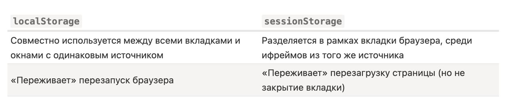

# Список тем для собеседования

Примеры независимы. Браузерный JavaScript выполняйте на HTTP(S)-странице после разбора HTML. Пути `/api/...` предполагают соответствующий сервер. JSX/TSX и TypeScript требуют настроенной сборки; пакеты для React, Redux и роутинга указаны в импортах.

## Общие вопросы по веб-технологиям

### Critical Rendering Path (CRP)

CRP — последовательность действий браузера до первого отображения страницы. В неё входят разбор HTML и критических CSS, расчёт стилей и геометрии, отрисовка и композиция.

Упрощённая схема рендеринга (этапы могут перекрываться и повторяться):

1. построение DOM-дерева
2. построение CSSOM-дерева;
3. просчитывание стилей (Style Calculation);
4. создание Render-дерева;
5. Layout
6. покраска / отрисовка (Paint).
7. Композиция (Compositing)

Упрощённая схема зависимостей: построение DOM и CSSOM может перекрываться; JavaScript не является обязательным этапом рендеринга.


Рассмотрим этапы подробнее:

#### Построение DOM-дерева

- DOM — дерево узлов документа, строящееся постепенно при разборе HTML. Корень — Document; `<html>` — корневой элемент. Узлы бывают элементами, текстом, комментариями и другими типами; атрибуты принадлежат элементам (например, href у `<a>`), а не каждому узлу.
- На иллюстрации фрагмент DOM: Document, doctype и пробельные текстовые узлы опущены; html — корневой элемент, а не корень всего DOM.
- 
- HTML разбирается постепенно по мере загрузки.

  1.1. JavaScript:
  - Обычный классический `<script>` без async/defer блокирует HTML-парсер при загрузке и выполнении. Скрипты-модули отложены по умолчанию.
  - Когда парсер доходит до обычного классического `<script>` без async/defer, он ожидает загрузки внешнего файла (если нужен) и выполнения скрипта. Для доступа к нужным элементам следует дождаться их разбора: например, использовать `defer` у внешнего классического скрипта или `DOMContentLoaded`.
  - У внешнего скрипта async позволяет не блокировать HTML-парсер во время загрузки; выполнение может его приостановить.

Пример:

```html
<main>
  <h1>Заголовок</h1>
  <p>Текст</p>
</main>
<!-- DOM: main содержит h1 и p; внутри них — текстовые узлы. -->
```

#### Построение CSSOM-дерева

- CSSOM (объектная модель CSS) — это объект, представляющий стили, связанные с DOM. CSSOM представляет таблицы стилей и правила CSS; вычисленные стили элементов получают с учётом каскада и наследования. CSSOM не является копией DOM.
- Следующая иллюстрация условно показывает стили элементов, а не буквальную структуру CSSOM (таблиц стилей и правил).
- 
- CSS, блокирующий рендеринг, задерживает отображение до получения и обработки необходимых стилей.
- **Ранее обнаруженные блокирующие таблицы стилей могут задерживать выполнение классических скриптов, блокирующих HTML-парсер, а также отложенных скриптов.**
- Таблица стилей с неподходящим `media` не блокирует текущий рендеринг.

Пример:

```html
<style>
  .note {
    color: navy;
  }
</style>
<p class="note">Примечание</p>
<!-- Правило попадает в CSSOM и применяется к p при вычислении стилей. -->
```

#### Вычисление стилей (Style Calculation)

- Сопоставление селекторов с элементами и вычисление стилей. Оптимизировать этот этап следует по результатам измерений.
  - также обрабатывает каскадирование стилей

Пример:

```javascript
const paragraph = document.createElement("p");
paragraph.style.color = "red";
document.body.append(paragraph);
console.log(getComputedStyle(paragraph).color); // "rgb(255, 0, 0)"
```

#### Создание Render-дерева

- Render-дерево — это совокупность DOM и CSSOM. Это дерево, которое даёт представление о том, что в конечном итоге будет отображено на странице. Это означает, что оно захватывает только видимый контент и не включает, например, элементы, которые были скрыты с помощью CSS-правила display: none.
- На примерах DOM и CSSOM, представленных выше, будет построено такое Render-дерево
- Упрощённое render-дерево: поддерево display:none не участвует в раскладке.
- 

Пример:

```html
<p>Участвует в раскладке</p>
<p style="display: none">Исключён из раскладки вместе с потомками</p>
<p style="visibility: hidden">Не виден, но занимает место</p>
```

#### Layout

- Рассчитывает расположение и размеры блоков элементов (грубо говоря строится чертеж / макет)
- На выходе - layout tree (где каждый узел содержит информацию о своём расположении)

Пример:

```javascript
const box = document.createElement("div");
box.style.width = "200px";
document.body.append(box);
console.log(box.getBoundingClientRect().width); // 200 CSS-пикселей
```

#### Отрисовка (Paint)

- Наконец, на шаге отрисовки, видимый контент страницы может быть преобразован в пиксели, чтобы появиться на экране.
- Браузер может создавать несколько слоев для более сложных эффектов, таких как плавающие элементы или элементы с прозрачностью. Эти слои потом будут объединены на этапе композиции.

Пример:

```javascript
const text = document.createElement("p");
text.textContent = "Цвет изменится";
document.body.append(text);
setTimeout(() => {
  text.style.color = "red";
}, 1000);
// Меняется цвет, но не геометрия текста: нужен paint.
```

#### Композиция

- Объединение слоев

- Изменение DOM не означает повторный разбор всего HTML и полную перерисовку. Браузер обновляет затронутые части; необходимость style/layout/paint зависит от изменения.

Источник: [MDN — Critical rendering path](https://developer.mozilla.org/en-US/docs/Web/Performance/Guides/Critical_rendering_path).

Пример:

```html
<!DOCTYPE html>
<html lang="ru">
  <head>
    <meta charset="utf-8" />
    <meta name="viewport" content="width=device-width, initial-scale=1" />
    <title>Этапы рендеринга</title>
    <style>
      /* CSS → CSSOM; правило участвует в вычислении стилей. */
      .card {
        width: 200px;
        padding: 16px;
        color: navy;
      }
      .hidden {
        display: none;
      } /* Не участвует в раскладке. */
    </style>
  </head>
  <body>
    <!-- HTML → DOM; видимая card участвует в дереве отображения. -->
    <p class="card">Карточка</p>
    <p class="hidden">Скрыто</p>
    <script>
      const card = document.querySelector(".card");
      card.style.width = "250px"; // Layout: меняется размер.
      card.style.color = "red"; // Paint: меняется цвет.
      // Compositing: браузер объединяет нарисованные слои в кадр.
    </script>
  </body>
</html>
```

### HTML: теги, атрибуты, async, defer и доступность

#### Базовые теги

- `<html>`, `<head>`, `<body>`, `<div>`, `<span>`, `<a>`, `<ul>`, `<li>`, `<p>`, ``, `<br>`, `<script>`, `<link>`, `<meta>`.
  - **Строчные**:
    - Строчные элементы участвуют в строковой раскладке и могут переноситься между строками
    - Для обычных незамещаемых строчных элементов вертикальные `margin` не влияют на раскладку; `padding` применим, но не увеличивает высоту строки
    - Допустимая вложенность определяется моделью содержимого HTML, а не CSS-свойством `display` (например, `<a>` может оборачивать блочный контент при соблюдении ограничений).
    - Примеры: `<span>`, `<a>`, ``, `<strong>`.
  - **Блочные**:
    - В обычном потоке блочный элемент начинает новую строку и при `width: auto` занимает доступную ширину.
    - Блочным элементам можно задавать `margin` и `padding`; ненулевые значения по умолчанию зависят от стилей браузера и элемента
    - Вложенность ограничена моделью содержимого: например, `<p>` не может содержать `<div>`
    - Примеры: `<div>`, `<p>`, `<h1>`, `<ul>` и т. п.

Пример:

```html
<div>
  <p>
    Абзац со <span>строчным фрагментом</span> и <a href="/about">ссылкой</a>.
  </p>
  <ul>
    <li>Первый пункт</li>
    <li>Второй пункт</li>
  </ul>
</div>
```

Документация: [MDN — модели содержимого HTML](https://developer.mozilla.org/en-US/docs/Web/HTML/Guides/Content_categories).

#### Семантические теги

- `<header>, <nav>, <footer>, <main>, <section>, <aside>, <article>, <time>, <details>`
- `<article>` - независимое, автономное содержимое
- `<time>` - дата и время
- `<details>` - Определяет дополнительные сведения, которые пользователь может просматривать или скрывать

Пример:

```html
<main>
  <article>
    <h1>Встреча</h1>
    <time datetime="2026-10-22">22 октября</time>
  </article>
  <details>
    <summary>Место встречи</summary>
    <p>Аудитория 1</p>
  </details>
</main>
```

#### Атрибуты

- Атрибут: **id** - Задает уникальный идентификатор для элемента. Этот атрибут часто используется для стилизации элементов через CSS или для доступа к элементу через JavaScript.

- Атрибут: **class** - Задает один или несколько классов для элемента, которые могут использоваться для стилизации через CSS или для манипуляций с элементами через JavaScript.

- Атрибут **src** задаёт URL внешнего ресурса: например, изображения для `` или кода для `<script>`. Способ использования ресурса зависит от элемента.

- Атрибут: **href** - Определяет URL ссылки, которая используется в элементах `<a>` для гиперссылок и `<link>` для связывания внешних ресурсов, таких как стили CSS.

- Атрибут: **alt** - Задает альтернативный текст для изображения в элементе ``. Этот текст отображается, если изображение не может быть загружено, и помогает в доступности контента.

- Атрибут **title** содержит дополнительную справочную информацию; браузер может показать её как подсказку при наведении. Доступ с клавиатуры и сенсорного экрана не гарантирован, поэтому важные инструкции и подписи должны быть видимыми.

- Атрибут: **style** - Включает инлайн-стили CSS для элемента. Применяется для задания стилей непосредственно внутри HTML-тега.

- Атрибут: **type** - Определяет тип элемента. Чаще всего используется в элементах `<input>` для задания типа вводимого значения (например, text, password, email и т. д.) и в элементах `<button>` и `<script>`.

- Атрибут: **value** - Определяет значение элемента. Применяется в элементах `<input>`, `<button>`, `<option>` и других.

- Атрибут: **name** - Задает имя элемента. Используется для группировки данных формы, чтобы сервер мог обработать их.

Пример:

```html
<a id="help" class="link" href="/help" title="Справка">Помощь</a>

<label for="name">Имя</label>
<input id="name" name="name" type="text" value="Анна" />
<p style="color: red">Пример встроенного стиля</p>
```

#### Data-атрибуты

- **Data-атрибут** — это пользовательский атрибут на HTML-элементе, название которого начинается с `data-`. Это встроенная возможность стандарта HTML5. В data-атрибутах можно хранить дополнительную информацию в стандартных HTML-элементах и работать с этой информацией в JavaScript при помощи собственного API.
- Имя может быть длинным, из нескольких слов (значения может и не быть). Слова разделяются тире:

```html
<div data-long-size-attribute="small"></div>
```

или

```html
<div data-long-size-attribute></div>
```

- У data-атрибутов есть свой собственный API. Читать и записывать значения data-атрибутов элемента можно с помощью свойства dataset. С его помощью можно также и добавлять новые data-атрибуты к элементу.
- Можно обращаться к значениям атрибутов data-\* также, как и к значениям других атрибутов: при помощи методов getAttribute и setAttribute для чтения и записи данных соответственно, для `data-long-size-attribute` доступ через `dataset.longSizeAttribute`; значения `dataset` — строки
- В CSS используются селекторы атрибутов, например [data-long-size-attribute="small"].
- Не следует утверждать универсальный порядок скорости `dataset` и `getAttribute`: производительность зависит от реализации и измеряется на конкретной задаче.
- 
  - На снимке перенос `data-state` — оформление, а типографские кавычки обозначают обычные кавычки JavaScript. Значения `dataset` — строки; для `data-client-name` используется `dataset.clientName`.

Документация: [MDN — dataset](https://developer.mozilla.org/en-US/docs/Web/API/HTMLElement/dataset).

#### Классы

- Универсальный атрибут тега, с помощью которого можно задать имя любому элементу на странице. Имя элемента в дальнейшем используется в качестве селектора в CSS и позволяет управлять стилями элемента. К тому же по имени класса удобно искать и манипулировать элементами на странице при помощи JavaScript.
- У элемента может быть несколько классов

```html
<p class="text">Очень крутой текст про крутые классы</p>
```

#### Атрибуты **async** **defer**

- **async** и **defer** позволяют загружать внешние классические скрипты параллельно разбору HTML. Само выполнение по-прежнему занимает основной поток.
- Внешние классические скрипты с **defer** загружаются параллельно разбору HTML и выполняются в порядке документа, а с **async** — по готовности без гарантированного порядка. Кроме того, **defer** всегда ждёт, пока весь HTML-документ будет готов, а **async** выполняется сразу после загрузки.
- Как понять:
  - Обычный классический script без async/defer останавливает парсер до окончания загрузки и выполнения; сетевой запрос при этом может начаться заранее благодаря preload-сканеру. Поэтому принято добавлять скрипты в конец документа, перед `</body>`, чтобы они не тормозили загрузку страницы. Но при помощи атрибутов **defer** и **async** можно явно управлять порядком загрузки и выполнения скриптов.
- **ASYNC** (**async**)
  - Указывает браузеру по возможности загружать скрипт асинхронно.
  - Загрузка асинхронна, но выполнение JavaScript на основном потоке может приостановить разбор HTML и отрисовку. Это означает, что файл будет выполняться без ожидания загрузки и отображения веб-страницы. При загрузке `<script async src="...">` HTML-парсер продолжает работу; во время выполнения скрипта он может остановиться.
  - **Выполнение** - Когда скрипт будет загружен – он сразу выполнится.
  - !Первым выполнится тот скрипт, который быстрее загрузится!
- **DEFER** (**defer**)
  - Указывает браузеру, что скрипт должен выполняться после разбора документа, но до события DOMContentLoaded.
  - **Выполнение** - после разбора документа (HTML)
  - Внешние классические defer-скрипты задерживают DOMContentLoaded до завершения своего выполнения.
  - Первым всегда выполнится script1.js, который подключён раньше. Даже если script2.js загрузится раньше, он будет выполнен после первого скрипта.
  - `<script src="script1.js" defer></script>`
- Полезная информация:
  - На практике **defer** используется для скриптов, которым требуется доступ ко всему DOM-дереву или если важен их порядок выполнения. А **async** хорош для независимых скриптов, например счётчиков и рекламы, порядок выполнения которых не играет роли.
  - Динамически вставленные внешние классические скрипты по умолчанию ведут себя как `async`; `script.async = false` до вставки позволяет сохранить порядок.
  - `defer` не действует на встроенные классические скрипты; модули отложены по умолчанию.

Источник: [MDN — script](https://developer.mozilla.org/en-US/docs/Web/HTML/Reference/Elements/script).

Пример:

```html
<!-- Загрузка параллельна; defer сохраняет порядок first → second. -->
<script src="first.js" defer></script>
<script src="second.js" defer></script>
<!-- Независимый скрипт выполнится по готовности. -->
<script src="metrics.js" async></script>
```

#### Веб-доступность

- **Веб-доступность (Accessibility)** в HTML — это практика создания веб-сайтов, доступных для всех пользователей, включая людей с ограниченными возможностями. Это включает в себя адаптацию контента для людей с нарушениями зрения, слуха, двигательной активности и когнитивными нарушениями.
- Основные аспекты веб-доступности:
  - Текстовые альтернативы (alt-тексты)
  - Навигация с помощью клавиатуры
  - Использование семантических тегов
  - Контрастность и цветовая гамма
  - Подписи и субтитры для мультимедиа
  - Формы и элементы управления

Пример:

```html
<!DOCTYPE html>
<html lang="ru">
  <head>
    <meta charset="utf-8" />
    <meta name="viewport" content="width=device-width, initial-scale=1" />
    <title>Семантическая страница</title>
    <link rel="stylesheet" href="styles.css" />
    <!-- app.js выполняется после разбора HTML; metrics.js — по готовности. -->
    <script src="app.js" defer></script>
    <script src="metrics.js" async></script>
  </head>
  <body>
    <header>
      <nav><a href="#main">К содержимому</a></nav>
    </header>
    <main id="main">
      <h1>Новости</h1>
      <article class="card featured" data-client-name="Анна">
        <h2>Встреча</h2>
        <p>
          <time datetime="2026-10-22">22 октября</time>:
          <strong>регистрация открыта</strong>.
        </p>
        
        <details>
          <summary>Подробности</summary>
          <p>Начало в 18:00.</p>
        </details>
        <ul>
          <li>Доклады</li>
          <li>Вопросы</li>
        </ul>
      </article>
      <form action="/register" method="post">
        <!-- label, семантика и нативная кнопка обеспечивают базовую доступность. -->
        <label for="email">Электронная почта</label>
        <input
          id="email"
          name="email"
          type="email"
          value=""
          autocomplete="email"
          required
        />
        <button type="submit">Записаться</button>
      </form>
    </main>
    <aside><p>Контакты организаторов</p></aside>
    <footer><p>Конференция</p></footer>
  </body>
</html>
```

Пример чтения data-атрибутов:

```javascript
const card = document.createElement("div");
card.dataset.clientName = "Анна";
console.log(card.getAttribute("data-client-name")); // "Анна"
card.setAttribute("data-count", "2");
console.log(card.dataset.count, typeof card.dataset.count); // "2", "string"
card.classList.add("card", "featured");
console.log(card.classList.contains("featured")); // true
```

### CSS: каскад, селекторы, псевдоклассы, псевдоэлементы, Flexbox и Grid

#### Каскадность, приоритет селекторов

- Каскад выбирает итоговое значение из конкурирующих деклараций. Специфичность — лишь один из его этапов: сначала учитываются применимость, происхождение, важность и каскадные слои, затем специфичность, близость `@scope` и порядок объявления.
- При одинаковом происхождении, слое и важности специфичность сравнивается по группам: ID; классы, атрибуты и псевдоклассы; теги и псевдоэлементы. `*` не добавляет специфичность. `:where()` имеет нулевую специфичность; `:is()`, `:not()` и `:has()` используют специфичность аргументов.
- Обычные inline-стили имеют приоритет над обычными авторскими правилами. `!important` меняет уровень каскада, а не специфичность; у важных деклараций порядок слоёв обратный. Активные CSS-переходы имеют приоритет даже над `!important`.

Источник: [MDN — каскад](https://developer.mozilla.org/en-US/docs/Web/CSS/Guides/Cascade/Introduction).

Пример:

```css
/* Для <p id="intro" class="note"> итоговый цвет — green. */
p {
  color: black;
}
.note {
  color: blue;
}
#intro {
  color: green;
} /* ID имеет большую специфичность. */
```

#### Псевдоклассы

- **Псевдоклассы** — особый вид селектора, который уточняет тип или состояние. Обычно это какой-то качественный признак: реакция на наведение курсора, порядок следования и другие.
- `:hover, :active, :visited, :checked, :disabled, :enabled, :focus, :not(), :nth-child(), :last-child, :first-child`

Пример:

```css
button:hover {
  background: lightblue;
}
button:focus-visible {
  outline: 3px solid navy;
}
li:nth-child(2) {
  font-weight: bold;
} /* второй элемент */
input:disabled {
  opacity: 0.5;
}
```

#### Псевдоэлементы

- Псевдоэлементы позволяют стилизовать части элемента, не представленные отдельными DOM-элементами: например, первую строку (::first-line), букву (::first-letter) или создаваемые ::before/::after боксы. Не все псевдоэлементы создают новый контент.
- Также псевдоэлементы приходят на помощь, когда нужно наложить поверх картинки так называемый оверлей (перекрывающий слой). На этом польза от псевдоэлементов не заканчивается.
- `::before, ::after, ::first-letter, ::first-line, ::placeholder`
- Для генерации `::before` и `::after` нужно `content`, отличное от `normal`/`none`; другим псевдоэлементам оно не обязательно.

```css
.header::before {
  content: "";
  position: absolute;
  top: 0;
  left: 0;
  width: 100%;
  height: 100%;
  background-color: rgba(0 0 0 / 0.7);
  z-index: -1;
}
```

#### Flexbox и Grid

- **Flexbox** — это модель для создания одномерных макетов (по одной оси — горизонтальной или вертикальной). Она особенно полезна для размещения элементов в строку или столбец, даже если размеры элементов неизвестны или динамически изменяются.
- **CSS Grid** — это мощная система для создания двухмерных макетов, позволяющая располагать элементы в строки и столбцы. Grid позволяет точно управлять размещением элементов в сетке и задавать отношения между строками и столбцами.

Пример:

```css
/* Для <p id="intro" class="note"> ID побеждает класс при прочих равных. */
.note {
  color: blue;
}
#intro {
  color: green;
}
/* Псевдоклассы описывают состояние или положение элемента. */
button:hover {
  background: lightblue;
}
button:focus-visible {
  outline: 3px solid navy;
}
input:checked {
  accent-color: green;
}
li:first-child {
  font-weight: bold;
}
/* Псевдоэлементы стилизуют часть элемента или создаваемый бокс. */
.note::before {
  content: "Примечание: ";
}
p::first-letter {
  font-size: 1.5em;
}
input::placeholder {
  color: #666;
}
/* Flexbox размещает элементы по одной оси. */
.toolbar {
  display: flex;
  gap: 1rem;
  align-items: center;
}
/* Grid задаёт строки и столбцы. */
.cards {
  display: grid;
  grid-template-columns: repeat(2, 1fr);
  gap: 1rem;
}
```

### DOM: события, навигация и изменение дерева

#### События DOM-дерева

- События — это сигналы, которые браузер посылает разработчику, а разработчик может на сигнал реагировать. По аналогии со светофором: видим зелёный свет, едем дальше. События бывают разных типов: клик, нажатие клавиши на клавиатуре, прокрутка страницы и так далее.
- Основные типы событий:
  1. События мыши:
  - `click`: Событие происходит при щелчке по элементу.
  - `dblclick`: Событие происходит при двойном щелчке по элементу.
  - `mouseover`: Событие происходит, когда указатель мыши перемещается на элемент.
  - `mouseout`: Событие происходит, когда указатель мыши покидает элемент.
  1. События клавиатуры:
  - `keydown`: Событие происходит при нажатии клавиши.
  - `keyup`: Событие происходит при отпускании клавиши.
  - `keypress`: устаревшее событие; для клавиш используйте `keydown`, для текстового ввода — `beforeinput`/`input`.
  1. События формы:
  - `submit`: Событие происходит при отправке формы.
  - `change`: происходит при фиксации изменения значения; для текстового поля обычно после потери фокуса. Для каждого изменения ввода используют `input`.
  1. События документа:
  - `DOMContentLoaded`: Событие происходит, когда HTML-документ полностью загружен и разобран, но внешние ресурсы, такие как стили и изображения, могут быть ещё не загружены.
  - `load` у `window`: документ и зависимые ресурсы загружены, кроме ресурсов с ленивой загрузкой.

- Всплытие и погружение
- Стандарт DOM Events описывает 3 фазы прохода события:
  1. Фаза погружения (capturing phase) – событие сначала идёт сверху вниз.
  2. Фаза цели (target phase) – событие достигло целевого(исходного) элемента.
  3. Фаза всплытия (bubbling stage) – событие начинает всплывать.

  **ВСПЛЫТИЕ**
  - когда на элементе происходит событие, обработчики сначала срабатывают на нём, потом на его родителе, затем выше и так далее, вверх по цепочке предков. (не все события всплывают, например, focus не всплывает)
  - event.target указывает на цель события; при переходе границы Shadow DOM возможен retargeting.
    - `event.target` обычно сохраняется при всплытии в одном дереве; за границей Shadow DOM наблюдаемая цель может быть переопределена.
    - `event.currentTarget` (а в обычном обработчике `addEventListener` также `this`, но не в стрелочном) — это текущий элемент, до которого дошло всплытие, на нём сейчас выполняется обработчик.
  - 
  - Любой промежуточный обработчик может решить, что событие полностью обработано, и остановить всплытие. Для этого нужно вызвать метод `event.stopPropagation()`.
    - `event.stopPropagation()` препятствует продвижению события дальше, но на текущем элементе все обработчики будут вызваны.
    - `event.stopImmediatePropagation()` - Он не только предотвращает всплытие, но и останавливает обработку событий на текущем элементе

  **ПОГРУЖЕНИЕ**
  - Чтобы поймать событие на стадии погружения, нужно использовать третий аргумент capture. (по умолчанию false)

```javascript
const elem = document.createElement("button");
const handler = () => console.log("click");
elem.addEventListener("click", handler, { capture: true });
// или просто "true", как сокращение для {capture: true}
elem.addEventListener("click", handler, true);
```

- Удаление обработчика происходит также с флагом

#### Навигация по DOM-дереву

- DOM представляет собой древовидную структуру, где каждый узел является объектом. Навигация по дереву DOM позволяет перемещаться между различными элементами документа.
- Основные методы навигации:

1. Доступ к элементам:

- `document.getElementById('id')`: Возвращает элемент по его id.
- `document.getElementsByClassName('class')`: Возвращает список элементов по их классу.
- `document.getElementsByTagName('tag')`: Возвращает список элементов по их тегу.
- `document.querySelector('selector')`: Возвращает первый элемент, соответствующий CSS-селектору.
- `document.querySelectorAll('selector')`: Возвращает `NodeList` (коллекцию, а это псевдомассив) элементов, соответствующие CSS-селектору.
  - querySelectorAll возвращает статический NodeList. Цепочка наследования: `myNodeList --> NodeList.prototype --> Object.prototype --> null`, поэтому у `NodeList` нет большинства методов массива, но есть `forEach` и итератор; можно использовать `Array.from(nodeList)`

1. Навигация по узлам:

- `parentNode`: Возвращает родительский узел.
- `childNodes`: Возвращает все дочерние узлы.
- `firstChild` / `lastChild`: Возвращает первый / последний дочерний узел.
- `previousSibling` / `nextSibling`: Возвращает предыдущий / следующий узел на том же уровне.

Пример:

```javascript
const list = document.createElement("ul");
list.innerHTML = "<li>А</li><li>Б</li>";
console.log(list.querySelectorAll("li").length); // 2
console.log(list.firstChild.nextSibling.textContent); // "Б"
console.log(list.lastChild.parentNode === list); // true
```

#### Изменение элементов дерева

- Для динамического изменения элементов на странице используются различные методы и свойства DOM.
- Основные методы изменения элементов:
  1. Создание элементов:
  - `document.createElement('tag')`: Создает новый элемент.
  - `document.createTextNode('text')`: Создает новый текстовый узел.
  1. Добавление элементов:
  - `parentNode.appendChild(newNode)`: Добавляет новый узел в конец списка дочерних элементов родительского узла.
  - `parentNode.insertBefore(newNode, referenceNode)`: Вставляет новый узел перед указанным узлом.
  1. Удаление элементов:
  - `parentNode.removeChild(childNode)`: Удаляет дочерний узел из родительского узла.
  1. Изменение атрибутов:
  - `element.setAttribute('attr', 'value')`: Устанавливает значение атрибута элемента.
  - `element.getAttribute('attr')`: Возвращает значение атрибута элемента.
  - `element.removeAttribute('attr')`: Удаляет атрибут элемента.

Пример:

```javascript
// Выполните в браузере после создания document.body.
const panel = document.createElement("section");
panel.id = "example";
panel.className = "panel";
panel.innerHTML =
  '<button type="button">Нажмите</button><input aria-label="Текст"><form><button>Отправить</button></form>';
document.body.appendChild(panel);
const button = panel.querySelector("button");
for (const type of [
  "click",
  "dblclick",
  "mouseover",
  "mouseout",
  "keydown",
  "keyup",
]) {
  button.addEventListener(type, (event) => console.log(type, event.target));
}
panel
  .querySelector("input")
  .addEventListener("input", (e) => console.log(e.target.value));
panel
  .querySelector("input")
  .addEventListener("change", () => console.log("Значение подтверждено"));
panel.querySelector("form").addEventListener("submit", (e) => {
  e.preventDefault();
});
// Погружение → цель → всплытие: при клике выводятся capture, target, bubble.
panel.addEventListener("click", () => console.log("capture"), {
  capture: true,
});
button.addEventListener("click", () => console.log("target"));
panel.addEventListener("click", (event) =>
  console.log("bubble", event.currentTarget),
);
// event.stopPropagation() останавливает продвижение к другим узлам;
// event.stopImmediatePropagation() — также остальные обработчики этого узла.
function handler() {
  console.log("временный обработчик");
}
button.addEventListener("click", handler, true);
button.removeEventListener("click", handler, true); // capture должен совпадать
console.log(document.getElementById("example") === panel); // true
console.log(document.getElementsByClassName("panel").length); // минимум 1
console.log(panel.getElementsByTagName("button").length); // 2
console.log(
  [...panel.querySelectorAll("button")].map((node) => node.textContent),
);
console.log(button.parentNode === panel, panel.firstChild === button); // true, true
console.log(panel.childNodes.length, panel.lastChild.nodeName); // 3, "FORM"
console.log(button.nextSibling.nodeName, button.previousSibling); // "INPUT", null
const text = document.createTextNode("Подсказка");
panel.insertBefore(text, button);
button.setAttribute("title", "Действие");
console.log(button.getAttribute("title")); // "Действие"
button.removeAttribute("title");
panel.removeChild(text);
const ready = () => console.log("DOM готов");
if (document.readyState === "loading")
  document.addEventListener("DOMContentLoaded", ready, { once: true });
else ready();
window.addEventListener("load", () => console.log("Ресурсы загружены"), {
  once: true,
});
```

### HTTP, HTTPS, REST API

#### HTTP

- HTTP (Hypertext Transfer Protocol) — это протокол прикладного уровня для передачи данных в интернете. Он является основой для обмена данными между веб-браузерами и серверами.
- Не шифрует данные
- Методы HTTP: Определяют действия, которые должны быть выполнены для ресурса. Основные методы включают (первые 5 - основные):
  1. GET: Получение ресурсов (данных).
  2. POST: Отправка данных на сервер. Используется для создания новых ресурсов.
  - неидемпотентен (см. ниже)
  1. PUT: Создание или полная замена представления ресурса по указанному URI.
  - Должен быть **идемпотентным**, то есть повторение одинакового запроса имеет тот же предполагаемый эффект на сервере, что и один запрос; статусы ответов могут различаться
  1. PATCH: Частичное обновление (обновление фрагмента).
  2. DELETE: Удаление ресурса на сервере.
  3. HEAD: Запрашивает заголовки ресурса, без тела ответа.
  4. OPTIONS: Запрашивает параметры взаимодействия с ресурсом или сервером (например, поддерживаемые методы).
  5. CONNECT: Устанавливает туннель для передачи данных через сервер.
  6. TRACE: Выполняет возврат запроса клиента для тестирования и диагностики.
- Статусы ответа (Коды состояния): Статусные коды указывают на результат выполнения запроса.
  1. 1xx - Информирование о **процессе** передачи запроса (**информационный**)
  2. 2xx - Информирование об **успешной** передаче
  3. 3xx - Информирование о **перенаправлении**
  4. 4xx - Ошибки **клиента** (этого нет, ты делаешь это неправильно, сюда нельзя)
  5. 5xx - Ошибки **сервера**
- Заголовки HTTP: Метаданные, передаваемые с запросами и ответами (разные).
  1. Content-Type: Указывает тип содержимого (например, application/json).
  2. Authorization: Используется для передачи данных аутентификации.
- В HTTP/1.1 запрос содержит стартовую строку, заголовки, пустую строку и необязательное тело. В HTTP/2 и HTTP/3 используются бинарные кадры.

Источник: [MDN — методы HTTP](https://developer.mozilla.org/en-US/docs/Web/HTTP/Reference/Methods).

Пример:

```http
GET /users/42 HTTP/1.1
Host: example.com
Accept: application/json

HTTP/1.1 200 OK
Content-Type: application/json

{"id":42,"name":"Анна"}
```

#### HTTPS

- HTTPS (Hypertext Transfer Protocol Secure) — это расширение HTTP, которое включает защиту передачи данных с помощью TLS для обеспечения безопасности передачи данных.
- Защищает соединение; сам по себе HTTPS не гарантирует добросовестность сайта или отсутствие уязвимостей.
- Основные особенности HTTPS:
  1. Шифрование: Данные шифруются для защиты от перехвата и изменений.
  2. Аутентификация: Использует цифровые сертификаты для проверки подлинности веб-сайта.
  3. Целостность данных: Обеспечивает защиту данных от подделки во время передачи.
- Преимущества HTTPS:
  1. Защита конфиденциальных данных (например, учетных данных пользователей, платежной информации).
  2. Повышение доверия пользователей.
  3. Возможность использования API, требующих безопасного контекста.

Пример:

```javascript
const url = new URL("https://example.com/users/42");
console.log(url.protocol); // "https:"
// Браузер устанавливает TLS-соединение и передаёт HTTP-запрос внутри него.
// Содержимое запроса шифруется в пути; сервер получает его после расшифровки.
```

#### REST API (Representational State Transfer Application Programming Interface)

- REST (Representational State Transfer) — это _**архитектурный стиль**_ для распределённых систем; HTTP часто используется для его реализации, но не является обязательной частью определения. RESTful API — это интерфейс, который следует принципам REST. Основные принципы REST API:
  - Клиент-серверная архитектура: Клиент и сервер независимы друг от друга.
  - Многоуровневая система: Архитектура может состоять из нескольких уровней, таких как балансировщики нагрузки, кеши и серверы.
  - Без состояния (Stateless): Каждый запрос от клиента к серверу должен содержать всю информацию, необходимую для обработки запроса. Сервер не должен полагаться на сохранённый контекст клиентской сессии между запросами; состояние ресурсов при этом сохраняется.
  - Кэширование: Ответы сервера могут быть кэшированы для повышения производительности. (PUT, DELETE не кэшируются)
  - Единообразие интерфейса: идентификация ресурсов, работа через представления, самоописательные сообщения и гипермедиа как средство переходов между состояниями. Одних URL, CRUD и JSON недостаточно для соблюдения всех ограничений REST.
  - Код по требованию — необязательное ограничение REST.
- Источник: [MDN — REST](https://developer.mozilla.org/en-US/docs/Glossary/REST).
- Формат данных - чаще всего JSON, но бывает и XML

Пример:

```http

# Пример HTTP/1.1. HTTPS передаёт такие сообщения внутри TLS-соединения.

GET /users/42 HTTP/1.1
Host: example.com
Accept: application/json

HTTP/1.1 200 OK
Content-Type: application/json
Cache-Control: max-age=60

{"id":42,"name":"Анна"}

# Создание ресурса; тело и Content-Type показаны для POST.

POST /users HTTP/1.1
Host: example.com
Content-Type: application/json
Authorization: Bearer example-token

{"name":"Анна"}

# Другие самостоятельные запросы (заголовки и тела опущены):

PUT /users/42 HTTP/1.1
PATCH /users/42 HTTP/1.1
DELETE /users/42 HTTP/1.1
HEAD /users/42 HTTP/1.1
OPTIONS /users HTTP/1.1
CONNECT example.com:443 HTTP/1.1
TRACE /diagnostics HTTP/1.1

# Примеры статусов: 100 Continue, 201 Created, 301 Moved Permanently,

# 404 Not Found, 500 Internal Server Error.

# URI /users/42 обозначает ресурс; JSON — одно из его представлений.

# Для REST также нужны остальные ограничения, включая гипермедиа:

# {"id":42,"links":[{"rel":"collection","href":"/users"}]}

```

### Сборщики: webpack, loaders и plugins

- **Сборщики** (бандлеры) – это инструменты, которые помогают объединять и управлять модулями и зависимостями в проекте. Они особенно полезны в больших проектах, где есть множество файлов JavaScript, стилей и других ресурсов.
  - Entry point — точка, с которой сборщик начинает строить граф зависимостей; точек входа может быть несколько, и не все файлы проекта обязательно входят в граф. Обычно таким файлом является index.js или main.js
  - Output — настройки места и имён выходных файлов; сборка может создавать несколько JS-чанков, CSS и других ресурсов
- **Loaders** - это функции, преобразующие и адаптирующие файлы заданного типа для дальнейшего их добавления в output файлы (определяют то, как будут выглядеть входящие файлы / код)
- **Plugins** подключаются к этапам всего жизненного цикла сборки, а не только после неё. webpack понимает JavaScript и JSON; loaders преобразуют другие типы модулей.

Источник: [webpack — Concepts](https://webpack.js.org/concepts/).

Пример:

```javascript
// webpack.config.cjs; нужны webpack, webpack-cli, css-loader и style-loader.
const path = require("node:path");
const webpack = require("webpack");
module.exports = {
  mode: "development",
  entry: "./src/index.js", // начало графа зависимостей
  output: { path: path.resolve(__dirname, "dist"), filename: "bundle.js" },
  module: { rules: [{ test: /\.css$/i, use: ["style-loader", "css-loader"] }] },
  plugins: [new webpack.DefinePlugin({ APP_VERSION: JSON.stringify("1.0.0") })],
};
// В src/index.js: import './styles.css'; console.log(APP_VERSION);
// Loaders преобразуют CSS; plugin подставляет константу при сборке.
```

### Линтеры: принцип работы и правила

- Линтеры анализируют исходный код и находят ошибки и нарушения правил проекта.
- ESLint – один из наиболее популярных линтеров для проектов на JavaScript/TypeScript
- Как работает?
  - Парсинг строк исходного кода и построение на его основе AST (абстрактного синтаксического дерева);
  - Запуск и выполнение правил над полученным AST;
  - Отображение результатов анализа.
    

Источник: [ESLint — парсеры и AST](https://eslint.org/docs/latest/extend/custom-parsers).

Пример:

```javascript
// eslint.config.mjs; современный flat config.
export default [
  {
    files: ["**/*.js"],
    rules: { "no-unused-vars": "error", eqeqeq: "error" },
  },
];
// Пример проверяемого файла:
// const unused = 1; // no-unused-vars: переменная не используется
// if (1 == '1') {} // eqeqeq: требуется ===
```

## JavaScript (JS)

### Типы данных, сравнение типов, преобразование типов

#### Типы данных

- `number`
- `bigint`
- `string`
- `symbol`
- `boolean`
- `undefined`
- `null`
- `Object` _**(не примитив)**_

- Различие между undefined и null:
  - `undefined` - отсутствие значения (переменная объявлена, но не определена)
  - `null` - умышленное отсутствие значения (пустое)

- `typeof null == 'object'`
- `typeof NaN == 'number'`

Пример:

```javascript
const values = [1, 1n, "текст", Symbol("id"), true, undefined, null, {}];
console.log(values.map((value) => typeof value));
// ["number", "bigint", "string", "symbol", "boolean", "undefined", "object", "object"]
```

#### Сравнение типов

- Операторы сравнения: `<` `<=` `>=` `==` `===` `!=`
- Результат: true или false
- Сравнение строк:
  - Чтобы определить, что одна строка больше другой, JavaScript использует «алфавитный» или «лексикографический» порядок.
- Сравнение разных типов:
  - Правила зависят от оператора: === не приводит типы; == имеет особые случаи для null/undefined, объектов и BigInt. < и > сравнивают две строки лексикографически, иначе используют числовое сравнение после преобразования примитивов.
- Строгое сравнение (`===`)
  - Проверяет равенство без приведения типов (обычное `==` делает приведение типов)
  - Если типы разные, то сразу возвращает false

```javascript
console.log(NaN === NaN);
// Вывод: false

console.log(+0 === -0);
// Вывод: true
```

- `Object.is(val1, val2)`
  - Сравнение SameValue: в отличие от ===, считает NaN равным NaN и различает +0 и -0.

```javascript
console.log(Object.is("1", 1));
// Вывод: false

console.log(Object.is(NaN, NaN));
// Вывод: true

console.log(Object.is(-0, 0));
// Вывод: false
```

- Оператор нулевого слияния - `??`
  - возвращает правый операнд, если левый равен `null` или `undefined`; иначе возвращает левый

- Дополнительная информация
  - **Строгое** сравнение undefined и null даёт `false`
  - **Нестрогое** сравнение undefined и null даёт `true`

#### Преобразование типов

- Строковое преобразование (string) - представление чего-либо в виде строки
  - Явное: `String(value)`
- Числовое преобразование (number)
  - Явное: `Number(value)`
  - Неявное:
    - при арифметических операциях выполняется числовое преобразование (в Number или BigInt), кроме строковой конкатенации через `+`
      - если один из операндов при сложении(+) является строкой, то происходит конкатенация строк и возвращается строка (2 + '2' = '22')
    - используем унарный плюс: +'2' === 2;
    - `==` выполняет преобразования по специальным правилам, а не всегда приводит оба значения к числу.
  - Примеры:
    - undefined -> `NaN` (Not a Number)
    - null -> `0`
    - true / false -> `1` / `0`
    - string -> пробелы по краям отрезаются, если пустая строка, то `0`, если возникла ошибка - `NaN`
- Логическое
  - Явно: `Boolean(value)`, `!!value`
  - Неявно: `&&` и `||` проверяют истинность операндов, но возвращают сами значения, а не обязательно boolean.
    - Оператор `||` - берет первое true значение или последнее falsy (если все другие falsy);

Пример:

```javascript
const values = [42, 42n, "текст", Symbol("id"), true, undefined, null, {}];
console.log(values.map((value) => typeof value));
// ["number", "bigint", "string", "symbol", "boolean", "undefined", "object", "object"]
console.log("10" < "2", "10" < 2); // true, false
console.log(1 == "1", 1 === "1"); // true, false
console.log(null == undefined, null === undefined); // true, false
console.log(0 ?? 10, null ?? 10); // 0, 10
console.log(String(null), Number(" 12 "), Boolean("false")); // "null", 12, true
console.log(Number(undefined), Number(null), Number(true), Number("")); // NaN, 0, 1, 0
console.log("2" + 2, "2" - 2, +"2"); // "22", 0, 2
console.log("" || "запасное", "готово" && 42); // "запасное", 42
```

### var, let, const, hoisting и TDZ

#### Переменные var, let, const

- VAR (не deprecated; в новом коде обычно предпочитают let/const):
  - Объявления могут обладать глобальной или локальной (функциональной) областью видимости.
  - Переменные var могут быть объявлены повторно или обновлены.
  - Переменные var поднимаются в верхнюю часть своей области видимости и инициализируются со значением undefined (без ошибки).
- LET:
  - Имеет блочную область видимости.
  - Переменные let можно переназначать, но нельзя повторно объявить в той же области видимости.
  - Всплывает
  - Привязка let до выполнения объявления не инициализирована. Если попытаться использовать переменную let до ее объявления, будет ошибка `ReferenceError`.

```javascript
let a;
console.log(a);
// undefined
```

- CONST:
  - Имеет блочную область видимости.
  - Привязки const нельзя переназначать или повторно объявлять в той же области видимости.
    Нельзя присвоить привязке `const` другой объект; свойства текущего объекта можно изменять.
  - Всплывает
  - Привязка const создаётся при входе в область видимости, но до выполнения объявления не инициализирована; чтение вызывает ReferenceError.

#### Всплытие (Hoisting)

- Термин для поведения объявлений до строки их появления; код физически не перемещается. `var` заранее инициализирована `undefined`, function declaration — функцией, а `let`, `const` и `class` остаются неинициализированными в TDZ.
- JavaScript сначала объявляет, а затем инициализирует переменные.
- Присваивания выполняются по порядку исполнения и могут перезаписать значение ранее инициализированной функции или переменной.

Пример:

```javascript
console.log(sum(2, 3)); // 5: Function Declaration доступна заранее
console.log(value); // undefined
function sum(a, b) {
  return a + b;
}
var value = 10;
```

#### Temporal Dead Zone (TDZ)

- TDZ — период от входа в область видимости до инициализации лексической привязки: она уже объявлена, но доступ вызывает `ReferenceError`.
- Переменная, объявленная с помощью let или const, не может быть доступна до ее объявления в пределах области видимости. Это вызовет ошибку ссылки или инициализации.
- Также нельзя обращаться к классам до их инициализации
- Function declaration обычно доступна до строки объявления; функция в `const`/`let` недоступна до инициализации привязки.

Пример поведения hoisting:

```js
console.log(value); // undefined
if (true) {
  var value = 1;
} // var не ограничена блоком if
// console.log(later); // ReferenceError: TDZ
let later = 2;
```

Пример:

```javascript
function demo() {
  console.log(value); // undefined: var инициализирована заранее
  if (true) {
    var value = 1;
  }
  console.log(value); // 1: var не ограничена блоком
  let count = 0;
  count++;
  const user = { name: "Анна" };
  user.name = "Иван"; // const запрещает переназначение, но не изменение свойств
  // user = {}; // TypeError
  {
    // console.log(count); // ReferenceError: локальная count находится в TDZ
    let count = 10;
    console.log(count); // 10
  }
}
demo();
```

### Виды функций, сходства и отличия

#### Виды функций

- `«Anonymous Function Expression»` (анонимное функциональное выражение):
  - Объявление функции в контексте какого-либо выражения, например присваивания.
  - Функция создаётся при вычислении выражения. Доступ к переменной до этого зависит от `var`, `let` или `const`.
  - Имеет собственную привязку `this`

```javascript
const funcExp = function (params) {
  console.log("Its func exp body");
};
```

- `«Named Function Expression»` (названное функциональное выражение):
  - Имя Named Function Expression доступно только внутри самой функции.
  - Удобно использовать для надежного вызова рекурсии

```javascript
const funcExp = function namedFunc(n) {
  if (n <= 0) return;
  console.log(n);
  namedFunc(n - 1);
};
```

- `«Function Declaration»` (объявление функции):
  - Функция, объявленная в основном потоке кода.
  - **Всплывает: инициализирована до исполнения тела области видимости, поэтому доступна до строки объявления**.
  - Имеет собственную привязку `this`.

```javascript
function funcDec(params) {
  console.log("Its func declar body");
}
```

- `«Arrow Function»` (стрелочная функция):
  - Стрелочная функция не имеет собственного `this`: он берётся из внешнего лексического окружения. Это не означает отсутствия собственного вызова и локальной области видимости.
  - `this` берется не в момент вызова функции, а в момент ее создания!
  - Никогда не могут использоваться в качестве функций-конструкторов и никогда не могут вызываться с помощью оператора `new`
  - Не имеют собственного arguments; при обращении используется внешнее лексическое окружение
  - Функция создаётся при вычислении выражения. Доступ к переменной до этого зависит от `var`, `let` или `const`.
  - Если не указывать {} (скобки) после =>, то идет неявный возврат результата

```javascript
const funcArr = (params) => {
  console.log("Its arrow func body");
};
```

- Из-за того, что у них нет собственного this, то и привязать его, используя специальные методы (см. ниже), нельзя

- `IIFE` (Immediately Invoked Function Expression)
  - Функция, которая выполняется сразу же после того, как она была определена
  - Изолируют локальные переменные от внешней области видимости; возвращённые замыкания могут сохранять к ним доступ
  - Память освобождается сборщиком мусора, когда значения становятся недостижимыми; немедленная очистка не гарантируется

```js
(function () {
  const message = "Локальная переменная";
  console.log(message);
})();
```

- Дополнительная информация:
  - Функция **высшего порядка** - функция, которая принимает в качестве параметра функцию (колбэк) или возвращает функцию

Пример:

```javascript
function applyTwice(fn, value) {
  return fn(fn(value));
} // функция высшего порядка
console.log(applyTwice((n) => n + 1, 0)); // 2
const user = {
  name: "Анна",
  makeGreeting() {
    return () => this.name;
  }, // this стрелки взят из вызова метода
};
const greet = user.makeGreeting();
console.log(greet.call({ name: "Иван" })); // "Анна": call не меняет this стрелки
```

### Замыкание (Closures)

- Замыкание — сочетание функции и её лексического окружения; функция сохраняет доступ к внешним привязкам после завершения внешнего вызова. [MDN — замыкания](https://developer.mozilla.org/ru/docs/Web/JavaScript/Guide/Closures).

```javascript
function createCounter() {
  let count = 0;
  return function increment() {
    count++;
    console.log(count);
  };
}

const counter = createCounter();
counter();
// 1
counter();
// 2
```

- В `counter` хранится функция, сохраняющая доступ к переменной `count`.

### Объекты, массивы и работа со ссылками

#### Объекты (Object - не примитивный тип данных)

- Объекты используются для хранения коллекций различных значений и более сложных сущностей
- Объект состоит из свойств: пар «ключ — значение».
- Вычисляемые свойства
  - Мы можем использовать квадратные скобки в литеральной нотации для создания вычисляемого свойства.

```js
let fruit = prompt("Какой фрукт купить?", "apple");
let bag = {
  [fruit]: 5,
};
alert(bag.apple); // 5, если fruit="apple"
```

- Смысл вычисляемого свойства прост: запись [fruit] означает, что имя свойства необходимо взять из переменной fruit.

- Для удаления используют - `delete` , например `delete user.age`
- Проверка на существование при помощи оператора `in`

```js
const object = { key: 1 };
console.log("key" in object); // true
```

- `for...in` - используется для перебора ключей

```js
const obj = { name: "Анна", age: 25 };
for (let key in obj) {
  console.log(key);
  console.log(obj[key]);
}
```

- for...in перебирает перечисляемые строковые ключи, включая унаследованные; символы пропускает. Для каждого объекта в цепочке индексы идут по возрастанию, остальные строки — по созданию.

- **Копирование** объектов:
  - Для неглубокого (поверхностного) копирования используется `Object.assign()` (см. ниже)

```js
const dest = {};
const src1 = { name: "Анна" };
const src2 = { age: 25 };
const src3 = { active: true };
Object.assign(dest, src1, src2, src3);
console.log(dest); // { name: "Анна", age: 25, active: true }
// dest - целевой объект
// src1, src2... - исходные объекты
```

- Для глубокого можно реализовать рекурсию или глобальный метод `structuredClone()` для поддерживаемых типов: он сохраняет циклические ссылки, но не копирует функции, DOM-узлы и произвольные цепочки прототипов. (Либо можно прибегнуть к сторонним библиотекам)

- **Методы** объекта (Objects Built-in methods)
- `Object.create(proto)` создаёт объект с заданным прототипом, которым может быть объект или null.

```javascript
const prototype = { active: true };
const user = Object.create(prototype);
console.log(user.active); // true: свойство найдено в прототипе
```

- `Object.keys()` возвращает собственные перечисляемые строковые ключи объекта.

```javascript
console.log(Object.keys({ name: "Анна", age: 25 })); // ["name", "age"]
```

- `Object.values()` возвращает значения собственных перечисляемых строковых свойств объекта.

```javascript
console.log(Object.values({ name: "Анна", age: 25 })); // ["Анна", 25]
```

- `Object.entries()` возвращает пары собственных перечисляемых строковых ключей и их значений.

```javascript
console.log(Object.entries({ age: 25 })); // [["age", 25]]
```

- `Object.assign()` копирует значения собственных перечисляемых строковых и символьных свойств источников в целевой объект; вложенные объекты не клонируются.

```javascript
const source = { nested: { count: 1 } };
const copy = Object.assign({}, source);
copy.nested.count = 2;
console.log(source.nested.count); // 2: вложенный объект общий
```

- Также для поверхностного копирования можно использовать spread-синтаксис.

```js
const source = {
  method2() {
    return "method2";
  },
};
const target = { ...source };
target.method2(); // 'method2'
```

- `Object.assign()` и spread не копируют унаследованные методы: они остаются в прототипе.

- `Object.freeze()` - запрещает добавление/удаление собственных свойств и изменение собственных свойств данных; заморозка поверхностная, вложенные объекты не замораживаются.

```javascript
const user = Object.freeze({ name: "Анна", settings: { dark: false } });
user.settings.dark = true; // вложенный объект не заморожен
console.log(Reflect.set(user, "name", "Иван")); // false
```

- `Object.seal()` - запрещает добавление и удаление собственных свойств и делает их неконфигурируемыми; writable-свойства можно изменять.

```javascript
const user = Object.seal({ name: "Анна" });
user.name = "Иван";
console.log(Reflect.deleteProperty(user, "name")); // false
console.log(Reflect.set(user, "age", 25)); // false
```

- `Object.getPrototypeOf()` возвращает прототип объекта или null.

```javascript
const user = Object.create(null);
console.log(Object.getPrototypeOf(user)); // null
```

#### Массивы и методы массивов

- Массив – это особый тип объекта, предназначенный для работы с упорядоченным набором элементов.
- Методы массивов (достаточно запомнить мутирующие)
- **МУТИРУЮТ:**
  - `push(...items)` - добавляет элементы в конец.

```javascript
const values = [1, 2];
console.log(values.push(3)); // 3 — новая длина
console.log(values); // [1, 2, 3]
```

- `pop()` - извлекает элемент с конца.

```javascript
const values = [1, 2];
console.log(values.pop(), values); // 2, [1]
```

- `shift()` - извлекает элемент с начала.

```javascript
const values = [1, 2];
console.log(values.shift(), values); // 1, [2]
```

- `unshift(...items)` - добавляет элементы в начало.

```javascript
const values = [2];
console.log(values.unshift(1), values); // 2, [1, 2]
```

- `sort(compareFn)` мутирует и возвращает массив. Без compareFn сравнивает строковые представления по кодовым единицам UTF-16; для чисел обычно используют (a, b) => a - b.

```javascript
const values = [10, 2, 1];
values.sort((a, b) => a - b);
console.log(values); // [1, 2, 10]
```

- `splice(start, deleteCount, ...items)` - изменяет содержимое массива, удаляя существующие элементы и/или добавляя новые.

```javascript
const values = [1, 2, 3];
console.log(values.splice(1, 1, 9)); // [2] — удалённые элементы
console.log(values); // [1, 9, 3]
```

- `reverse()` - меняет порядок следования элементов на противоположный и возвращает изменённый массив.

```javascript
const values = [1, 2, 3];
values.reverse();
console.log(values); // [3, 2, 1]
```

- **ВОЗВРАЩАЮТ НОВЫЙ:**
  - `slice(start, end)` - копирует заданную часть массива и возвращает её в виде нового массива. Этот метод не трогает оригинальный массив. (Включает start, не включает end)

```javascript
const values = [1, 2, 3];
console.log(values.slice(1, 2)); // [2]
console.log(values); // [1, 2, 3]
```

- `concat(...items)` - возвращает новый массив, копирует все элементы текущего массива и добавляет к нему items. Если какой-то из items является массивом, добавляются его элементы.

```javascript
console.log([1].concat([2, 3], 4)); // [1, 2, 3, 4]
```

- `map(func)` - создаёт новый массив из результатов вызова func для каждого элемента.

```javascript
console.log([1, 2].map((n) => n * 2)); // [2, 4]
```

- `filter(func)` - фильтрует элементы через функцию и возвращает все значения, для которых функция возвращает истинное (truthy) значение.

```javascript
console.log([1, 2, 3].filter((n) => n > 1)); // [2, 3]
```

- **ПОИСК:**
  - `indexOf(searchElement, fromIndex)` - ищет элемент, начиная с позиции fromIndex, и возвращает его индекс или -1, если элемент не найден.

```javascript
console.log([1, 2, 1].indexOf(1, 1)); // 2
```

- `includes(searchElement, fromIndex)` возвращает boolean; `lastIndexOf(searchElement, fromIndex)` ищет с конца и возвращает индекс или `-1`.

```javascript
console.log([NaN].includes(NaN)); // true
console.log([1, 2, 1].lastIndexOf(1)); // 2
```

- `find(callback)` - возвращает значение первого найденного в массиве элемента, которое удовлетворяет условию, переданному в callback функции. В противном случае возвращается undefined. Callback принимает (element, index, array).

```javascript
console.log([1, 2, 3].find((n) => n > 1)); // 2
console.log([1].find((n) => n > 1)); // undefined
```

- `findIndex(callback)` - похож на `find`, но возвращает индекс элемента вместо его значения.

```javascript
console.log([1, 2].findIndex((n) => n > 1)); // 1
console.log([1].findIndex((n) => n > 1)); // -1
```

- `reduce(callback, initialValue)` - вычисляет одно значение на основе всего массива, вызывая callback для каждого элемента и передавая промежуточный результат между вызовами.

```javascript
console.log([1, 2, 3].reduce((sum, n) => sum + n, 0)); // 6
```

- `some(fn)` - немедленно возвращает true и останавливает перебор остальных элементов, если fn возвращает истинное значение; иначе возвращает false.

```javascript
console.log([1, 2].some((n) => n > 1)); // true
console.log([].some(Boolean)); // false
```

- `every(fn)` возвращает false при первом ложном результате fn; иначе true (в том числе для пустого массива).

```javascript
console.log([1, 2].every((n) => n > 0)); // true
console.log([].every(Boolean)); // true
```

- `arr.fill(value, start, end)` мутирует массив, заполняя диапазон `[start, end)` значением value.

```javascript
const values = [1, 2, 3];
values.fill(0, 1, 3);
console.log(values); // [1, 0, 0]
```

- `arr.copyWithin(target, start, end)` мутирует массив: копирует диапазон `[start, end)` в позицию target без изменения длины.

```javascript
const values = [1, 2, 3, 4];
values.copyWithin(0, 2, 4);
console.log(values); // [3, 4, 3, 4]
```

- `arr.flat(depth)` разворачивает вложенность на заданную глубину (по умолчанию 1); `flatMap(fn)` совмещает map и разворачивание на один уровень.

```javascript
console.log([1, [2, [3]]].flat()); // [1, 2, [3]]
console.log([1, 2].flatMap((n) => [n, n * 10])); // [1, 10, 2, 20]
```

- **ПЕРЕБОР:**
  - `forEach(callback)` вызывает callback для существующих элементов, пропуская пустые слоты; возвращает undefined.

```javascript
const result = [1, 2].forEach((n) => console.log(n)); // 1, затем 2
console.log(result); // undefined
```

- **ПРЕОБРАЗОВАНИЯ:**
  - `split/join` - преобразует строку в массив и обратно.

```javascript
const words = "один два".split(" ");
console.log(words); // ["один", "два"]
console.log(words.join("-")); // "один-два"
```

- **ПРОВЕРКА:**
  - `Array.isArray(arr)` - проверяет, является ли arr массивом.

```javascript
console.log(Array.isArray([])); // true
console.log(Array.isArray({ length: 0 })); // false
```

Документация: [MDN — Array](https://developer.mozilla.org/ru/docs/Web/JavaScript/Reference/Global_Objects/Array).

#### Особенности работы со ссылочными типами данных

- Примитивные значения (например, числа или строки) хранятся в переменной как есть
- присваивание копирует значение; представление в памяти определяется реализацией движка.
- Объекты, массивы и функции — по ссылке на место в памяти.
- компьютер отдаёт нам ссылку на место, где данные хранятся, и самостоятельно будет работать с ними по инструкциям, которые мы ему даём. Таким образом в переменную мы получаем лишь ссылку на данные.

Пример:

```javascript
const original = { nested: { value: 1 } };
const alias = original;
alias.nested.value = 2;
console.log(original.nested.value); // 2: один объект
const shallow = { ...original };
console.log(shallow === original, shallow.nested === original.nested); // false, true
const deep = structuredClone(original);
deep.nested.value = 3;
console.log(original.nested.value); // 2: вложенный объект скопирован
const user = { name: "Анна", age: 25 };
console.log("age" in user); // true
delete user.age;
console.log("age" in user); // false
```

### Map и Set, отличия от объектов и массивов

#### Map

- Map — это коллекция ключ/значение, похожая на Object, но с возможностью использовать ключи любого типа.
- **Методы:**
  - `new Map()`: создаёт пустую коллекцию.
  - `map.set(key, value)`: добавляет пару ключ/значение.
  - `map.get(key)`: возвращает значение по ключу или `undefined`, если ключ отсутствует.
  - `map.has(key)`: возвращает `true`, если ключ присутствует в коллекции, иначе `false`.
  - `map.delete(key)`: удаляет элемент по ключу.
  - `map.clear()`: очищает коллекцию от всех элементов.
  - `map.size`: возвращает текущее количество элементов.

Пример:

```javascript
const key = {};
const map = new Map([[key, "значение"]]);
console.log(map.get(key), map.has(key), map.size); // "значение", true, 1
map.set("name", "Анна");
console.log(map.delete(key)); // true
map.clear();
console.log(map.size); // 0
```

#### Set

- Set — это коллекция уникальных значений.
- **Методы:**
  - `new Set(iterable)`: создаёт Set, можно передать перебираемый объект для инициализации.
  - `set.add(value)`: добавляет значение, возвращает тот же объект set.
  - `set.delete(value)`: удаляет значение, возвращает `true`, если значение было в множестве, иначе `false`.
  - `set.has(value)`: возвращает `true`, если значение присутствует в множестве, иначе `false`.
  - `set.clear()`: удаляет все значения.
  - `set.size`: возвращает количество элементов в множестве.

Пример:

```javascript
const set = new Set([1, 1, 2]);
set.add(3);
console.log(set.size, set.has(2)); // 3, true
console.log(set.delete(2)); // true
set.clear();
console.log(set.size); // 0
```

#### Немного про WeakMap и WeakSet

- WeakMap хранит ключи-объекты и незарегистрированные символы без сильной ссылки на них; сборка мусора возможна при их недостижимости
- WeakSet хранит объекты и незарегистрированные символы слабо; перечислить его содержимое нельзя
- **То есть их преимущество в очистке от мусора при недостижимости данных**

Пример:

```javascript
let key = {};

const metadata = new WeakMap([[key, "метаданные"]]);
const visited = new WeakSet([key]);

console.log(metadata.get(key), visited.has(key)); // "метаданные", true
key = null; // если других ссылок нет, объект может быть собран
```

Документация: [MDN — WeakMap](https://developer.mozilla.org/en-US/docs/Web/JavaScript/Reference/Global_Objects/WeakMap).

#### Отличия объектов и массивов

- У каждого свои методы
- Массив задаёт индексированную последовательность; порядок собственных ключей обычного объекта также определён: индексы по возрастанию, остальные строки и символы — по созданию (набор ключей зависит от метода обхода)
- Ключи свойств и массива, и обычного объекта — строки или символы; индексы массива представлены строковыми ключами. Map допускает ключи любых типов

Пример:

```javascript
const key = {};
const map = new Map();

map.set(key, "значение");
console.log(map.get(key), map.has(key), map.size); // "значение", true, 1
console.log(map.delete(key)); // true

map.set("name", "Анна");
map.clear();
console.log(map.size); // 0

const set = new Set([1, 1, 2]);
set.add(3);
console.log(set.has(2), set.size); // true, 3
console.log(set.delete(2)); // true

set.clear();
console.log(set.size); // 0

let object = {};
const weakMap = new WeakMap([[object, "метаданные"]]);
const weakSet = new WeakSet([object]);
console.log(weakMap.get(object), weakSet.has(object)); // "метаданные", true

object = null; // ключ теперь может быть собран; момент сборки не гарантирован
const record = { 2: "б", 1: "а", name: "Анна" };
console.log(Object.keys(record)); // ["1", "2", "name"]
console.log([
  ...new Map([
    [2, "б"],
    [1, "а"],
  ]).keys(),
]); // [2, 1]: порядок вставки
```

### Контекст this, виды привязок, call, apply, bind

#### Контекст this

- `this` — значение, определяемое способом вызова обычной функции; в строгом режиме оно может быть примитивом или undefined. Контекст выполнения — более широкое понятие.
- У стрелочных функций `this` лексический. [MDN — this](https://developer.mozilla.org/ru/docs/Web/JavaScript/Reference/Operators/this).

Пример:

```javascript
const user = {
  name: "Анна",
  greet() {
    return this.name;
  },
};

console.log(user.greet()); // "Анна"
console.log(user.greet.call({ name: "Иван" })); // "Иван": this зависит от вызова
```

#### Виды привязок (call, apply, bind)

1. По умолчанию

- когда ни один из других методов привязок не был вызван
- Если функция вызвана просто как функция (не как метод объекта), то this будет указывать на глобальный объект (в браузере это window, а в Node.js - global). В строгом режиме (strict mode) this будет undefined.

  1. Неявная привязка

- функция вызывается через объект, this указывает на этот объект.

```js
function foo() {
  console.log(this.a);
}

var obj = {
  a: 2,
  foo: foo,
};

obj.foo(); // 2
```

1. Явная привязка (первый параметр - **всегда контекст** потом параметры, передаваемые в привязанную функцию)

- `foo.call(obj, 'param1', 'param2')` - сразу же исполняется (бесконечное количество параметров через запятую)
- `foo.apply(obj, ['param1', 'param2', 3])` - сразу же исполняется (второй аргумент — массив или другой array-like объект; null/undefined означает отсутствие аргументов)
- `foo.bind(obj, 'param1', 'param2')` - возвращает функцию с жестко привязанным контекстом (бесконечное количество параметров через запятую)

  1. Привязка с new

- Функции, вызываемые с помощью модификатора new именуют функциями-конструкторами. При вызове функции с `new` выполняются следующие действия:
  - Создаётся новый объект
  - Только что созданный объект связывается с прототипом вызываемой функции
  - Только что созданный объект становится this этой функции
  - Только что созданный объект автоматически вернется в качестве результата выполнения этой функции, если только функция сама не возвращает объект (не примитив)

- Определение привязки this для вызова функции требует поиска непосредственной точки вызова этой функции. Как уже выяснилось, к точке вызова могут быть применены четыре правила, в именно таком порядке приоритета:
  1. Вызвана с new? Используем только что созданный объект.
  2. Для связанной через bind функции сохраняется связанный this, call/apply его не заменяют. При вызове через new связанный this игнорируется. Иначе call/apply задают this (с преобразованием в нестрогой функции).
  3. Вызвана с объектом контекста, владеющего вызовом функции? Используем этот объект контекста.
  4. По умолчанию: undefined в режиме strict mode, в противном случае объект global.

- При передаче метода как callback его связь с объектом теряется. Используйте `bind()` или обёртку, если нужно сохранить `this`.

- Стрелочные функции используют this внешнего лексического окружения — функции, модуля или скрипта. call/apply/bind не меняют этот this, вызов через new запрещён.

Пример:

```javascript
function greet(prefix, suffix) {
  "use strict";
  return `${prefix}${this.name}${suffix}`;
}

const user = { name: "Анна", greet };
console.log(user.greet("Привет, ", "!")); // "Привет, Анна!": неявная привязка
console.log(greet.call(user, "Привет, ", "!")); // тот же результат
console.log(greet.apply(user, ["Привет, ", "!"])); // аргументы в массиве

const bound = greet.bind(user, "Привет, ");
console.log(bound("!")); // "Привет, Анна!"

function getThis() {
  "use strict";
  return this;
}
console.log(getThis()); // undefined: обычный вызов в строгом режиме

function User(name) {
  this.name = name;
}
console.log(new User("Иван").name); // "Иван": this — новый экземпляр
```

### Классы

- представляют собой синтаксический сахар над существующим в JavaScript механизмом прототипного наследования (см. ниже)
- Создание - new MyNewClass()

```js
class User {
  constructor(name) {
    this.name = name;
  }

  sayHi() {
    alert(this.name);
  }
}

let user = new User("Иван");
user.sayHi();
```

- Классы - это не просто синтаксический сахар
  - Конструктор класса нельзя вызвать без new; тела классов выполняются в строгом режиме. Поэтому class не полностью эквивалентен ручному присваиванию методов прототипу.
  - Методы класса являются неперечислимыми. Определение класса устанавливает флаг enumerable в false для всех методов в "prototype". И это хорошо, так как если мы проходимся циклом for..in по объекту, то обычно мы не хотим при этом получать методы класса.
  - Классы всегда используют use strict. Весь код внутри класса автоматически находится в строгом режиме.
- Классы можно создавать через class Expression (как function expression)
- **Наследование классов** - Наследование классов – это способ расширения одного класса другим классом. Таким образом, мы можем добавить новый функционал к уже существующему.
  - В явно заданном конструкторе наследника вызывают `super()` до доступа к `this`; без собственного конструктора вызов добавляется автоматически. Конструктор может вместо этого явно вернуть другой объект.
- В классах можно переопределять методы наследуемых классов (родителей)
- Статические методы
  - Принадлежат классу в целом, а не относятся к конкретному объекту класса
  - Наследуются
  - Статические свойства используются в тех случаях, когда мы хотели бы сохранить данные на уровне класса, а не какого-то одного объекта.

```js
class MyClass {
  static property = 0;

  static method() {
    return this.property;
  }
}
```

- Условно защищённые поля
  - Префикс `_` — соглашение об именовании; JavaScript не ограничивает доступ извне. Встроенного модификатора protected нет.
- Приватные поля (Private)
  - имеют префикс `#`
  - не можем получить к нему доступ извне или из наследуемых классов
  - Приватные элементы базового класса могут присутствовать на экземпляре наследника, но код наследника не имеет к ним прямого доступа.

Пример:

```javascript
class Counter {
  #value = 0; // настоящее приватное поле

  _label = "Счёт"; // соглашение: доступ извне технически разрешён

  static description = "Счётчик";

  increment() {
    return ++this.#value;
  }

  read() {
    return this.#value;
  }
}

class DoubleCounter extends Counter {
  increment() {
    super.increment();
    return super.increment();
  } // переопределение
}

const counter = new DoubleCounter();
console.log(counter.increment(), counter.read()); // 2, 2
console.log(DoubleCounter.description); // "Счётчик": статическое свойство наследуется
console.log(Object.keys(Counter.prototype)); // []: методы неперечислимы

// counter.#value; // SyntaxError: прямой доступ к приватному полю запрещён

const Named = class {
  value = 1;
}; // class expression
console.log(new Named().value); // 1
```

### Наследование: `__proto__` и `prototype`

- `[[Prototype]]` — внутренняя ссылка объекта на его прототип или `null`. Читать её следует через `Object.getPrototypeOf(obj)`; `__proto__` — устаревший аксессор, отсутствующий у некоторых объектов.
- `Constructor.prototype` — обычное свойство функции, используемое `new` для установки прототипа экземпляра. У стрелочных функций такого свойства нет; наличие `prototype` само по себе не гарантирует возможность вызова с `new` (например, генераторы).
- Прототип можно задать через `Object.create(proto)` без конструктора. Поиск отсутствующего свойства идёт по цепочке прототипов до `null`.
- Примитивы не являются объектами, но доступ к свойствам большинства примитивов использует временную обёртку; `null` и `undefined` её не имеют.

Источник: [MDN — наследование и цепочка прототипов](https://developer.mozilla.org/ru/docs/Web/JavaScript/Guide/Inheritance_and_the_prototype_chain).

Пример:

```javascript
function Animal() {}

Animal.prototype.eat = function () {
  return "Ест";
};

const rabbit = new Animal();
console.log(Object.getPrototypeOf(rabbit) === Animal.prototype); // true
console.log(rabbit.eat()); // "Ест": метод найден в прототипе

const child = Object.create(rabbit);
console.log(child.eat()); // "Ест": поиск проходит по цепочке
console.log(Object.getPrototypeOf(Object.prototype)); // null
```

### AJAX

- AJAX (аббревиатура от «Asynchronous Javascript And Xml») – технология обращения к серверу без перезагрузки страницы.
- Возможность асинхронно отправлять запросы к серверу и менять интерфейс в зависимости от них
- Позволяет загрузить 1 раз страницу и не перезагружать ее после запросов
- Для запросов используют `fetch()` или `XMLHttpRequest`; XML не обязателен.

Пример:

```javascript
// API должен возвращать JSON; пример выполняется на странице того же origin.
async function loadUser() {
  try {
    const response = await fetch("/api/user");
    if (!response.ok) throw new Error(`HTTP ${response.status}`);
    const user = await response.json();
    const output = document.createElement("p");
    output.textContent = user.name;
    document.body.append(output); // интерфейс обновляется без перезагрузки
  } catch (error) {
    console.error(error);
  }
}
loadUser();
```

### Промисы

- `Promise` представляет будущий результат операции: значение или причину ошибки.
- Состояния промисов
  - `pending` — промис ещё не выполнен и не отклонён
  - `fulfilled` — выполнено успешно
  - `rejected` — выполнено с ошибкой

```js
var promise = new Promise(function (resolve, reject) {
  // Эта функция будет вызвана автоматически
  // В ней можно делать любые асинхронные операции,
  // А когда они завершатся — нужно вызвать одно из:
  // resolve(результат) при успешном выполнении
  // reject(ошибка) при ошибке
});
```

- Функция, переданная в конструкцию new Promise, называется исполнитель (`executor`). При создании Promise она выполняется синхронно; обработчики then/catch выполняются асинхронно.
- Executor может запустить асинхронную операцию. По её завершении вызывают `resolve` или `reject`, чтобы определить результат промиса.
  - `resolve(value)` разрешает промис значением или принимает итоговое состояние thenable; это не всегда немедленный переход в fulfilled.
  - `reject(reason)` отклоняет промис с любым значением; обычно передают объект Error.
- Промис не может передумать, например, вызвать reject ПОСЛЕ вызова resolve
- Цепочки промисов:
  - Каждый `then()` возвращает новый промис, поэтому вызовы можно объединять в цепочку. Несколько вызовов `then()` на одном промисе создают независимые ветки.

```js
fetch("/api/user")
  .then((response) => {
    if (!response.ok) throw new Error(`HTTP ${response.status}`);
    return response.json();
  })
  .then((user) => console.log(user))
  .catch((error) => console.error(error));
```

- В каждом then мы получаем текущий результат работы.
  Можно его обработать синхронно и вернуть результат (например, применить JSON.parse). Или же, если нужна асинхронная обработка – инициировать её и вернуть промис.
- 
- Схема показывает успешную цепочку: каждый `then()` возвращает новый промис. Возвращённый обработчиком промис передаёт своё итоговое состояние следующему звену. Песочные часы обозначают возможное ожидание операции, а не отложенный запуск executor: он вызывается синхронно.

- Методы промисов:
  - `then()`
    - также перехватывает ошибки, если задан второй аргумент (который является обработчиком ошибок).
  - `catch()`
    - выполняется при ошибке
    - можно пробросить ошибку дальше
  - `finally()` выполняется при завершении конкретного промиса независимо от успеха; возврат обычного значения не заменяет результат, а throw или отклонённый промис меняет его на отклонение
- При возникновении ошибки – она отправляется в ближайший обработчик onRejected.
  - если ошибка не критическая можно перейти в ближайший (следующий) .then вернув значение при помощи return
  - Необработанное отклонение вызывает `unhandledrejection` в браузере и обычно сообщение в консоли; реакция среды может отличаться. Обычный синхронный try/catch не ловит позднее отклонение без await.
- У объекта `promise`, возвращаемого конструктором new Promise, есть внутренние свойства:
  - `[[PromiseState]]` (внутреннее состояние, не публичное свойство state) — вначале "`pending`" («ожидание»), потом меняется на "`fulfilled`" («выполнено успешно») после разрешения обычным значением (при resolve с thenable ожидается его результат) или на "`rejected`" («выполнено с ошибкой») при вызове `reject`.
  - `[[PromiseResult]]` хранит итоговое значение или причину отклонения после завершения промиса; при resolve с thenable принимается его итоговый результат. Публичного свойства result нет.

- Статические методы промисов
  - `Promise.all(iterable)` - ожидает выполнения всех промисов и возвращает массив с результатами. Если хотя бы один промис из переданного массива завершится с ошибкой, то `Promise.all()` тоже завершится с этой ошибкой.
  - `Promise.race(iterable)` принимает состояние первого завершившегося промиса (успех или ошибка); остальные операции не отменяются.
  - `Promise.any(iterable)` ждёт первый успех; если все отклонены (или iterable пуст), отклоняется с AggregateError.
  - `Promise.resolve(value)` разрешает value: обычное значение даёт fulfilled-промис, thenable принимается с его итоговым состоянием; подходящий Promise возвращается без создания нового
  - `Promise.reject(reason)` создаёт отклонённый промис с причиной reason.

- **ASYNC / AWAIT**
  - У слова `async` один простой смысл: эта функция всегда возвращает промис. Значения других типов оборачиваются в завершившийся успешно промис автоматически
  - `await` приостанавливает текущую async-функцию (или модуль), а не поток JavaScript. Продолжение выполняется асинхронно: возвращает значение fulfilled-промиса или бросает причину rejected-промиса.
    - Пока промис не выполнится, JS-движок может заниматься другими задачами: выполнять прочие скрипты, обрабатывать события и т. п.
    - В обычной функции await требует async; также разрешён на верхнем уровне модуля
  - ошибки можно ловить, используя `try..catch`

Документация: [MDN — Promise](https://developer.mozilla.org/ru/docs/Web/JavaScript/Reference/Global_Objects/Promise).

Пример:

```javascript
const pending = new Promise(() => {}); // pending
const success = Promise.resolve(2); // fulfilled
const failure = Promise.reject(new Error("Сбой")); // rejected
failure.catch((error) => console.log(error.message)); // "Сбой"
success.then((value) => value * 3).then(console.log); // 6: Promise chaining
Promise.resolve(1)
  .then(() => {
    throw new Error("Ошибка шага");
  })
  .catch((error) => {
    console.log(error.message);
    return 0;
  })
  .finally(() => console.log("Очистка"))
  .then(console.log); // 0: catch восстановил цепочку
Promise.resolve()
  .then(
    () => {
      throw new Error("Сбой");
    },
    () => console.log("Не вызовется"),
  )
  .catch((error) => console.log(error.message)); // "Сбой": второй аргумент then не ловит ошибку своего onFulfilled
Promise.all([Promise.resolve(1), Promise.resolve(2)]).then(console.log); // [1, 2]
Promise.race([Promise.resolve("первый"), Promise.resolve("второй")]).then(
  console.log,
); // "первый"
Promise.any([Promise.reject("сбой"), Promise.resolve(2)]).then(console.log); // 2
async function read() {
  try {
    return await Promise.resolve(42);
  } catch (error) {
    console.error(error);
    return 0;
  }
}
read().then(console.log); // 42
// Внутренние [[PromiseState]] и [[PromiseResult]] не доступны как свойства:
console.log(success.state, success.result); // undefined, undefined
```

### Хранение данных в браузере

#### `localStorage` и `sessionStorage`

- Ключи и значения Web Storage сохраняются как строки; переданные другие типы преобразуются к строке.
- Web Storage обычно ограничено 5 MiB для localStorage и 5 MiB для sessionStorage на источник; доступ может быть запрещён, а превышение квоты вызывает QuotaExceededError.
- Хранилище привязано к источнику (домен/протокол/порт). Это значит, что разные протоколы или поддомены определяют разные объекты хранилища, и они не могут получить доступ к данным друг друга.
- Имеют одинаковые методы:
  - `setItem(key, value)` – сохранить пару ключ/значение.
  - `getItem(key)` – получить данные по ключу key.
  - `removeItem(key)` – удалить данные с ключом key.
  - `clear()` – удалить всё.
  - `key(index)` – получить ключ на заданной позиции.
  - `length` – количество элементов в хранилище.
  - Для перебора ключей можно использовать length и key(index); Object.keys(storage) также возвращает ключи собственных перечисляемых свойств.
- `localStorage`
  - Этот объект один на все вкладки и окна в рамках источника (один и тот же домен/протокол/порт).
  - У данных нет встроенного срока действия; обычно сохраняются после перезапуска, но могут быть удалены пользователем, политикой браузера или в конце приватной сессии.
- `sessionStorage`
  - sessionStorage существует только в рамках текущей вкладки браузера.
    - У другой вкладки отдельное хранилище; при наличии opener оно первоначально копируется из открывшей вкладки, после чего изменения независимы.
    - Но оно разделяется между ифреймами на той же вкладке (при условии, что они из одного и того же источника).
  - Данные переживают перезагрузку. Закрытие вкладки завершает сессию; при восстановлении сессии браузер может восстановить и данные.



Таблица описывает обычный режим браузера. В приватном режиме localStorage очищается после закрытия последней приватной вкладки; восстановление сессии может восстановить sessionStorage. Копирование из opener не создаёт общего хранилища между вкладками.

Пример:

```javascript
localStorage.setItem("interview:theme", "dark");
sessionStorage.setItem("interview:step", "2");
console.log(localStorage.getItem("interview:theme")); // "dark"
console.log(sessionStorage.getItem("interview:step")); // "2"
localStorage.removeItem("interview:theme");
sessionStorage.removeItem("interview:step");
```

Документация: [MDN — Web Storage](https://developer.mozilla.org/en-US/docs/Web/API/Web_Storage_API).

#### Куки, document.cookie

- Куки – это небольшие строки данных, которые хранятся непосредственно в браузере. Они являются частью HTTP-протокола
- Обычный предел одной cookie — около 4 KiB; точные ограничения зависят от браузера
- Сервер устанавливает cookie через Set-Cookie. Браузер отправляет подходящие cookie в Cookie с учётом Domain, Path, Secure, SameSite, срока действия, credentials запроса и политики сторонних cookie.
- Чтение

```js
alert(document.cookie);
```

- Запись
  - Одна запись document.cookie устанавливает одну доступную cookie; замена требует совпадения имени, домена и пути. Другие cookie не изменяются.

```js
document.cookie = "user=John"; // устанавливаем user для текущих домена и пути по умолчанию
alert(document.cookie);
```

- Атрибуты куки:
  - Expires/Max-Age: Определяют время жизни куки.
  - Secure: ограничивает отправку защищённым соединением (браузеры делают исключение для localhost).
  - HttpOnly: запрещает чтение/изменение cookie через document.cookie; браузер продолжает отправлять её с подходящими запросами, включая fetch.
  - SameSite: ограничивает отправку в межсайтовом контексте (site отличается от origin); SameSite=None требует Secure. Это один из механизмов снижения риска CSRF.

Документация: [MDN — cookie](https://developer.mozilla.org/en-US/docs/Web/HTTP/Guides/Cookies).

#### IndexedDB

IndexedDB — асинхронное хранилище структурированных данных.

Пример:

```javascript
// Выполните на HTTP(S)-странице с разрешённым доступом к Web Storage.
localStorage.setItem("interview:theme", "dark");
console.log(localStorage.getItem("interview:theme")); // "dark"
console.log(localStorage.length, localStorage.key(0)); // число записей и первый ключ
for (let i = 0; i < localStorage.length; i++) {
  const key = localStorage.key(i);
  console.log(key, localStorage.getItem(key));
}
localStorage.removeItem("interview:theme");
sessionStorage.setItem("interview:draft", JSON.stringify({ text: "Черновик" }));
console.log(JSON.parse(sessionStorage.getItem("interview:draft")).text); // "Черновик"
sessionStorage.removeItem("interview:draft");
// localStorage.clear(); // удаляет ВСЕ записи данного хранилища
// sessionStorage.clear(); // применяйте только при намеренном полном сбросе
// Cookie: Max-Age задаёт срок, Path — путь, SameSite — межсайтовую отправку.
document.cookie = "interviewTheme=dark; Max-Age=3600; Path=/; SameSite=Lax";
console.log(document.cookie); // доступные JavaScript cookie
// На HTTPS можно добавить Secure; HttpOnly задаётся только сервером.
document.cookie = "interviewTheme=; Max-Age=0; Path=/"; // удаление
```

Пример IndexedDB:

```javascript
const request = indexedDB.open("interview-example", 1);
request.onupgradeneeded = () =>
  request.result.createObjectStore("notes", { keyPath: "id" });
request.onsuccess = () => {
  const db = request.result;
  const write = db.transaction("notes", "readwrite");
  write.objectStore("notes").put({ id: 1, text: "Заметка" });
  write.oncomplete = () => {
    const read = db.transaction("notes").objectStore("notes").get(1);
    read.onsuccess = () => {
      console.log(read.result.text);
      db.close();
    }; // "Заметка"
  };
};
request.onerror = () => console.error(request.error);
```

### Event Loop

- В браузере после выполнения задачи и освобождения стека выполняется контрольная точка микрозадач (Promise.then, queueMicrotask); очередь микрозадач опустошается, включая добавленные ими микрозадачи. Затем браузер может обновить отображение и перейти к следующей задаче. setTimeout задаёт минимальную задержку, а не точное время выполнения.

Источник: [MDN — цикл событий](https://developer.mozilla.org/en-US/docs/Web/JavaScript/Reference/Execution_model).

Пример:

```javascript
console.log("начало");
setTimeout(() => console.log("таймер"), 0);
Promise.resolve().then(() => console.log("промис"));
queueMicrotask(() => console.log("микрозадача"));
console.log("конец");
// начало → конец → промис → микрозадача → таймер
```

## TypeScript

### Псевдонимы типов и интерфейсы

#### Псевдонимы типов

- Псевдоним позволяет назвать тип и использовать это имя повторно.
- Запись `type Name = Type` задаёт имя для типа.
- Повторное объявление псевдонима с тем же именем вызывает ошибку компиляции.

```ts
type User = {
  firstName: string;
  pointsCount: number;
};
// Теперь можно удобно типизировать
function doSomething(user: User) {
  // ...
}
```

#### Интерфейсы

- Интерфейс описывает свойства и методы объекта без их реализации.
- Интерфейсы определяются с помощью ключевого слова `interface`.
- Могут иметь несколько объявлений с объединением (declaration merging), а не заменой предыдущего
- Используются в том числе и для классов
- Если интерфейс переопределяется:
  - Если имеет разные свойства, то они сливаются в один интерфейс, то есть свойства из первого объявления сольются со свойствами из второго объявления
  - одинаковые свойства должны иметь совместимые идентичные типы; конфликтующие типы вызывают ошибку, методы допускают перегрузки

```ts
interface IUser {
  id: number;
  name: string;
  sayWords(words: string): void; // Метод
}
```

Документация: [TypeScript — типы объектов](https://www.typescriptlang.org/docs/handbook/2/objects.html).

Документация: [TypeScript — объединение деклараций](https://www.typescriptlang.org/docs/handbook/declaration-merging.html).

Пример:

```typescript
type Id = string | number;
interface User {
  id: Id;
}
interface User {
  name: string;
} // слияние объявлений
const user: User = { id: 1, name: "Анна" };
interface Named {
  name: string;
}
class Person implements Named {
  constructor(public name: string) {}
}
// type Id = boolean; // Ошибка: псевдоним нельзя объявить повторно
// interface User { id: boolean; } // Ошибка: несовместимый тип свойства
```

### Дженерики

- Дженерики (generic) помогают писать универсальный, переиспользуемый код, а также в некоторых случаях позволяют отказаться от any.
- **Главная** задача дженериков — помочь разработчику писать код, который одинаково будет работать со значениями разных типов.

```ts
function include<T>(array: T[], query: T): boolean {
  for (const value of array) {
    if (value === query) {
      return true;
    }
  }
  return false;
}
```

- Вместо конкретного типа, мы как будто объявляем «переменную», а затем передаём в неё нужный тип. Таким образом, получается код, который может работать с разными типами

Пример вызова:

```typescript
function identity<T>(value: T): T {
  return value;
}
const number = identity(42); // number
const text = identity("Привет"); // string
console.log(number, text); // 42, "Привет"
```

### Utility Types

- это набор встроенных типов, которые можно использовать для манипулирования типами данных в коде. Рассмотрим их подробнее.
- Примеры:
  1. `Partial<T>` — делает все свойства типа T необязательными.
  2. `Required<T>` - Делает все свойства типа T обязательными.
  3. `Readonly<T>` - Делает свойства типа T доступными только для чтения через этот тип; ограничение поверхностное и не замораживает объект в runtime.
  4. `Pick<T, K>` - Создает новый тип, выбирая набор свойств K из типа T.
  5. `Omit<T, K>` - Создает новый тип, исключая набор свойств K из типа T.
  6. `Record<K, T>` - Создает тип объекта, ключи которого типа K, а значения типа T.
  7. `Exclude<T, U>` - Создает тип, исключая из типа T все типы, которые присваиваются типу U.
  8. `Extract<T, U>` - Создает тип, который содержит только те типы из T, которые присваиваются типу U.
  9. `NonNullable<T>` - Исключает null и undefined из типа T.

Документация: [TypeScript — Utility Types](https://www.typescriptlang.org/docs/handbook/utility-types.html).

Пример:

```typescript
type User = { id: number; name?: string; active: boolean };
const patch: Partial<User> = { active: false };
const full: Required<User> = { id: 1, name: "Анна", active: true };
const fixed: Readonly<User> = { id: 1, active: true };
// fixed.id = 2; // Ошибка компиляции
const summary: Pick<User, "id" | "name"> = { id: 1 };
const withoutId: Omit<User, "id"> = { active: true };
const roles: Record<"admin" | "guest", boolean> = { admin: true, guest: false };
const numberOnly: Exclude<string | number, string> = 42;
const stringOnly: Extract<string | number, string> = "текст";
const present: NonNullable<string | null | undefined> = "есть значение";
```

### Условные типы (Conditional Types)

- это типы, способные принимать одно из двух значений, основываясь на принадлежности одного типа к другому. Условные типы семантически схожи с тернарным оператором.

```ts
interface Animal {
  live(): void;
}
interface Dog extends Animal {
  woof(): void;
}

type Example1 = Dog extends Animal ? number : string;
```

Пример результата условного типа:

```typescript
type IsString<T> = T extends string ? "да" : "нет";
const first: IsString<string> = "да";
const second: IsString<number> = "нет";
```

### Перегрузка функций (Function Overloads)

- это несколько сигнатур вызова одной реализации; сигнатура реализации извне недоступна как дополнительная перегрузка.

```ts
export function myFunction(input: string): string;
export function myFunction(input: number): number;
/**
 * Overloads
 * @param input
 * @returns number|string
 */
export function myFunction(input: unknown): unknown {
  return input;
}
```

Документация: [TypeScript — функции](https://www.typescriptlang.org/docs/handbook/2/functions.html).

Пример вызова перегрузок:

```typescript
function echo(value: string): string;
function echo(value: number): number;
function echo(value: string | number) {
  return value;
}
console.log(echo("Привет").toUpperCase(), echo(42).toFixed(1)); // "ПРИВЕТ", "42.0"
// echo(true); // Ошибка: нет перегрузки для boolean
```

### Операторы

- И (&&), логическое ИЛИ (||) и оператор нулевого слияния (??).

Пример:

```typescript
const name: string | null = null;
const count = 0;
console.log(name ?? "Гость"); // "Гость"
console.log(count || 10, count ?? 10); // 10, 0
console.log(true && "Готово"); // "Готово": && возвращает операнд
```

### Дополнительная информация по типам данных TS

- Кортеж — тип массива с заданными типами позиций; он не неизменяем по умолчанию. Для запрета изменений через эту ссылку используют readonly-кортеж.
- `Enum` (перечисления) Представляет собой набор логически связанных констант, в качестве значений которых могут выступать как числа, так и строки. В случае, когда идентификаторам констант значение не устанавливается явно, они ассоциируются с числовыми значениями, в порядке возрастания, начиная с нуля.

```ts
enum Fruits {
  Apple, // 0
  Pear = 1, // 1
  Banana, // 2
  Citrus = "Lemon",
}
```

- `Array` - означает массив
- `void` — результат функции не предполагается использовать; это не полный синоним undefined и не гарантия отсутствия значения в runtime
- Отличие типа `unknown` от `any` - главное отличие `unknown` от any связано с проверкой типов. `unknown` требует сужения/проверки типа для типозависимых операций; сравнения и присваивание в unknown допустимы, any отключает такие проверки
- `never` обозначает невозможное значение: например, результат функции, которая всегда бросает ошибку или не завершается

Пример:

```typescript
const pair: [string, number] = ["Анна", 25];
pair[1] = 26; // обычный кортеж допускает изменение
const fixed: readonly [string, number] = ["Анна", 25];
// fixed[1] = 26; // Ошибка компиляции
const values: Array<number> = [1, 2, 3];
function log(message: string): void {
  console.log(message);
}
let data: unknown = "строка";
if (typeof data === "string") console.log(data.toUpperCase()); // "СТРОКА"
let unchecked: any = 42;
// unchecked.missing(); // компилируется, но вызовет TypeError
function fail(message: string): never {
  throw new Error(message);
}
```

## React

### Virtual DOM, reconciliation

1. Virtual DOM — представление интерфейса в памяти, связанное с реальным DOM через рендерер React; это не полная копия DOM.
2. Reconciliation сопоставляет элементы по типу, позиции и ключу. При одинаковом типе и позиции состояние обычно сохраняется; другой тип или key сбрасывает состояние соответствующего поддерева.
3. Стабильный key помогает сопоставлять соседние элементы списка при перестановке. Он не гарантирует отсутствие перемонтирования при переносе к другому родителю.
4. Глубокое сравнение пропсов не является общим правилом reconciliation. `memo` по умолчанию сравнивает каждое свойство через `Object.is`.
5. Приоритет обновления определяется срочностью, а не вычислительной сложностью: ввод пользователя может иметь приоритет над переходом. Внутренние Fiber-деревья current/work-in-progress — детали реализации, а не два DOM-дерева.

Источники: [React — сохранение состояния](https://react.dev/learn/preserving-and-resetting-state), [React — memo](https://react.dev/reference/react/memo).

Пример:

```jsx
import { useState } from "react";
function Counter({ name }) {
  const [count, setCount] = useState(0);
  return (
    <button onClick={() => setCount((c) => c + 1)}>
      {name}: {count}
    </button>
  );
}
function App() {
  const [name, setName] = useState("Анна");
  return (
    <>
      <button onClick={() => setName((n) => (n === "Анна" ? "Иван" : "Анна"))}>
        Сменить
      </button>
      <Counter key={name} name={name} />
    </>
  );
}
// Смена key сбрасывает состояние Counter; без key в этой позиции счёт сохранялся бы.
```

### JSX и TSX

#### JSX (JavaScript XML)

- Расширение синтаксиса JavaScript для описания разметки; JSX похож на HTML, но имеет собственные правила
- После компиляции каждое JSX-выражение становится обычным вызовом JavaScript-функции, результат которого — объект JavaScript (см картинку ниже)
  
- Классическое преобразование использует React.createElement; автоматический JSX runtime использует функции jsx/jsxs
- Есть ограничения, например: для CSS-класса DOM-элемента используется className; это соглашение React DOM, а не запрет зарезервированного слова в объекте
- Соседние JSX-теги в одном выражении оборачивают контейнером или фрагментом. Компонент также может вернуть массив элементов, строку, число или null
  - есть искусственный тег `<React.Fragment></React.Fragment>`, либо более привычный синтаксис `<></>` (если мы хотим задать какой-то атрибут, например, key, то нужно указывать `<React.Fragment></React.Fragment>`, а не пустой тег)

Пример:

```jsx
function Greeting({ name }) {
  return (
    <>
      <h1 className="title">Привет, {name}</h1>
      <p>Добро пожаловать</p>
    </>
  );
}
// <Greeting name="Анна" /> описывает заголовок и абзац внутри Fragment.
```

Документация: [JSX](https://react.dev/learn/writing-markup-with-jsx).

#### TSX

- является расширением JSX, предназначенным специально для TypeScript
- Добавляет статическую типизацию
- Добавляет все возможности TypeScript (дженерики, утилити типы и т. п.)
- Типизация помогает находить ошибки до запуска программы.

Пример:

```tsx
import { Fragment } from "react";
type Props = { name: string };
function Greeting({ name }: Props) {
  return (
    <>
      <h1 className="title">Привет, {name}</h1>
      <p>JSX с типами</p>
    </>
  );
}
function List() {
  return ["Анна", "Иван"].map((name) => (
    <Fragment key={name}>
      <Greeting name={name} />
    </Fragment>
  ));
}
// <Greeting name={42} />; // Ошибка TypeScript: ожидается string
```

### Жизненный цикл классового компонента

- Кратко:
  1. Создание компонента
  2. Монтирование в DOM
  3. Обновление
  4. Размонтирование
- Подробно:
  1. Монтирование (Mounting):
  - constructor(): Вызывается при создании компонента. Используется для инициализации состояния и привязки методов.
  - static getDerivedStateFromProps(): Вызывается перед render при монтировании и каждом обновлении, включая обновления локального состояния. Позволяет обновлять состояние на основе новых свойств.
  - render(): Обязательный метод, который возвращает элементы React для отображения в DOM.
  - componentDidMount(): Вызывается сразу после того, как компонент был вставлен в DOM. Здесь можно выполнять запросы к API и другие инициализационные задачи.
  1. Обновление (Updating):
  - static getDerivedStateFromProps(): Вызывается при обновлении компонента, перед рендерингом. Позволяет обновлять состояние на основе новых свойств.
  - shouldComponentUpdate(): Определяет, нужно ли компоненту перерисовываться. Позволяет оптимизировать производительность.
  - render(): Вызывается для вычисления следующего интерфейса; вызов не означает обязательного изменения DOM.
  - getSnapshotBeforeUpdate(): Читает данные DOM перед его обновлением, возвращённый снимок передаётся в componentDidUpdate.
  - componentDidUpdate(): Вызывается после обновления компонента и обновления DOM. Здесь можно выполнять дополнительные действия после обновления.
  1. Размонтирование (Unmounting):
  - componentWillUnmount(): Вызывается перед тем, как компонент будет удален из DOM. Здесь можно очищать ресурсы, отписываться от событий и т. д.
  1. Обработка ошибок (Error Handling):
  - static getDerivedStateFromError(): Вызывается при возникновении ошибки в методах жизненного цикла ниже в дереве компонентов. Позволяет обновить состояние компонента в ответ на ошибку.
  - componentDidCatch(): Вызывается после возникновения ошибки. Позволяет логировать ошибки или выполнять другие действия по их обработке.

Схема относится к классовым компонентам на клиенте. В Strict Mode при разработке React может дополнительно выполнить цикл componentDidMount → componentWillUnmount → componentDidMount для проверки очистки ресурсов.


Документация: [Component](https://react.dev/reference/react/Component).

Пример:

```jsx
import { Component } from "react";
class Status extends Component {
  constructor(props) {
    super(props);
    this.state = { previous: props.text };
  }
  static getDerivedStateFromProps(props, state) {
    return props.text !== state.previous ? { previous: props.text } : null;
  }
  shouldComponentUpdate(nextProps) {
    return nextProps.text !== this.props.text;
  }
  componentDidMount() {
    console.log("Монтирование");
  }
  getSnapshotBeforeUpdate() {
    return document.title;
  }
  componentDidUpdate(previousProps, previousState, snapshot) {
    console.log("Обновление", previousProps.text, snapshot);
  }
  componentWillUnmount() {
    console.log("Очистка");
  }
  render() {
    return <p>{this.props.text}</p>;
  }
}
class ErrorBoundary extends Component {
  state = { failed: false };
  static getDerivedStateFromError() {
    return { failed: true };
  }
  componentDidCatch(error, info) {
    console.error(error, info.componentStack);
  }
  render() {
    return this.state.failed ? <p>Ошибка</p> : this.props.children;
  }
}
// <ErrorBoundary><Status text="Готово" /></ErrorBoundary>
// Изменение text вызывает обновление; удаление Status — очистку.
```

### Функциональные и классовые компоненты

- **Классовые** компоненты пишутся как наследники React.Component
  - у них есть методы для отслеживания жизненного цикла
  - возврат компонента происходит при помощи метода `render`
- Функциональные компоненты основаны на функциях; хуки добавили им состояние и эффекты. Для нового кода React рекомендует функции
  - для управления состоянием используются хуки
  - функция возвращает описание интерфейса через `return` или неявный возврат стрелочной функции

- Дополнительная информация по компонентам
  - Есть **управляемые** и **неуправляемые** компоненты
    1. Управляемый компонент принимает свое текущее значение в качестве пропсов, а также коллбэк для изменения этого значения.

```jsx
<input value={someValue} onChange={handleChange} />
```

    1. Неуправляемые компоненты выглядят как обычная HTML-форма, доступ к данным которой можно получить на submit

```jsx
class Form extends Component {
  render() {
    return (
      <div>
        <input type="text" />
      </div>
    );
  }
}
```

Пример:

```jsx
import { Component, useState } from "react";
class ClassGreeting extends Component {
  render() {
    return <p>Привет, {this.props.name}</p>;
  }
}
function Greeting({ name }) {
  return <p>Привет, {name}</p>;
}
function Form() {
  const [name, setName] = useState("");
  return (
    <form
      onSubmit={(event) => {
        event.preventDefault();
        console.log(new FormData(event.currentTarget).get("comment"));
      }}
    >
      <label>
        Имя
        <input value={name} onChange={(e) => setName(e.target.value)} />
      </label>
      <label>
        Комментарий
        <input name="comment" defaultValue="Привет" />
      </label>
      <button type="submit">Отправить</button>
    </form>
  );
}
// Имя управляется state; неуправляемый comment читается из DOM при submit.
```

### Хуки и методы классовых компонентов

- Хуки:
  - Обычные хуки вызывают на верхнем уровне функционального компонента или пользовательского хука, а не внутри условий, циклов или обработчиков событий.
  - `useState(initValue)` используется для добавления локального состояния
    - Возвращает массив из двух элементов: текущее состояние и функцию обновления. Этот массив не является автоматически неизменяемым; менять состояние нужно через setter.
  - `useEffect(cb, [dep])` позволяет выполнять побочные эффекты (запросы к API, подписки) в функциональных компонентах
    - Выполняется после фиксации изменений DOM; обычно браузер сначала рисует экран, но для эффектов, вызванных взаимодействием, это не гарантируется. Долгий синхронный код эффекта занимает основной поток.
  - `useLayoutEffect(cb, [dep])` имеет такой же функционал и синтаксис, но выполняется после обновления DOM, до следующей отрисовки экрана; это не привязка к внутреннему этапу Layout браузера
    - сначала отрабатывает, а потом отображает страницу
  - Сходства:
    - Если в useEffect не указать зависимости, то эффект будет выполняться после каждого commit компонента
    - Эффекты синхронизируют компонент с внешней системой; cleanup выполняется перед повторным setup при изменении зависимостей и при размонтировании. Это не точная замена методов жизненного цикла. В StrictMode в разработке возможен дополнительный цикл setup/cleanup.
    - Подписки на события очищайте в функции, возвращаемой эффектом.

```ts
useEffect(() => {
  window.addEventListener("scroll", updateSticky);
  return () => {
    window.removeEventListener("scroll", updateSticky);
  };
}, [updateSticky]);
```

- `useContext(context)` читает ближайшее значение контекста от провайдера выше в дереве; контекст сам по себе не является хранилищем состояния
  - `createContext(defaultValue)` создаёт контекст; defaultValue — запасное значение при отсутствии провайдера
  - Нужно обернуть приложение в `myContext.Provider` с value

```tsx
<UserContext.Provider value={user}>
  <MyComponent />
</UserContext.Provider>
```

    - `useContext(context)` — чтение значения контекста.

- `useMemo(func, [dep])` - мемоизирует результат функции, принимает также массив зависимостей (но стоит использовать с умом, при использовании создается функция + массив зависимостей)
- `useCallback(func, [dep])` возвращает сохранённую ссылку на функцию, пока зависимости не изменились. Создание переданного функционального выражения при рендере при этом не предотвращается.
- `useMemo` и `useCallback` — оптимизации производительности; React может сбросить кеш, поэтому от него не должна зависеть корректность программы.
- Стабильная ссылка полезна при передаче callback в дочерний компонент с `memo()`.
- `useRef(initialValue)` возвращает стабильный объект с полем current; изменение current не запускает рендер. Используется для DOM-ссылок и данных между рендерами.
- `memo(component)` позволяет пропускать рендер при неизменных пропсах; это оптимизация, а не гарантия отсутствия рендеров
  - будет сравнивать текущие пропсы компонента с предыдущими. Одинаковые пропсы позволяют пропустить обновление от родителя; собственное состояние и используемый контекст всё равно могут вызвать рендер.
  - используется в компонентах, которые рендерятся часто или получают пропсы, которые редко изменяются.
  - По умолчанию React.memo использует поверхностное сравнение пропсов. Если вам нужно более сложное сравнение, вы можете передать свою функцию сравнения вторым аргументом:

```jsx
function areEqual(prevProps, nextProps) {
  // Сравнение пропсов
  return prevProps.name === nextProps.name;
}

const MyComponent = React.memo(function MyComponent({ name }) {
  console.log("Rendering MyComponent");
  return <div>Hello, {name}!</div>;
}, areEqual);

export default MyComponent;
```

- Сходства:
  1. Использование для управления состоянием:
  - Классовые компоненты: this.state и this.setState() для управления состоянием.
  1. Работа с эффектами:
  - Классовые компоненты используют методы жизненного цикла (componentDidMount(), componentDidUpdate(), componentWillUnmount()).
  1. Работа со ссылками:
  - Классовые компоненты: Работа со ссылками выполняется через React.createRef() и ref атрибуты.
  1. Контекст:
  - Классовые компоненты: Контекст читают через static contextType или Context.Consumer; createContext создаёт объект контекста.

- Отличия
  - Классовые компоненты не используют хуки; для оптимизаций есть PureComponent, shouldComponentUpdate и ручное кеширование.
  - Собственную границу ошибок средствами React реализуют классом с getDerivedStateFromError/componentDidCatch; функция может использовать уже готовую границу
    - Используется для отлавливания ошибок (возвращает страницу ошибки), чтобы пользователь при критической ошибке, не смотрел в белый экран
    - Не ловит ошибки обработчиков событий, большинства асинхронных callback, серверного рендеринга и самой границы. Синхронная ошибка, брошенная React при выполнении setup/cleanup эффекта потомка, может быть поймана границей; отклонение отдельного асинхронного запроса нужно обработать явно.
    - Методы:
      - static getDerivedStateFromError(): Вызывается при возникновении ошибки в методах жизненного цикла ниже в дереве компонентов. Позволяет обновить состояние компонента в ответ на ошибку.
      - componentDidCatch(): Вызывается после возникновения ошибки. Позволяет логировать ошибки или выполнять другие действия по их обработке.

Документация: [useState](https://react.dev/reference/react/useState).

Документация: [useEffect](https://react.dev/reference/react/useEffect).

Документация: [useLayoutEffect](https://react.dev/reference/react/useLayoutEffect).

Документация: [useRef](https://react.dev/reference/react/useRef).

Документация: [useContext](https://react.dev/reference/react/useContext).

Документация: [useMemo](https://react.dev/reference/react/useMemo).

Документация: [useCallback](https://react.dev/reference/react/useCallback).

Пример:

```jsx
import {
  createContext,
  memo,
  useCallback,
  useContext,
  useEffect,
  useLayoutEffect,
  useMemo,
  useRef,
  useState,
} from "react";
const Theme = createContext("light");
const AddButton = memo(function AddButton({ onAdd }) {
  return <button onClick={onAdd}>Добавить</button>;
});
function Counter() {
  const [count, setCount] = useState(0);
  const inputRef = useRef(null);
  const theme = useContext(Theme);
  const doubled = useMemo(() => count * 2, [count]);
  const increment = useCallback(() => setCount((c) => c + 1), []);
  useEffect(() => {
    const onResize = () => console.log(window.innerWidth);
    window.addEventListener("resize", onResize);
    return () => window.removeEventListener("resize", onResize);
  }, []); // подписка и очистка
  useLayoutEffect(() => {
    console.log(inputRef.current.getBoundingClientRect().width);
  }, []); // измерение после commit, до paint
  return (
    <section data-theme={theme}>
      <label>
        Заметка
        <input ref={inputRef} />
      </label>
      <button onClick={() => inputRef.current.focus()}>Фокус</button>
      <AddButton onAdd={increment} />
      <p>
        {count}; удвоено: {doubled}
      </p>
    </section>
  );
}
function App() {
  return (
    <Theme.Provider value="dark">
      <Counter />
    </Theme.Provider>
  );
}
// useState хранит счёт, useRef — DOM-узел, useContext читает тему.
// useMemo/useCallback сохраняют результат/ссылку; memo может пропустить рендер AddButton.
```

### Роутинг React

- Роутинг — сопоставление URL и интерфейса. React сам по себе не включает маршрутизатор; для этого используют фреймворк или библиотеку, например React Router. Клиентская навигация позволяет обновлять представление без полной перезагрузки документа.

Пример:

```jsx
// Нужен пакет react-router; пример декларативного API.
import { BrowserRouter, Link, Route, Routes } from "react-router";
function App() {
  return (
    <BrowserRouter>
      <nav>
        <Link to="/">Главная</Link> <Link to="/about">О проекте</Link>
      </nav>
      <Routes>
        <Route path="/" element={<h1>Главная</h1>} />
        <Route path="/about" element={<h1>О проекте</h1>} />
      </Routes>
    </BrowserRouter>
  );
}
// Link меняет URL и интерфейс без полной перезагрузки.
// Для прямого открытия /about сервер должен отдавать HTML приложения.
```

Документация: [React Router: декларативный роутинг](https://reactrouter.com/start/declarative/routing).

## ООП и чистота кода

### 4 принципа ООП

- инкапсуляция — объединение данных и операций с ограничением доступа к внутреннему устройству; замыкания и приватные поля могут быть средствами её реализации
- полиморфизм — возможность работать с разными реализациями через общий интерфейс, например через переопределённый метод; это не определение перегрузки функций
- наследование (расширение класса)
- абстракция — предоставление нужных для задачи операций без раскрытия деталей реализации.

Документация: [MDN — объектно-ориентированное программирование](https://developer.mozilla.org/en-US/docs/Learn_web_development/Extensions/Advanced_JavaScript_objects/Object-oriented_programming).

Пример:

```javascript
class Shape {
  area() {
    throw new Error("Реализуйте area");
  }
} // абстракция
class Square extends Shape {
  // наследование
  #side; // инкапсуляция
  constructor(side) {
    super();
    this.#side = side;
  }
  area() {
    return this.#side ** 2;
  }
}
class Circle extends Shape {
  constructor(radius) {
    super();
    this.radius = radius;
  }
  area() {
    return Math.PI * this.radius ** 2;
  }
}
const areas = [new Square(2), new Circle(1)].map((shape) => shape.area()); // полиморфизм
console.log(areas); // [4, 3.141592653589793]
```

### Паттерны проектирования

- Паттерн — повторно используемый подход к решению типичной задачи, а не готовый фрагмент кода. Пример: Observer организует подписку наблюдателей на изменения.

Пример:

```javascript
// Observer: издатель уведомляет зарегистрированных наблюдателей.
function createSubject() {
  const listeners = new Set();
  return {
    subscribe(fn) {
      listeners.add(fn);
      return () => listeners.delete(fn);
    },
    notify(value) {
      for (const fn of listeners) fn(value);
    },
  };
}
const subject = createSubject();
const unsubscribe = subject.subscribe((value) => console.log(value));
subject.notify("Обновление"); // "Обновление"
unsubscribe();
subject.notify("Не будет выведено");
```

### SOLID, DRY, KISS и YAGNI

#### SOLID

- S - single - single responsibility - модуль/класс должен иметь одну причину для изменения (одну ответственность)
- O - open - open/closed - принцип открытости закрытости, то есть модули должны быть открыты для расширения, но закрыты для изменения существующего кода при добавлении нового поведения
- L - Liskov - принцип Барбары Лисков о том, что наследник объекта может заменить сам объект без нарушения логики
- I - interface - принцип разделения интерфейсов, много маленьких интерфейсов вместо одного большого
- D - dependency - dependency inversion - модули высокого и низкого уровня должны зависеть от абстракций; абстракции не должны зависеть от деталей

- DRY — избегать дублирования знаний, поддерживая единый источник истины.
- KISS — выбирать понятное и достаточно простое решение.
- YAGNI — не добавлять возможности до появления реальной потребности.

Документация: [Дока — принципы SOLID](https://doka.guide/tools/oop/#solid).

Пример:

```typescript
// S: расчёт суммы и вывод отчёта имеют разные причины для изменения.
const total = (prices: number[]) => prices.reduce((sum, n) => sum + n, 0);
const printReport = (value: number) => console.log(`Итого: ${value}`);
// O: добавляем новые расчёты площади, не меняя sumAreas.
interface Shape {
  area(): number;
}
const sumAreas = (shapes: Shape[]) =>
  shapes.reduce((sum, shape) => sum + shape.area(), 0);
// L: обе реализации соблюдают контракт Shape (неотрицательная площадь).
class Square implements Shape {
  constructor(private side: number) {
    if (side < 0) throw new RangeError("side");
  }
  area() {
    return this.side ** 2;
  }
}
class Circle implements Shape {
  constructor(private radius: number) {
    if (radius < 0) throw new RangeError("radius");
  }
  area() {
    return Math.PI * this.radius ** 2;
  }
}
// I: узкие интерфейсы — потребителю чтения не нужна запись.
interface Reader {
  read(): string;
}
interface Writer {
  write(text: string): void;
}
// D: сервис зависит от абстракции Reader, реализация передаётся снаружи.
class ReportService {
  constructor(private source: Reader) {}
  build() {
    return this.source.read();
  }
}
console.log(new ReportService({ read: () => "Отчёт" }).build()); // "Отчёт"
console.log(sumAreas([new Square(2), new Circle(1)])); // 7.141592653589793
// DRY: формула суммы хранится в одном месте; KISS: достаточно обычных функций.
printReport(total([10, 20])); // "Итого: 30"
// YAGNI: экспорт в PDF добавим, когда он понадобится; сейчас нужен текст.
```
