# Список тем для собеседования

## Общие вопросы по web-технологиям

### Critical Rendering Path (CRP) или Критический Путь Рендеринга (КПР)

Это шаги, выполняемые до тех пор, пока веб-страница не начнет рендериться в браузере. Для рендеринга страниц браузерам необходим сам HTML-документ, а также все критически важные ресурсы, необходимые для рендеринга этого документа.

Существует 6 этапов CRP: 
1. построение DOM-дерева 
2. построение CSSOM-дерева; 
3. создание Render-дерева; 
4. просчитывание стилей (Style Calculation)
5. Layout 
6. покраска / отрисовка (Paint).
7. Композиция (Compositing)

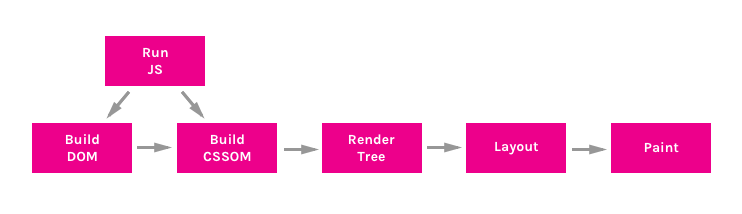

Разберем каждый из них по подробнее:

1. Построение DOM-дерева
- DOM (объектная модель документа) дерево это объект, представляющий полностью разобранную HTML-страницу. Начиная с корневого элемента `<html>`, узлы создаются для каждого элемента/текста на странице. Элементы, вложенные в другие элементы, представлены в виде дочерних узлов, и каждый узел содержит полный набор атрибутов для этого элемента. Например, элемент `<a>` будет иметь атрибут href, связанный с узлом.
- 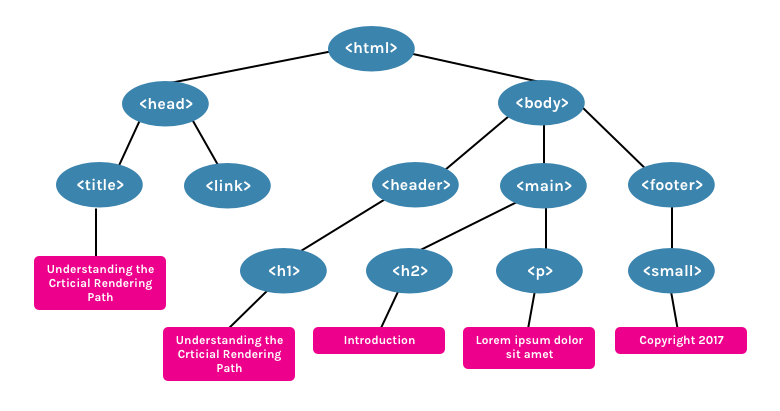
- может быть загружен по частям\*

  1.1. JavaScript:
  - JavaScript является блокирующим ресурсом для парсера (если специально не помечен как асинхронный или отложенный). Это означает, что JavaScript блокирует разбор самого HTML-документа.
  - Когда парсер доходит до тега `<script>` (не важно внутренний он или внешний), он останавливается, забирает файл (если он внешний) и запускает его. Вот почему, если мы имеем JavaScript-файл, который ссылается на элементы документа, мы обязательно должны поместить его после их появления.
  - JavaScript можно загружать асинхронно, указав атрибут **async**, для того, чтобы избежать блокировки парсера.

2. Построение CSSOM-дерева:
- CSSOM (объектная модель CSS) — это объект, представляющий стили, связанные с DOM. Он выглядит так же как DOM, но с соответствующими стилями для каждого узла. Не имеет значения были ли стили объявлены явно или наследуются.
- 
- **CSS считается «блокирующим обработку ресурсом». Это значит, что Render-дерево (см. ниже) не может быть построено без полного первоначального разбора CSS.**
- **CSS также может являться «блокирующим скрипты», потому что JavaScript-файлы должны дождаться построения CSSOM, прежде чем начать исполняться.**
- В прошлом это использовалось , чтобы позволить некритическому CSS загружаться без блокировки рендеринга.

3. Создание Render-дерева:
- Render-дерево — это совокупность DOM и CSSOM. Это дерево, которое даёт представление о том, что в конечном итоге будет отображено на странице. Это означает, что оно захватывает только видимый контент и не включает, например, элементы, которые были скрыты с помощью CSS-правила display: none.
- На примерах DOM и CSSOM, представленных выше, будет построено такое Render-дерево
- 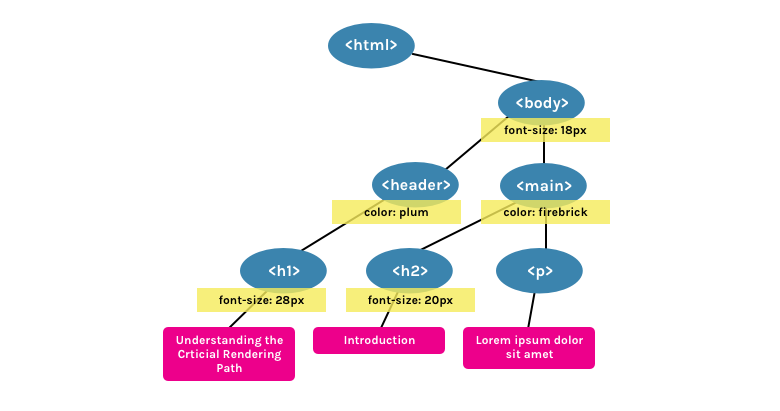

4. Просчитывание стилей (Style Calculation)
- применение селекторов в элементам (CSS к DOM) (чем сложнее селектор, тем дольше)
  - также обрабатывает каскадирование стилей

5. Layout
- Рассчитывает расположение и размеры блоков элементов (грубо говоря строится чертеж / макет)
- На выходе - layout tree (шде каждый узел содержит информацию о свое расположении)

6. Покраска / Отрисовка (Paint)
- Наконец, на шаге отрисовки, видимый контент страницы может быть преобразован в пиксели, чтобы появиться на экране.
- Браузер может создавать несколько слоев для более сложных эффектов, таких как плавающие элементы или элементы с прозрачностью. Эти слои потом будут объединены на этапе композиции.

7. Композиция 
- Объединение слоев

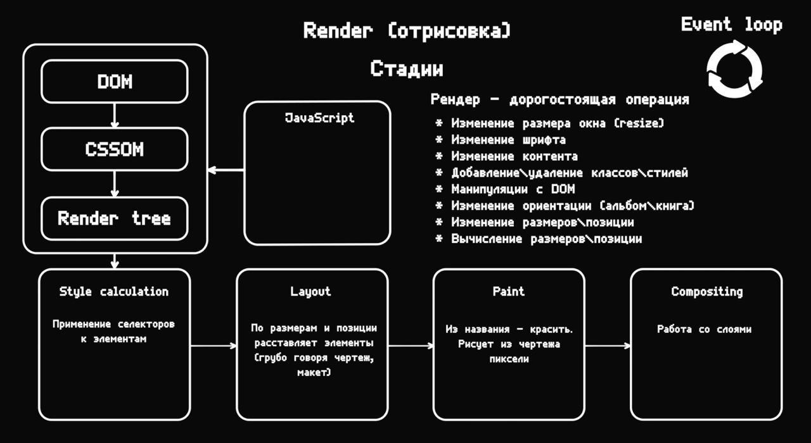
- При изменении DOM при помощи JS происходит полная перерисовка (с 1 шага по последний)

### HTML: Базовые теги, семантические теги, атрибуты, data-атрибуты, классы, **async** **defer**, accessibility

1. Базовые теги:

- `<html>, <head>, <body>, <div>, <span>, <a>, <ul>, <li>, <p>, , <br>, <script>, <link>, <meta>, `
  - **Строчные**:
    - Строчные элементы занимают только необходимое пространство и располагаются в одну строку
    - Строчные элементы по умолчанию не имеют отступов сверху и снизу
    - Строчные элементы не могут содержать блочные элементы.
    - Примеры: `<span>`, `<a>`, ``, `<strong>`.
  - **Блочные**:
    - Блочные элементы занимают всю доступную ширину и начинают новую строку
    - Блочные элементы имеют отступы (margins) и внутренние отступы (padding) по всем сторонам
    - Любая вложенность
    - Примеры: `<div>`, `<p>`, `<h1>`, `<ul>` и тп
    

2. Семантические теги:

- `<header>, <nav>, <footer>, <main>, <section>, <aside>, <article>, <time>, <details>`
- `<article>` - независимое, автономное содержимое
- `<time>` - дата и время
- `<details>` - Определяет дополнительные сведения, которые пользователь может просматривать или скрывать

3. Атрибуты:

- Атрибут: **id** - Задает уникальный идентификатор для элемента. Этот атрибут часто используется для стилизации элементов через CSS или для доступа к элементу через JavaScript.

- Атрибут: **class** - Задает один или несколько классов для элемента, которые могут использоваться для стилизации через CSS или для манипуляций с элементами через JavaScript.

- Атрибут: **src** - Определяет URL ресурса, который будет загружен и отображен в элементе, таком как `` для изображения или `<script>` для JavaScript файла.

- Атрибут: **href** - Определяет URL ссылки, которая используется в элементах `<a>` для гиперссылок и `<link>` для связывания внешних ресурсов, таких как стили CSS.

- Атрибут: **alt** - Задает альтернативный текст для изображения в элементе ``. Этот текст отображается, если изображение не может быть загружено, и помогает в доступности контента.

- Атрибут: **title** - Определяет всплывающую подсказку для элемента. Этот текст отображается, когда пользователь наводит курсор на элемент.

- Атрибут: **style** - Включает инлайн-стили CSS для элемента. Применяется для задания стилей непосредственно внутри HTML-тега.

- Атрибут: **type** - Определяет тип элемента. Чаще всего используется в элементах `<input>` для задания типа вводимого значения (например, text, password, email и т.д.) и в элементах `<button>` и `<script>`.

- Атрибут: **value** - Определяет значение элемента. Применяется в элементах `<input>`, `<button>`, `<option>` и других.

- Атрибут: **name** - Задает имя элемента. Используется для группировки данных формы, чтобы сервер мог обработать их.

4. Data-атрибуты (data (eng) - данные)

- **Дата-атрибут** — это пользовательский атрибут на HTML-элементе, название которого начинается с `data-`. Это встроенная возможность стандарта HTML5. В дата-атрибутах можно хранить дополнительную информацию в стандартных HTML-элементах и работать с этой информацией в JavaScript при помощи собственного API.
- Имя может быть длинным, из нескольких слов (значения может и не быть). Слова разделяются тире:
- ```html
  <div data-long-size-atribute="small"></div>
  ```
  или
  ```html
  <div data-long-size-atribute></div>
  ```
- У дата-атрибутов есть свой собственный API. Читать и записывать значения дата-атрибутов элемента можно с помощью свойства dataset. С его помощью можно также и добавлять новые дата-атрибуты к элементу.
- Можно обращаться к значениям атрибутов data-\* также, как и к значениям других атрибутов: при помощи методов getAttribute и setAttribute для чтения и записи данных соответственно, также можно получать доступ через dataset.dataValue
- К ним можно обращаться через CSS используя [...].
- !!!Производительность чтения дата-атрибутов по сравнению с хранением этих данных в хранилищах данных JavaScript намного хуже, использование dataset ещё медленнее, чем чтение данных с помощью getAttribute!!!
- 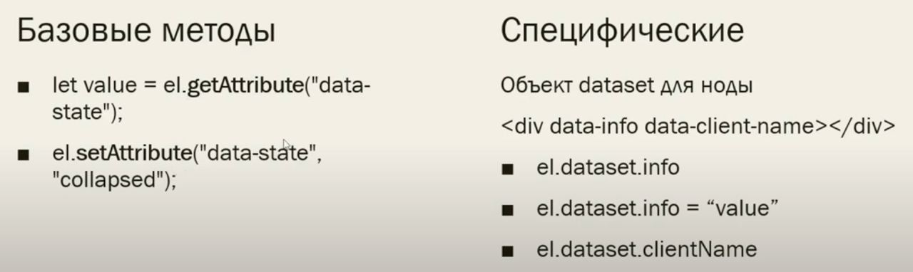

5. Классы :)

- Универсальный атрибут тега, с помощью которого можно задать имя любому элементу на странице. Имя элемента в дальнейшем используется в качестве селектора в CSS и позволяет управлять стилями элемента. К тому же по имени класса удобно искать и манипулировать элементами на странице при помощи JavaScript.
- У элемента может быть несколько классов
- ```html
  <p class="text">Очень крутой текст про крутые классы</p>
  ```

6. Атрибуты **async** **defer**

- Использование \***\*async\*\*** и \***\*defer\*\*** помогает улучшить производительность загрузки страницы, избегая блокировки парсинга HTML, что особенно важно для современных веб-приложений, где загрузка и выполнение скриптов могут существенно влиять на пользовательский опыт.
- Скрипты с атрибутами **defer** загружаются и выполняются последовательно, а с **async** – асинхронно. Кроме того, **defer** всегда ждёт, пока весь HTML-документ будет готов, а **async** выполняется сразу после загрузки.
- Как понять:
  - Обычно браузеры загружают `<script>` синхронно, во время разбора документа. Поэтому принято добавлять скрипты в конец документа, перед `</body>`, чтобы они не тормозили загрузку страницы. Но при помощи атрибутов **defer** и **async** можно явно управлять порядком загрузки и выполнения скриптов.
- **ASYNC** (**async**)
  - Указывает браузеру по возможности загружать скрипт асинхронно.
  - Скрипт выполняется полностью асинхронно. Это означает, что файл будет выполняться без ожидания загрузки и отображения веб-страницы. При обнаружении `<script async src="...">` браузер не останавливает обработку страницы, а спокойно работает дальше.
  - **Выполнение** - Когда скрипт будет загружен – он сразу выполнится.
  - !Первым выполнится тот скрипт, который быстрее загрузится!
- **DEFER** (**defer**)
  - Указывает браузеру, что скрипт должен выполняться после разбора документа, но до события DOMContentLoaded.
  - **Выполнение** - после разбора документа (HTML)
  - Скрипты с атрибутом **defer** будут предотвращать запуск события DOMContentLoaded до тех пор, пока скрипт не будет загружен полностью и не завершится его инициализация.
  - Первым всегда выполнится script1.js, который подключён раньше. Даже если script2.js загрузится раньше, он будет выполнен после первого скрипта.
  - `<script src="script1.js" defer></script>`
- Полезная информация:
  - На практике **defer** используется для скриптов, которым требуется доступ ко всему DOM-дереву или если важен их порядок выполнения. А **async** хорош для независимых скриптов, например счётчиков и рекламы, порядок выполнения которых не играет роли.
  - **Динамически вставленный `<script>` (например, вставленный при помощи `document.createElement`) по умолчанию загружается браузером асинхронно.**

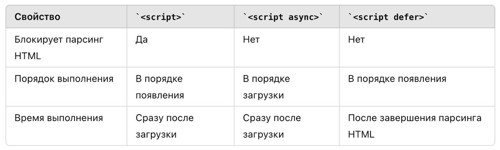

7. Accessibility (Веб-доступность)

- **Веб-доступность (Accessibility)** в HTML — это практика создания веб-сайтов, доступных для всех пользователей, включая людей с ограниченными возможностями. Это включает в себя адаптацию контента для людей с нарушениями зрения, слуха, двигательной активности и когнитивными нарушениями.
- Основные аспекты веб-доступности:
  - Текстовые альтернативы (alt-тексты)
  - Навигация с помощью клавиатуры
  - Использование семантических тегов
  - Контрастность и цветовая гамма
  - Подписи и субтитры для мультимедиа
  - Формы и элементы управления

### CSS: Каскадность, приоритет селекторов, псевдоклассы, псевдоэлементы, flex, grid

1. Каскадность, приоритет селекторов

- Один из основных принципов работы CSS, также это приоритет одних правил/стилей над другими. Когда одни стили перебивают другие. Это понятие также называется "специфичность селектора".
- Чем выше — тем «важнее»:
  1. !important
  2. inline стили
  3. селектор id
  4. селектор class
  5. тег (div и тп)
  6. `*` (все другое)

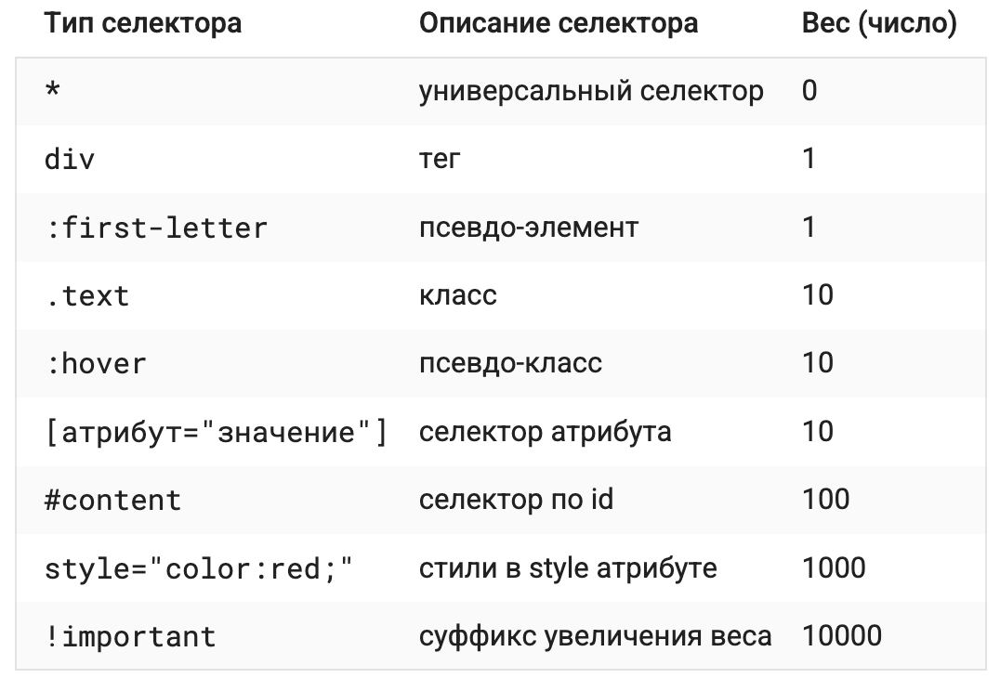
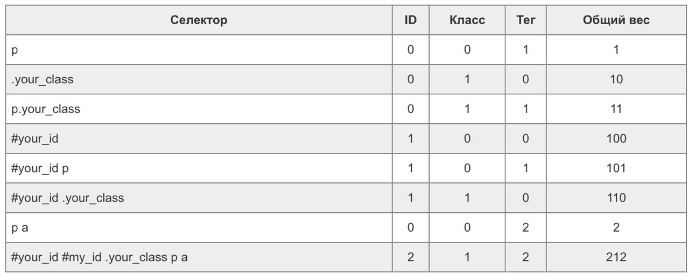

2. Псевдоклассы

- **Псевдоклассы** — особый вид селектора, который уточняет тип или состояние. Обычно это какой-то качественный признак: реакция на наведение курсора, порядок следования и другие.
- `:hover, :active, :visited, :checked, :disabled, :enabled, :focus, :blur, :not, :nth-child(), :last-child, :first-child`

3. Псевдоэлементы:

- Псевдоэлементы — это элементы, которых не существует в HTML-разметке. Они создаются и позиционируются исключительно при помощи CSS. Чаще всего используются для создания различных декоративных элементов (которые не несут содержательного смысла).
- Также псевдоэлементы приходят на помощь, когда нужно наложить поверх картинки так называемый оверлей (перекрывающий слой). На этом польза от псевдоэлементов не заканчивается.
- `::before, ::after, ::first-letter, ::first-line, ::placeholder`
- content — обязательное свойство псевдоэлементов
- ```css
  .header::before {
    content: "";
    position: absolute;
    top: 0;
    left: 0;
    width: 100%;
    height: 100%;
    background-color: rgba(0 0 0 / 0.7);
    z-index: -1;
  }
  ```

4. flex, grid

- **Flexbox** — это модель для создания одномерных макетов (по одной оси — горизонтальной или вертикальной). Она особенно полезна для размещения элементов в строку или столбец, даже если размеры элементов неизвестны или динамически изменяются.
- **CSS Grid** — это мощная система для создания двухмерных макетов, позволяющая располагать элементы в строки и столбцы. Grid позволяет точно управлять размещением элементов в сетке и задавать отношения между строками и столбцами.

### DOM: События DOM дерева, навигация по дереву, изменение элементов дерева
1. События DOM дерева
  - События — это сигналы, которые браузер посылает разработчику, а разработчик может на сигнал реагировать. По аналогии со светофором: видим зелёный свет, едем дальше. События бывают разных типов: клик, нажатие клавиши на клавиатуре, прокрутка страницы и так далее.
  - Основные типы событий:
    1) События мыши:
      - `click`: Событие происходит при щелчке по элементу.
      - `dblclick`: Событие происходит при двойном щелчке по элементу.
      - `mouseover`: Событие происходит, когда указатель мыши перемещается на элемент.
      - `mouseout`: Событие происходит, когда указатель мыши покидает элемент.
    2) События клавиатуры:
      - `keydown`: Событие происходит при нажатии клавиши.
      - `keyup`: Событие происходит при отпускании клавиши.
      - `keypress`: Событие происходит при нажатии клавиши, но до её отпускания.
    3) События формы:
      - `submit`: Событие происходит при отправке формы.
      - `change`: Событие происходит при изменении значения элемента формы.
    4) События документа:
      - `DOMContentLoaded`: Событие происходит, когда HTML-документ полностью загружен и разобран, но внешние ресурсы, такие как стили и изображения, могут быть ещё не загружены.
      - `load`: Событие происходит, когда весь документ полностью загружен, включая все внешние ресурсы.

  - Всплытие и погружение
  - Стандарт DOM Events описывает 3 фазы прохода события:
    1. Фаза погружения (capturing phase) – событие сначала идёт сверху вниз.
    2. Фаза цели (target phase) – событие достигло целевого(исходного) элемента.
    3. Фаза всплытия (bubbling stage) – событие начинает всплывать.

    **ВСПЛЫТИЕ**
    - когда на элементе происходит событие, обработчики сначала срабатывают на нём, потом на его родителе, затем выше и так далее, вверх по цепочке предков. (не все события всплывают, например, focus не всплывает)
    - Самый глубокий элемент, который вызывает событие, называется целевым элементом, и он доступен через `event.target`
      - `event.target` – это «целевой» (самый глубокий) элемент, на котором произошло событие, в процессе всплытия он неизменен.
      - `this` / `event.currentTarget` – это «текущий» элемент, до которого дошло всплытие, на нём сейчас выполняется обработчик.
    - 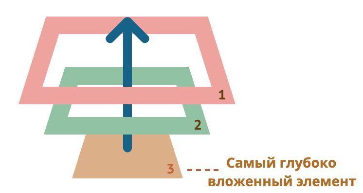   
    - Любой промежуточный обработчик может решить, что событие полностью обработано, и остановить всплытие. Для этого нужно вызвать метод `event.stopPropagation()`.
      - `event.stopPropagation()` препятствует продвижению события дальше, но на текущем элементе все обработчики будут вызваны.
      - `event.stopImmediatePropagation()` - Он не только предотвращает всплытие, но и останавливает обработку событий на текущем элементе

    **ПОГРУЖЕНИЕ**
    - Чтобы поймать событие на стадии погружения, нужно использовать третий аргумент capture. (по умолчанию false)
    - ```javascript
      elem.addEventListener(..., {capture: true})
      // или просто "true", как сокращение для {capture: true}
      elem.addEventListener(..., true)
      ```
    - Удаление обработчика происходит также с флагом


2. Навигация по DOM-дереву
  - DOM представляет собой древовидную структуру, где каждый узел является объектом. Навигация по дереву DOM позволяет перемещаться между различными элементами документа.
  - Основные методы навигации:
    1) Доступ к элементам:
      - `document.getElementById('id')`: Возвращает элемент по его id.
      - `document.getElementsByClassName('class')`: Возвращает список элементов по их классу.
      - `document.getElementsByTagName('tag')`: Возвращает список элементов по их тегу.
      - `document.querySelector('selector')`: Возвращает первый элемент, соответствующий CSS-селектору.
      - `document.querySelectorAll('selector')`: Возвращает `NodeList` (коллекцию, а это псевдомассив) элементов, соответствующие CSS-селектору.
        - Цепочка наследования: `myNodeList --> NodeList.prototype --> Object.prototype --> null`, поэтому мы не можем использовать методы массива с NodeList
    2) Навигация по узлам:
      - `parentNode`: Возвращает родительский узел.
      - `childNodes`: Возвращает все дочерние узлы.
      - `firstChild` / `lastChild`: Возвращает первый / последний дочерний узел.
      - `previousSibling` / `nextSibling`: Возвращает предыдущий / следующий узел на том же уровне.

3. Изменение элементов дерева
  - Для динамического изменения элементов на странице используются различные методы и свойства DOM.
  - Основные методы изменения элементов:
    1) Создание элементов:
      - `document.createElement('tag')`: Создает новый элемент.
      - `document.createTextNode('text')`: Создает новый текстовый узел.
    2) Добавление элементов:
      - `parentNode.appendChild(newNode)`: Добавляет новый узел в конец списка дочерних элементов родительского узла.
      - `parentNode.insertBefore(newNode, referenceNode)`: Вставляет новый узел перед указанным узлом.
    3) Удаление элементов:
      - `parentNode.removeChild(childNode)`: Удаляет дочерний узел из родительского узла.
    4) Изменение атрибутов:
      - `element.setAttribute('attr', 'value')`: Устанавливает значение атрибута элемента.
      -` element.getAttribute('attr')`: Возвращает значение атрибута элемента.
      -` element.removeAttribute('attr')`: Удаляет атрибут элемента.

### HTTP, HTTPS, REST API
1. HTTP
  - HTTP (Hypertext Transfer Protocol) — это протокол прикладного уровня для передачи данных в интернете. Он является основой для обмена данными между веб-браузерами и серверами.
  - Не безопасный
  - Методы HTTP: Определяют действия, которые должны быть выполнены для ресурса. Основные методы включают (первые 5 - основные):
    1. GET: Получение ресурсов (данных).
    2. POST: Отправка данных на сервер. Используется для создания новых ресурсов.
      - неидемпотентен (см. ниже)
    3. PUT: Обновление существующих данных на сервере.
      - Должен быть **идемпотентным**, т.е. всегда выполнятся с одним результатом
    4. PATCH: Частичное обновление (обновление фрагмента).
    5. DELETE: Удаление ресурса на сервере.
    6. HEAD: Запрашивает заголовки ресурса, без тела ответа.
    7. OPTIONS: Запрашивает поддерживаемые сервером методы для определенного ресурса.
    8. CONNECT: Устанавливает туннель для передачи данных через сервер.
    9. TRACE: Выполняет возврат запроса клиента для тестирования и диагностики.
  - Статусы ответа (Коды состояния): Статусные коды указывают на результат выполнения запроса.
    1. 1ХХ - Информирование о **процессе** передачи запроса (**информационный**)
    2. 2ХХ - Информирование об **успешной** передаче
    3. 3ХХ - Информирование о **перенаправлении**
    4. 4ХХ - Ошибки **клиента** (этого нет, ты делаешь это неправильно, сюда нельзя)
    5. 5ХХ - Ошибки **сервера**
  - Заголовки HTTP: Метаданные, передаваемые с запросами и ответами (разные).
    1. Content-Type: Указывает тип содержимого (например, application/json).
    2. Authorization: Используется для передачи данных аутентификации.
  - Запрос состоит из заголовков (обязательных и не обязательных) и из тела запроса (передаваемая инф-ия)

2. HTTPS
  - HTTPS (Hypertext Transfer Protocol Secure) — это расширение HTTP, которое включает шифрование данных с помощью SSL/TLS для обеспечения безопасности передачи данных.
  - Безопасный
  - Основные особенности HTTPS:
    1. Шифрование: Данные шифруются для защиты от перехвата и изменений.
    2. Аутентификация: Использует цифровые сертификаты для проверки подлинности веб-сайта.
    3. Целостность данных: Обеспечивает защиту данных от подделки во время передачи.
  - Преимущества HTTPS:
    1. Защита конфиденциальных данных (например, учетных данных пользователей, платежной информации).
    2. Повышение доверия пользователей.
    3. Улучшение ранжирования в поисковых системах (SEO).

3. REST API (Representational State Transfer Application Programming Interface)
  - REST (Representational State Transfer) — это ***архитектурный стиль*** для создания веб-сервисов, которые взаимодействуют через HTTP. RESTful API — это интерфейс, который следует принципам REST. Основные принципы REST API:
    - Клиент-серверная архитектура: Клиент и сервер независимы друг от друга.
    - Многоуровневая система: Архитектура может состоять из нескольких уровней, таких как балансировщики нагрузки, кеши и серверы.
    - Без состояния (Stateless): Каждый запрос от клиента к серверу должен содержать всю информацию, необходимую для обработки запроса. **Каждый раз клиент и сервер общаются, как в первый раз**
    - Кэширование: Ответы сервера могут быть кэшированы для повышения производительности. (PUT, DELETE не кэшируются)
    - Единообразие интерфейса: Использование стандартных методов HTTP (GET, POST, PUT, DELETE) и четко определенные URL для ресурсов.
  - Формат данных - чаще всего JSON, но бывает и XML

### Бандлеры, принцип работы, webpack, лоадеры, плагины
- **Сборщики** (бандлеры) – это инструменты, которые помогают объединять и управлять модулями и зависимостями в проекте. Они особенно полезны в больших проектах, где есть множество файлов JavaScript, стилей и других ресурсов.
  - Entry point - это модуль, импортирующий в себя все остальные файлы. Обычно таким файлом является index.js или main.js
  - Output - итоговый сгенерированный файл, который непосредственно добавляется в тег script в корневой файл index.html
- **Loaders** - это функции, преобразующие и адаптирующие файлы заданного типа для дальнейшего их добавления в output файлы (определяют то, как будут выглядить входящие файлы / код)
- **Plugins** - это классы, позволяющие выполнять задачи после бандла (генерировать новые типы output-ов, работать со сборкой и т.д.). По умолчанию webpack работает только с js (определяют то, как будут выглядить исходящие файлы / код)

 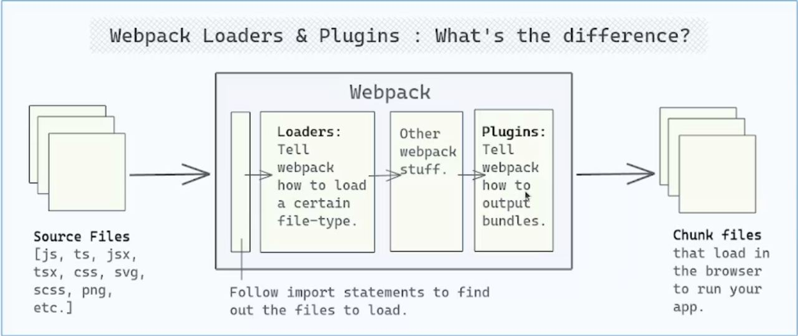

### Линтеры, принцип работы, правила
- Линтеры – это анализаторы исходного кода, предназначенные для выявления ошибок и отклонений от принятого code style
- ESLint – один из наиболее популяных линтеров для проектов на JavaScript/TypeScript
- Как работает?
  - Парсинг строк исходного кода и построение на его основе AST (абстрактного синтаксического дерева);
  - Запуск и выполнение правил над полученным AST;
  - Отображение результатов анализа.
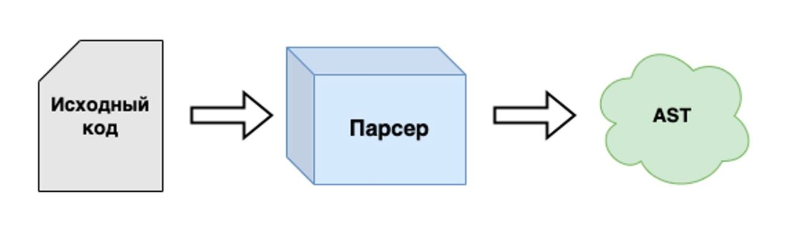

## JavaScript (JS)

### Типы данных, сравнение типов, преобразование типов
1. Типы данных:
    - `number`
    - `bigInt`
    - `string`
    - `symbol`
    - `boolean`
    - `undefined`
    - `null`
    - `Object` ***(не примитив)***
    
  - Различие между undefined и null:
    - `undefined` - отсутствие значения (переменная объявлена, но не определена)
    - `null` - умышленное отсутствие значения (пустое)

  - `typeof null == 'object'`
  - `typeof NaN == 'number'` 

2. Сравнение типов
  - Операторы сравнения: `<` `<=` `>=` `==` `===` `!=`
  - Результат: true или false
  - Сравнение строк:
    - Чтобы определить, что одна строка больше другой, JavaScript использует «алфавитный» или «лексикографический» порядок.
  - Сравнение разных типов:
    - При сравнении значений разных типов JavaScript приводит каждое из них к числу.
  - Строгое сравнение (`===`)
    - Проверяет равенство без привидения типов (обычное `==` делает привидение типов)
    - Если типы разные, то сразу возвращает false
    - ```javascript
      console.log(NaN === NaN);
      // Вывод: false

      console.log(+0 === -0);
      // Вывод: false
      ```
  - `Object.is(val1, val2)`
    - Грубо говоря, супер строгое сравнение (не оф. термин)
    - ```javascript
      console.log(Object.is('1', 1));
      // Вывод: false

      console.log(Object.is(NaN, NaN));
      // Вывод: true

      console.log(Object.is(-0, 0));
      // Вывод: false
      ```

  - Оператор нулевого слияния - `??`
    - если первый элемент null / undefined, то берет второй (значение) и наоборот

  - Дополнительная информация*
    - **Строгое** сравнение undefined и null дает false
    - **Нестрогое** сравнение undefined и null дает true

3. Преобразование типов
  - Строковое преобразование (string) - представление чего-либо в виде строки
    - Явное: `String(value)`
  - Числовое преобразование (number)
    - Явное: `Number(value)`
    - НЕявное: 
      - при всех арифметические операциях
        - если один из операндов при сложении(+) является строкой, то происходит конкатенация строк и возвращается строка (2 + '2' = '22') 
      - используем унарный плюс: +'2' === 2;
      - используем оператор нестрогого сравнения ==.
    - Примеры:
      - undefined -> `NaN` (Not a Number)
      - null -> `0`
      - true / false -> `1` / `0`
      - string -> проблемы по краям отрезаются, если пустая строка, то `0`, если возникла ошибка - `NaN`
  - Логическое
    - Явно: `Boolean(value)`, `!!value`
    - НЕявно: интерпретатор приведёт примитивные значения к логическим, если мы используем && или ||.
      - Оператор `||` - берет первое true значение или последнее falsy (если все другие falsy);

### Переменные var, let, const, всплытие переменных, TDZ
1. Переменные var, let, const
  - VAR (устаревшее):
    - Объявления могут обладать глобальной или локальной (функциональной) областью видимости.
    - Переменные var могут быть объявлены повторно или обновлены.
    - Переменные var поднимаются в верхнюю часть своей области видимости и инициализируются со значением undefined (без ошибки).
- LET:
  - Имеет блочную область видимости.
  - Переменные let могут быть обновлены, но не объявлены повторно.
  - Всплывает
  - Ключевое слово let не инициализируется. Если попытаться использовать переменную let до ее объявления, будет ошибка `ReferenceError`.
  - ```javascript
    let a
    console.log(a)
    // undefined
    ```
- CONST:
  - Имеет блочную область видимости.
  - Переменные const не могут быть обновлены или объявлены повторно.
  const-объект не может быть обновлен, но свойства таких объектов можно изменять.
  - Всплывает
  - Объявления через const перемещаются вверх, но не инициализируются (при обращении - ошибка).

2. Всплытие (Hoisting)
  - Механизм в JavaScript, при котором переменные и объявления функций поднимаются вверх своей области видимости перед выполнением кода.
  - JavaScript сначала объявляет, а затем инициализирует переменные.
  - Объявления функций «поднимаются» над объявлением переменных, но не над их назначениями.
  - 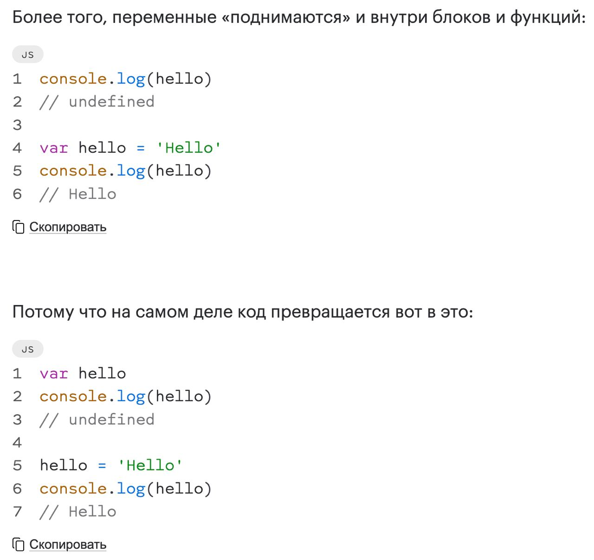

3. Temporal Dead Zone (TDZ):
  - TDZ - состояние, когда переменные недоступны, находятся в области видимости, но не объявлены.
  - Переменная, объявленная с помощью let или const, не может быть доступна до ее объявления в пределах области видимости. Это вызовет ошибку ссылки или инициализации.
  - Также нельзя обращаться к классам до их инициализации
  - А вот у функций TDZ нет (к ним можно обращаться всегда)

### Виды функций, сходства и отличия
1. Виды функций
  - `«Anonymous Function Expression»` (анонимное функциональное выражение):
    - Объявление функции в контексте какого-либо выражения, например присваивания.
    - **Не всплывает (нельзя обратиться до инициализации)**.
    - Имеет собственный `this`
    - ```javascript
      const funcExp = function(params) {
        console.log('Its func exp body');
      }
      ```
  - `«Named Function Expression»` (названное функциональное выражение):
    - Имя функционального выражения имеет особый смысл. Оно доступно только изнутри самой функции, т.е. переменной.
    - Удобно использовать для надежного вызова рекурсии
    - ```javascript
          const funcExp = function namedFunc(params) {
            console.log('Its func exp body');
            // можно вызывать рекурсивно
            namedFunc('privet')
          }
          ```

  - `«Function Declaration»` (объявление функции):
    - Функция, объявленная в основном потоке кода.
    - **Всплывает (можно обратиться до инициализации)**.
    - Имеет собственный `this`.
    - ```javascript
      function funcDec(params) {
        console.log('Its func declar body')
      }
      ```

  - `«Arrow Function»` (стрелочная функция):
    - Функция не создает собственный контекст выполнения, она использует внешний (родительский). То есть, нет собственного `this`.
    - `this` берется не в момент вызова функции, а в момент ее создания!
    - Никогда не могут использоваться в качестве функций-конструкторов и никогда не могут вызываться с помощью оператора `new`
    - Не имеют `arguments`
    - **Не всплывает (нельзя обратиться до инициализации)**.
    - Если не указывать {} (скобки) после =>, то идет неяный возврат результата
     - ```javascript
        const funcArr = (params) => {
          console.log('Its arrow func body')
        }
        ```
    - Из-за того, что у них нет собственного this, то и привязать его, используя специальные методы (см. ниже), нельзя

  - `IIFE` (Immediately Invoked Function Expression)
    - Функция, которая выполняется сразу же после того, как она была определена
    - Замыкают переменные в своих пределах, т.е. не могут быть использованы внутри области видимости
    - После выполнения сразу очищают память
    - ```js
        (function () {
            statements
        })();
      ```

  - Дополнительная информация:
    - Функция **высшего порядка** - функция, которая принимает в качестве параметра функцию (колбек) или возвращает функцию

### Замыкание (Closures)
  - Когда переменная замкнута между функциями, внутрення функция получает ее через outer
  - ```javascript
      function createCounter() {
        count = 0;
        return function increment() {
          count++;
          console.log(count);
        }
      }

      const counter = createCounter();
      counter();
      // 1
      counter();
      // 2
    ```
  - В переменной counter присваивается функция с ее лексичексим окружением*

### Объекты и массивы. Особенности работы со ссылочными типами данных, методы массивов
1. Объекты (Object - не примитивный тип данных)
  - Объекты используются для хранения коллекций различных значений и более сложных сущностей
  - Состоит из свойств - пара ключ-значение
  - Вычисляемые свойства
    - Мы можем использовать квадратные скобки в литеральной нотации для создания вычисляемого свойства.
    - ```js
      let fruit = prompt("Какой фрукт купить?", "apple");
      let bag = {
        [fruit]: 5,
      }
      alert( bag.apple ); // 5, если fruit="apple"
      ```
    - Смысл вычисляемого свойства прост: запись [fruit] означает, что имя свойства необходимо взять из переменной fruit.
  - Для удаления используют - `delete` , например `delete user.age`
  - Проверка на существование при помощи оператора `in`
    - ```js
      "key" in object // true или false (если существует)
      ```
  - `for...in` - используется для перебора ключей
    -  ```js
        for(let key in obj) {
          console.log(key);
          console.log(obj[key]);
        }
        ```
    - Если ключи - целочисленные, то выводится они будут в порядке возрастания, а не в том, котором они лежат в объекте (свойства упорядочены особым образом: свойства с целочисленными ключами сортируются по возрастанию, остальные располагаются в порядке создания)
  - **Копирование** объектов:
    - Для неглубокого (поверхностного) копирования используется `Object.assign()` (см. ниже)
    - ```js
        Object.assign(dest, [src1, src2, src3...])
        // dest - целевой объект
        // src1, src2... - исходные объекты
      ```
    - Для глубокого можно реализовать рекурсию или глобальный метод `structuredClone()`, который позволяет сделать полную копию объекта. К сожалению он поддерживается только современными браузерами. (Либо можно прибегнуть к сторонним библиотекам)
  - **Методы** объекта (Objects Built-in methods)
    - `Object.create()` - используется для создания новых объектов и их привязки к прототипу существующего объекта.
    - `Object.keys()` - создает массив, содержащий ключи объекта.
    - `Object.values()` - создает массив, содержащий значения объекта.
    - `Object.entries()` - создает вложенный массив пар ключ-значение для объекта.
    - `Object.assign()` - используется для копирования значений одного объекта в другой объект.
      - Также для копирования можно использовать `spread-оператор`
      - ```js
          const target = { ...source };
          target.method2(); // method2
        ```
      - Метод объекта не скопировать, если он находится в его прототипе, т.е. в prototype (надо копировать из прототипа)*
    - `Object.freeze()` - предотвращает изменение свойств и значений объекта, а также добавление или удаление свойств объекта.
    - `Object.seal()` - предотвращает добавление новых свойств к объекту, но допускает изменение существующих свойств.
    - `Object.getPrototypeOf()` - используется для получения внутреннего скрытого свойства [[Prototype]] объекта, которое также доступ

2. Массивы и методы массивов
  - Массив – это особый тип объекта, предназначенный для работы с упорядоченным набором элементов.
  - Методы массивов (достаточно запомнить мутирующие)
    - **МУТИРУЮТ:**
      - `push(...items)` - добавляет элементы в конец.
      - `pop()` - извлекает элемент с конца.
      - `shift()` - извлекает элемент с начала.
      - `unshift(...items)` - добавляет элементы в начало.
      - `sort(func)` - сортирует массив «на месте» и возвращает его. Сортирует элементы как **строки**!. Чтобы сравнивать элементы как числа, то надо писать свой callback.
      - `splice(start, deleteCount, ...items)` - изменяет содержимое массива, удаляя существующие элементы и/или добавляя новые.
      - `reverse()` - меняет порядок следования элементов на противоположный и возвращает изменённый массив.

    - **ВОЗВРАЩАЮТ НОВЫЙ:**
      - `slice(start, end)` - копирует заданную часть массива и возвращает её в виде нового массива. Этот метод не трогает оригинальный массив. (Не включает start и end)
      - `concat(...items)` - возвращает новый массив, копирует все элементы текущего массива и добавляет к нему items. Если какой-то из items является массивом, добавляются его элементы.
      - `map(func)` - создаёт новый массив из результатов вызова func для каждого элемента.
      - `filter(func)` - фильтрует элементы через функцию и возвращает все значения, для которых функция возвращает true.

    - **ПОИСК:**
      - `indexOf(searchElement, fromIndex)` - ищет элемент, начиная с позиции fromIndex, и возвращает его индекс или -1, если элемент не найден.
      - `includes(searchElement, fromIndex)` и `lastIndexOf(searchElement, fromIndex)` - возвращает true, если в массиве имеется элемент searchElement, в противном случае false. (С начала / с конца)
      - `find(callback)` - возвращает значение первого найденного в массиве элемента, которое удовлетворяет условию, переданному в callback функции. В противном случае возвращается undefined. Callback принимает (element, index, array).
      - `findIndex(callback)` - похож на `find`, но возвращает индекс элемента вместо его значения.
      - `reduce(callback, initialValue)` - вычисляет одно значение на основе всего массива, вызывая callback для каждого элемента и передавая промежуточный результат между вызовами.
      - `some(fn)` - немедленно возвращает true и останавливает перебор остальных элементов, если fn возвращает ложное значение.
      - `every(fn)` - немедленно возвращает false и также прекращает перебор остальных элементов.
      - `arr.fill(value, start, end)` – заполняет массив повторяющимися value, начиная с индекса start до end.
      - `arr.copyWithin(target, start, end)` – копирует свои элементы, начиная с позиции start и заканчивая end, в себя, на позицию target (перезаписывая существующие).
      - `arr.flat(depth)/arr.flatMap(fn)` создаёт новый плоский массив из многомерного массива.

    - **ПЕРЕБОР:**
      - `forEach(callback)` - вызывает callback для каждого элемента. Ничего не возвращает.

    - **ПРЕОБРАЗОВАНИЯ:**
      - `split/join` - преобразует строку в массив и обратно.

    - **ПРОВЕРКА:**
      - `Array.isArray(arr)` - проверяет, является ли arr массивом.

3. Особенности работы со ссылочными типами данных
  - Примитивные значения (например, числа или строки) хранятся в переменной как есть
    - если присвоить какое-то значение переменной в другую, то мы просто скопируем это же количество байт в новое место.
  - Объекты, массивы и функции — по ссылке на место в памяти.
    - компьютер отдаёт нам ссылку на место, где данные хранятся, и самостоятельно будет работать с ними по инструкциям, которые мы ему даём. Таким образом в переменную мы получаем лишь ссылку на данные.

### Map и Set, отличия от объектов и массивов
1. Map
  - Map — это коллекция ключ/значение, похожая на Object, но с возможностью использовать ключи любого типа.
  - **Методы:**
    - `new Map()`: создаёт пустую коллекцию.
    - `map.set(key, value)`: добавляет пару ключ/значение.
    - `map.get(key)`: возвращает значение по ключу или `undefined`, если ключ отсутствует.
    - `map.has(key)`: возвращает `true`, если ключ присутствует в коллекции, иначе `false`.
    - `map.delete(key)`: удаляет элемент по ключу.
    - `map.clear()`: очищает коллекцию от всех элементов.
    - `map.size`: возвращает текущее количество элементов.

  
2. Set 
  - Set — это коллекция уникальных значений.
  - **Методы:**
    - `new Set(iterable)`: создаёт Set, можно передать перебираемый объект для инициализации.
    - `set.add(value)`: добавляет значение, возвращает тот же объект set.
    - `set.delete(value)`: удаляет значение, возвращает `true`, если значение было в множестве, иначе `false`.
    - `set.has(value)`: возвращает `true`, если значение присутствует в множестве, иначе `false`.
    - `set.clear()`: удаляет все значения.
    - `set.size`: возвращает количество элементов в множестве.

3. Немного про WeakMap и WeakSet
  - WeakMap — это коллекция, где ключами могут быть только объекты, и автоматически удаляющая их при недоступности
  - WeakSet — это коллекция, которая хранит только объекты и удаляет их, когда они становятся недостижимыми
  - **То есть их преимущество в очистке от мусора при недостижимости данных**

4. Отличия объектов и массивов
  - У каждого свои методы
  - Массив - всегда упорядочен, а объект - нет
  - У массива индексирование - всегда числовой индекс, а у объекта - строка или символ

### Контекст this, виды привязок, call, apply, bind
1. Контекст this
  - this — это ссылка на некий объект, к свойствам которого можно получить доступ внутри вызова функции. Этот this — и есть контекст выполнения.
  - this - указывает на тот объект в контексте которого это было вызвано
  ((ДОПОЛНИТЬ))
2. Виды привязок (call, apply, bind)
    1. По умолчанию 
      - когда ни один из других методов привязок не был вызван
      - Если функция вызвана просто как функция (не как метод объекта), то this будет указывать на глобальный объект (в браузере это window, а в Node.js - global). В строгом режиме (strict mode) this будет undefined.
    2. Неявная привязка
      - функция вызывается через объект, this указывает на этот объект.
      - ```js
          function foo() {
            console.log(this.a);
          }

          var obj = {
            a: 2,
            foo: foo,
          };

          obj.foo(); // 2
        ```
    3. Явная привязка (первый параметр - **всегда контекст** потом параметры, передаваемые в привязанную функцию)
      - `foo.call(obj, 'param1', 'param2')` - сразу же исполняется (бесконечное количество параметров через запятую)
      - `foo.apply(obj, ['param1', 'param2', 3])` - сразу же исполняется (ДВА параметра, второй массив передаваемых параметров)
      - `foo.bind(obj, param1', 'param2')`  - возвращает функцию с жестко привязанным контекстом (бесконечное количество параметров через запятую)
    4. Привязка с new 
      - Функции, вызываемые с помощью модификатора new именуют функциями-конструкторами. Когда мы вызываем функцию с new происходит сразу несколько вещей:
        - Создаётся новый объект
        - Только что созданный объект связывается с прототипом вызываемой функции
        - Только что созданный объект становится this этой функции
        - Только что созданный объект автоматически вернется в качестве результата выполнения этой функции, если только функция сама не возвращает объект (не примитив)
  
- Определение привязки this для вызова функции требует поиска непосредственной точки вызова этой функции. Как уже выяснилось, к точке вызова могут быть применены четыре правила, в именно таком порядке приоритета:
  1. Вызвана с new? Используем только что созданный объект.
  2. Вызвана с помощью call или apply (или bind)? Используем указанный объект.
  3. Вызвана с объектом контекста, владеющего вызовом функции? Используем этот объект контекста.
  4. По умолчанию: undefined в режиме strict mode, в противном случае объект global.

- Остерегайтесь случайного/неумышленного вызова с применением правила привязки по умолчанию. В случаях, когда вам нужно "безопасно" игнорировать привязку this, "DMZ"-объект, подобный ø = Object.create(null), — хорошая замена, защищающая объект global от непредусмотренных побочных эффектов.

- Вместо четырех стандартных правил привязки стрелочные функции ES6 используют лексическую область видимости для привязки this, что означает, что они заимствуют привязку this (какой бы она ни была) от вызова своей окружающей функции. Они по существу являются синтаксической заменой self = this в до-ES6 коде.

### Классы
- представляют собой синтаксический сахар над существующим в JavaScript механизмом прототипного наследования (см. ниже)
- Создание - new MyNewClass()
- ```js
  class User {
    constructor(name) {
      this.name = name;
    }
    sayHi() {
      alert(this.name);
    }

  }
  let user = new User("Иван");
  user.sayHi();
  ```
- Классы - это не просто синтаксический сахар
  - Функция, созданная с помощью class, помечена специальным внутренним свойством [[IsClassConstructor]]: true. Поэтому это не совсем то же самое, что создавать её вручную.
  - Методы класса являются неперечислимыми. Определение класса устанавливает флаг enumerable в false для всех методов в "prototype". И это хорошо, так как если мы проходимся циклом for..in по объекту, то обычно мы не хотим при этом получать методы класса.
  - Классы всегда используют use strict. Весь код внутри класса автоматически находится в строгом режиме.
- Классы можно создавать через class Expression (как function expression)
- **Наследование классов** - Наследование классов – это способ расширения одного класса другим классом. Таким образом, мы можем добавить новый функционал к уже существующему.
  - Если происходит наследование, нужно обязательно вызывать super() в конструкторе, иначе будет ошибка, что this не определено
- В классах можно переопределять методы наследуемых классов (родителей)
- Статические методы
  - Принадлежат классу в целом, а не относятся к конкретному объекту класса
  - Наследуются
  - Статические свойства используются в тех случаях, когда мы хотели бы сохранить данные на уровне класса, а не какого-то одного объекта.
  - ```js
    class MyClass {
      static property = ...;

      static method() {
        ...
      }
    }
    ```
- Защищенные поля (Protected)
  - имеют префикс `_`
  - не могут быть доступны извне класса
  - наследуются
- Приватные поля (Private)
  - имеют префикс `#`
  - не можем получить к нему доступ извне или из наследуемых классов
  - не наследуются

### Наследование, отличие proto и prototype
- Самое понятное обьяснение [тут](https://www.youtube.com/watch?v=b55hiUlhAzI&ab_channel=IT-KAMASUTRA)
- **proto** 
  - **есть у всех объектов**, даже у примитивов, если мы обращаемся к ним через `'21'.__proto__` (грубо говоря, оно есть у всего)
  - объект, который ссылается на prototype класса, с помощью которой объект был создан
  - если 2 объекта созданы на основе 1-го объекта, то их proto будут равны
  - чтобы понимать что за proto нужно точно знать с помощью какой ***функции-конструктора*** (класса) создан данный объект (new Number(), new Promise() и т.п.)
- **prototype**
  - есть только у **Class** либо у **Function**
  - каждый prototype - **независимый** **уникальный** объект, с определенным набором свойств и методов
- Если у объекта нет нужного метода, то он пойдет вниз по цепочке прототипов

### AJAX (?)
- AJAX (аббревиатура от «Asynchronous Javascript And Xml») – технология обращения к серверу без перезагрузки страницы.
- Возможность асинхронно отправлять запросы к серверу и менять интерфейс в зависимости от них
- Позволяет загрузить 1 раз страницу и не перезагружать ее после запросов
- HTTPrequest

### Промисы
- `Promise` — объект для написания и обработки асинхронного кода, предоставляют удобный способ организации асинхронного кода.
- Состояния промисов
  - `pending` — операция началась
  - `fulfilled` — выполнено успешно
  - `rejected` — выполнено с ошибкой
- ```js
    var promise = new Promise(function(resolve, reject) {
      // Эта функция будет вызвана автоматически

      // В ней можно делать любые асинхронные операции,
      // А когда они завершатся — нужно вызвать одно из:
      // resolve(результат) при успешном выполнении
      // reject(ошибка) при ошибке
    })
  ```
  - Функция, переданная в конструкцию new Promise, называется исполнитель (`executor`). Когда Promise создаётся, она запускается автоматически.
  - Внутри функции промиса может быть и запрос к серверу, таймаут и ожидание ввода пользователя, или другой асинхронный процесс. Главное, чтобы по своему завершению он вызвал `resolve` или `reject`, которые передадут результат обработчикам.
    - `resolve(value)` — если работа завершилась успешно, с результатом value.
    - `reject(error)` — если произошла ошибка, error – объект ошибки.
- Промис не может передумать, например, вызвать reject ПОСЛЕ вызова resolve
- Цепочки промисов:
  - «Чейнинг» (chaining), то есть возможность строить асинхронные цепочки из промисов – пожалуй, основная причина, из-за которой существуют и активно используются промисы. Главное - вызывать .then за .then, а не многократно вызывать then у промиса.
  - ```js
      httpGet(...)
      .then(...)
      .then(...)
      .then(...)
    ```
  - В каждом then мы получаем текущий результат работы.
  Можно его обработать синхронно и вернуть результат (например, применить JSON.parse). Или же, если нужна асинхронная обработка – инициировать её и вернуть промис.
  - 
- Методы промисов:
  - `then()`
    - также перехватывает ошибки, если задан второй аргумент (который является обработчиком ошибок).
  - `catch()` 
    - выполняется при ошибке
    - можно пробросить ошибку дальше
  - `finally()` - выполняется в любом случае в конце обработки
- При возникновении ошибки – она отправляется в ближайший обработчик onRejected.
  - если ошибка не критическая можно перейти в ближайший (следующий) .then вернув значение при помощи return
  - Существенное отличие от `try..catch` в том, что промисы асинхронные, поэтому при отсутствии внешнего `.catch` ошибка не «вываливается» в консоль и не «убивает» скрипт
- У объекта `promise`, возвращаемого конструктором new Promise, есть внутренние свойства:
  - `state` («состояние») — вначале "`pending`" («ожидание»), потом меняется на "`fulfilled`" («выполнено успешно») при вызове resolve или на "`rejected`" («выполнено с ошибкой») при вызове `reject`.
  - `result` («результат») — вначале undefined, далее изменяется на value при вызове resolve(value) или на error при вызове `reject(error)`

- Статические методы промисов
  - `Promise.all(iterable)` - ожидает выполнения всех промисов и возвращает массив с результатами. Если хотя бы один промис из переданного массива завершится с ошибкой, то `Promise.all()` тоже завершится с этой ошибкой.
  - `Promise.race(iterable)` - ожидает первый выполненный любой промис, который становится его результатом, остальные игнорируются.
  - `Promise.any` - Метод очень похож на Promise.race, но ждёт только первый успешно выполненный промис, из которого берёт результат.
  - `Promise.resolve(value)` - создаёт успешно выполнившийся промис с результатом value
  - `Promise.reject(value)` - создаёт уже выполнившийся промис, но не с успешным результатом, а с ошибкой error.

- **ASYNC / AWAIT**
  - У слова `async` один простой смысл: эта функция всегда возвращает промис. Значения других типов оборачиваются в завершившийся успешно промис автоматически
  - Ключевое слово `await` заставит интерпретатор JavaScript ждать до тех пор, пока промис справа от `await` не выполнится. После чего оно вернёт его результат, и выполнение кода продолжится.
    - Пока промис не выполнится, JS-движок может заниматься другими задачами: выполнять прочие скрипты, обрабатывать события и т.п.
    - Нельзя использовать в обчных функция без `async`
  - ошибки можно ловить, используя `try..catch`

### Хранение данных в браузере
1. `localStorage` и `sessionStorage`
  - !ключ и значение должны быть **строками**!
  - Большинство современных браузеров могут выделить как минимум 5 мегабайтов данных (или больше), и этот размер можно поменять в настройках.
  - Хранилище привязано к источнику (домен/протокол/порт). Это значит, что разные протоколы или поддомены определяют разные объекты хранилища, и они не могут получить доступ к данным друг друга.
  - Имеют одинаковые методы:
    - `setItem(key, value)` – сохранить пару ключ/значение.
    - `getItem(key)` – получить данные по ключу key.
    - `removeItem(key)` – удалить данные с ключом key.
    - `clear()` – удалить всё.
    - `key(index)` – получить ключ на заданной позиции.
    - `length` – количество элементов в хранилище.
    - *Используйте Object.keys для получения всех ключей.*
- `localStorage`
  - Этот объект один на все вкладки и окна в рамках источника (один и тот же домен/протокол/порт).
  - Данные не имеют срока давности, по которому истекают и удаляются. Сохраняются после перезапуска браузера и даже ОС.
- `sessionStorage`
  - sessionStorage существует только в рамках текущей вкладки браузера.
    - Другая вкладка с той же страницей будет иметь другое хранилище.
    - Но оно разделяется между ифреймами на той же вкладке (при условии, что они из одного и того же источника).
  - Данные продолжают существовать после перезагрузки страницы, но не после закрытия/открытия вкладки.


2. Куки, document.cookie
- Куки – это небольшие строки данных, которые хранятся непосредственно в браузере. Они являются частью HTTP-протокола
- Максимальный размер 4Кб
- Куки обычно устанавливаются веб-сервером при помощи заголовка Set-Cookie. Затем браузер будет автоматически добавлять их в (почти) каждый запрос на тот же домен при помощи заголовка Cookie.
- Чтение
  - ```js
    alert( document.cookie );
    ```
- Запись
  - Запись в document.cookie обновит только упомянутые в ней куки, но при этом не затронет все остальные.
  - ```js
    document.cookie = "user=John"; // обновляем только куки с именем 'user'
    alert(document.cookie);
    ```
- Атрибуты куки:
  - Expires/Max-Age: Определяют время жизни куки.
  - Secure: Кука передается только по HTTPS.
  - HttpOnly: Доступ к куке возможен только через HTTP(S), а не через JavaScript.
  - SameSite: Управляет отправкой куки при кросс-доменных запросах, помогает защититься от CSRF-атак.

3. Есть еще indexDB

### Event Loop
- много писать :)


## TypeScript

### Alias типы и интерфейсы
1. Alias типы (Псевдонимы типов)
  - Чтобы постоянно не писать весь тип используют псевдонимы
  - Псевдоним типа объявляется при помощи ключевого слова type, после которого следует идентификатор (имя) псевдонима, а за ним идет оператор присваивания =, справа от которого находится тип, ассоциирующийся с псевдонимом.
  - Не могут быть повторно определены, выдает ошибку
  - ```ts
    type User = {
      firstName: string;
      pointsCount: number;
    }
    // Теперь можно удобно типизировать
    function doSomething(user: User) {
      // ...
    }
    ```

2. Интерфейсы
  - Интерфейс определяет свойства и методы, которые объект должен реализовать. Другими словами, интерфейс - это определение кастомного типа данных, но без реализации.
  - Интерфейсы определяются с помощью ключевого слова `interface`. 
  - Могут быть повторно определены
  - Используются в том числе и для классов
  - Если интерфейс переопределяется:
    - Если имеет разные свойства, то они сливаются в один интерфейс, то есть св-а из первого объявления сольются со св-ами из второго объявления
    - если одинаковые, то будет ругаться, что выше указан другой тип
  - ```ts
    interface IUser {
      id: number;
      name: string;
      sayWords(words: string): void; // Метод
    }
    ```


### Дженерики
- Дженерики (generic) помогают писать универсальный, переиспользуемый код, а также в некоторых случаях позволяют отказаться от any. 
- **Главная** задача дженериков — помочь разработчику писать код, который одинаково будет работать со значениями разных типов.
- ```ts
  function include < T > (array: T[], query: T): boolean {
    for (const value of array) {
      if (value === query) {
        return true;
      }
    }
    return false;
  }
  ```
- Вместо конкретного типа, мы как будто объявляем «переменную», а затем передаём в неё нужный тип. Таким образом, получается код, который может работать с разными типами

### Utility Types
- это набор встроенных типов, которые можно использовать для манипулирования типами данных в коде. Рассмотрим их подробнее.
- Примеры:
    1. Partial<T> -Делает все свойства типа T необязательными.
    2. Required<T> - Делает все свойства типа T обязательными.
    3. Readonly<T> - Делает все свойства типа T только для чтения.
    4. Pick<T, K> - Создает новый тип, выбирая набор свойств K из типа T.
    5. Omit<T, K> - Создает новый тип, исключая набор свойств K из типа T.
    6. Record<K, T> - Создает тип объекта, ключи которого типа K, а значения типа T.
    7. Exclude<T, U> - Создает тип, исключая из типа T все типы, которые присваиваются типу U.
    8. Extract<T, U> - Создает тип, который содержит только те типы из T, которые присваиваются типу U.
    9. NonNullable<T> - Исключает null и undefined из типа T.

### Условные типы (Conditional Types)
- это типы, способные принимать одно из двух значений, основываясь на принадлежности одного типа к другому. Условные типы семантически схожи с тернарным оператором.
- ```ts
  T extends U ? T1 : T2;
  type T0<T> = T extends number ? string : boolean;
  ```

### Перегрузка функций (Function Overloads)
- это возможность определить несколько версий одной функции, каждая из которых принимает свой набор параметров.
- ```ts
  export function myFunction(input: string): string;
  export function myFunction(input: number): number;
  /**
  * Overloads
  * @param input
  * @returns number|string
  */
  export function myFunction(input: unknown): unknown {
      return input;
  }
  ```

### Операторы
- И (&&), логическое ИЛИ (||) и оператор нулевого слияния (??).

### Дополнительная информация по типам данных TS
- Кортежи (неизменяемый тип данных, похожий на массив)
- `Enum` (перечисления) Представляет собой набор логически связанных констант, в качестве значений которых могут выступать как числа, так и строки. В случае, когда идентификаторам констант значение не устанавливается явно, они ассоциируются с числовым значениями, в порядке возрастания, начиная с нуля.
  - ```ts
      enum Fruits {
        Apple, // 0 
        Pear = 1, // 1
        Banana, // 2 
        Citrus = "Lemon",
      }
    ```
- `Array` - означает массив
- `void` - функция ничего не возвращает
- Отличие типа `unknown` от `any` - главное отличие `unknown` от any связано с проверкой типов. `unknown` запрещает выполнять любые операции
- `never` означает тип, которые никогда не получит результат, например, функция, которая никогда не завершится

## React

### Virtual DOM, reconcilation
1. Virtual DOM
  - Это легковесная копия реального DOM, никак не связанный с реальным
  - При изменении компонентов, React перестраивает Virtual DOM и начинает сравнивать его с предыдущей своей версией **(также это называется сравнения CurrentTree, т.е. старого илил текущего дерева с новым - WorkInProgressTree)**, после выявления **различий** React внесет минимально необходимые изменения в реальный DOM только там, где они нужны (также WorkInProgressTree становится ыCurrentTree)

2. React Reconcilation
  - Правила сравнения двух деревьев отображения
    - Для сравнения используется эвристический алгоритм. Эвристика - правило, которое не всегда дает лучший результат, но дает его в большинстве случаев
  - **Приоритизация** - когда большая и тяжелая операция разбивается на маленькие и сначала выполняются легкие операции (hover), а затем оставшиеся (выполняет их в порядке сложности)
  - **Правила** сравнения 2-х деревьев:
    1. Все элементы сравниваются последовательно (сверху вниз), если они имеют одинаковый тип, то обновляется только контент с атрибутами
    2. Если у элемента полностью меняется тип (div -> span), то он полностью перерисовывается (перемонтируется) и даже не будет смотреть блок дальше (внутри)
    3. Можно задать элементу `key` для изменения порядка элементов без перемонтирования
    4. *Глубокое сравнение пропсов*

### JSX|TSX
1. JSX (JavaScript XML)
  - Расширение языка JS в котором может содержаться HTML шаблон
  - После компиляции каждое JSX-выражение становится обычным вызовом JavaScript-функции, результат которого — объект JavaScript (см картинку ниже)
  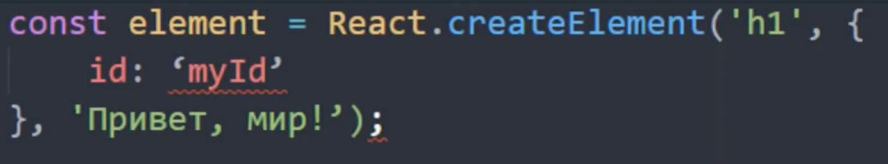
  - Своего рода синтаксический сахар над react.CreateElement
  - Есть ограничения, например: нельзя использовать атрибут class (тк это слово уже зарезервировано)
  - **ОБЯЗАТЕЛЬНО** должен быть один родительский элемент 
    - есть искусственный тег `<React.fragment></React.fragment>`, либо более привычный синтаксис `<></>` (если мы хотим задать какой-т атрибут, например, key, то нужно указывать `<React.fragment></React.fragment>`, а не пустой тег)

2. TSX
  - является расширением JSX, предназначенным специально для TypeScript
  - Добавляет статическую типизацию
  - Добавляет все возможности TypeScript (дженерики, утилити типы и тп)
  - Все это помогает избежать множества багов и ошибок при разработке

### Жизненный цикл компонента
- Кратко:
  1. Создание компонента
  2. Монтирование в дом
  3. Обновление
  4. Размонтирование
- Подробно:
  1. Mounting (Монтаж):
    - constructor(): Вызывается при создании компонента. Используется для инициализации состояния и привязки методов.
    - static getDerivedStateFromProps(): Вызывается как часть инициализации и при получении новых свойств. Позволяет обновлять состояние на основе новых свойств.
    - render(): Обязательный метод, который возвращает элементы React для отображения в DOM.
    - componentDidMount(): Вызывается сразу после того, как компонент был вставлен в DOM. Здесь можно выполнять запросы к API и другие инициализационные задачи.
  2. Updating (Обновление):
    - static getDerivedStateFromProps(): Вызывается при обновлении компонента, перед рендерингом. Позволяет обновлять состояние на основе новых свойств.
    - shouldComponentUpdate(): Определяет, нужно ли компоненту перерисовываться. Позволяет оптимизировать производительность.
    - render(): Второй раз вызывается метод render() для обновления интерфейса.
    - getSnapshotBeforeUpdate()
    - componentDidUpdate(): Вызывается после обновления компонента и обновления DOM. Здесь можно выполнять дополнительные действия после обновления.
  3. Unmounting (Размонтирование):
    - componentWillUnmount(): Вызывается перед тем, как компонент будет удален из DOM. Здесь можно очищать ресурсы, отписываться от событий и т.д.
  4. Error Handling (Обработка ошибок):
    - static getDerivedStateFromError(): Вызывается при возникновении ошибки в методах жизненного цикла ниже в дереве компонентов. Позволяет обновить состояние компонента в ответ на ошибку.
    - componentDidCatch(): Вызывается после возникновения ошибки. Позволяет логировать ошибки или выполнять другие действия по их обработке.

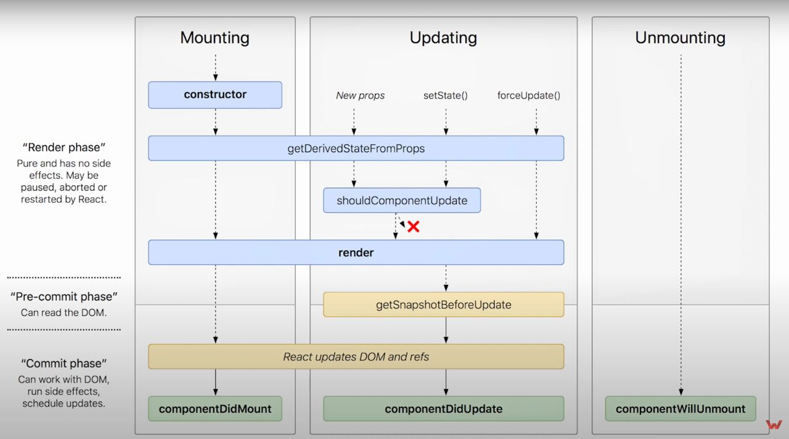

### Функциональные, классовые компоненты
- Первыми были **классовые** компоненты, которые писали при помощи классов
  - у них были свои методы для отслеживания жизненного цикла
  - возврат компонента происходит при помощи метода `render`
- Затем появились функциональные компоненты, основанные на функциях
  - для управления состоянием используются хуки
  - возврат компонента происходит при помощи метода `return`

- Дополнительная информация по компонентам
  - Есть **управляемые** и **не управляемые** компоненты
    1. Управляемый компонент принимает свое текущее значение в качестве пропсов, а также коллбэк для изменения этого значения.
    ```html
      <input value={someValue} onChange={handleChange} />
    ```
    2. Не управляемые компоненты выглядят как обычная HTML-форма, доступ к данным которой можно получить на submit
    ```js
      class Form extends Component {
        render() {
          return (
            <div>
              <input type="text" />
            </div>
          );
        }
      }
    ```

### Хуки (useState, useEffect, useMemo, useCallback, useRef, useContext знать как минимум). Сходства и отличия хуков и методов классовых компонентов
- Хуки:
  - `useState(initValue)` используется для добавления локального состояния
    - Возвращает **кортеж** в этом контексте представляет собой массив фиксированной длины, содержащий несколько значений, обычно два, которые возвращаются хук функцией.
      - кортеж неизменяемый (immutable), имеет фиксированную длину. (Грубо говоря - неизменяемый массив данных)
  - `useEffect(cb, [dep])` позволяет выполнять побочные эффекты (запросы к API, подписки) в функциональных компонентах
    - не блокирует бразуер
    - сначала отображает страницу, а потом отрабатывает
  - `useLayoutEffect(cb, [dep])` имеет такой же функционал и синтаксис, но выполняется во время этапа Layout (см. CRP)
    - сначала отрабатывает, а потом отображает страницу
  - Сходства:
    - Если в useEffect не указать зависимости, то эффект будет выполняться после каждого рендера компонента
    - Оба хука выше реализуют методы жизненного цикла (componentDidMount(), componentDidUpdate(), componentWillUnmount()).
    - Также, если есть прослушка на действие, то ее желательно убирать в хуке на unmount (возвращать колбек), см пример ниже
    - ```ts
        useEffect(() => {
          window.addEventListener('scroll', updateSticky);
          return () => {
            window.removeEventListener('scroll', updateSticky);
          };
        }, [updateSticky]);
      ```
  - `useContext(context)` используется для работы с контекстом (своего рода глобальный стейт)
    - `createContext(initValue)` - инициализация контекста
    - Нужно обернуть приложение в `myContext.Provide` с value
      - ```ts
        <UserContext.Provider value={user}>
          <MyComponent />
        </UserContext.Provider>
        ```
    - `useContext(context)` - использование контекст
  - `useMemo(func, [dep])` - мемоизирует результат функции, принимает также массив зависимостей (но стоит использовать с умом, при использовании создается функция + массив зависимостей)
  - `useCallBack(func, [dep])` -  мемоизирует функцию, принимает также массив зависимостей(но стоит использовать с умом, при использовании создается функция + массив зависимостей).
  - Обычно используют для пробрасывания пропсами и лучше чтобы дочерный элемент был обернут в `memo()`
  - `memo(component)` - предотвращает ненужные повторные рендеры компонента, если его пропсы не изменились
    - будет сравнивать текущие пропсы компонента с предыдущими. Если пропсы не изменились, компонент не будет перерисован, что может улучшить производительность.
    - используется в компонентах, которые рендерятся часто или получают пропсы, которые редко изменяются.
    - По умолчанию React.memo использует поверхностное сравнение пропсов. Если вам нужно более сложное сравнение, вы можете передать свою функцию сравнения вторым аргументом:
    - ```js
      function areEqual(prevProps, nextProps) {
        // Сравнение пропсов
        return prevProps.name === nextProps.name;
      }

      const MyComponent = React.memo(function MyComponent({ name }) {
        console.log('Rendering MyComponent');
        return <div>Hello, {name}!</div>;
      }, areEqual);

      export default MyComponent;
      ```

- Сходства:
  1. Использование для управления состоянием:
  - Классовые компоненты: this.state и this.setState() для управления состоянием.
  2. Работа с эффектами:
  - Классовые компоненты используют методы жизненного цикла (componentDidMount(), componentDidUpdate(), componentWillUnmount()).
  3. Работа с ссылками:
  - Классовые компоненты: Работа с ссылками выполняется через React.createRef() и ref атрибуты.
  4. Контекст:
  - Классовые компоненты: Контекст используется через React.createContext() и Consumer в классовых компонентах.

- Отличия
  - Заключаются в отсутствии мемоизации (useMemo, useCallback)
  - `ErrorBoundary` - единственный компонент, который можно реализовать ТОЛЬКО на классах
    - Используется для отлавливания ошибок (возвращает страницу ошибки), чтобы пользователь при критической ошибке, не смотрел в белый экран
    - Не перехватывает асинхронные ошибки и ошибки в хуках юзэффект и лейаут эффект
    - Методы: 
      - static getDerivedStateFromError(): Вызывается при возникновении ошибки в методах жизненного цикла ниже в дереве компонентов. Позволяет обновить состояние компонента в ответ на ошибку.
      - componentDidCatch(): Вызывается после возникновения ошибки. Позволяет логировать ошибки или выполнять другие действия по их обработке.

### Роутинг React
- это библиотека для навигации и маршрутизации в React приложениях. Она предназначена для создания одностраничных приложений (SPA), где страницы загружаются и обновляются без полной перезагрузки браузера.

## OOP и чистота кода

### 4 принципа ООП
- инкапсуляция (она же замыкание в жс)
- полиморфизм(возможность создать несколько ф-ций с одним именем, но разными параметрами)
- наследование (расширение класса)
- абстракция (абстрактные классы)

### Паттерны проектирования

### SOLID, DRY KISS YAGNI
1. SOLID
  - S - single - single responsibility - каждый класс реализует одну задачу
  - O - open - open/closed - принцип открытости закрытости, т.е модули должны быть открыты для расширения, но закрыты для удаления и изменения
  - L - Liskov - принцип барбары лисков о том, что наследник объекта может заменить сам объект без нарушения логики
  - I - interface - принцип разделения интерфейсов, много маленьких интерфейсов вместо одного большого
  - D - dependency - dependency inversion - класс должен зависеть от абстракции
