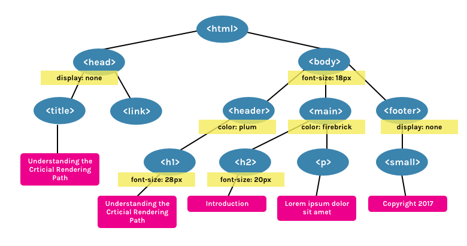

# Список тем для собеседования

## Общие вопросы по web-технологиям

### Critical Rendering Path (CRP) или Критический Путь Рендеринга (КПР)

Это шаги, выполняемые до тех пор, пока веб-страница не начнет рендериться в браузере. Для рендеринга страниц браузерам необходим сам HTML-документ, а также все критически важные ресурсы, необходимые для рендеринга этого документа.

Существует 6 этапов CRP: 1. построение DOM-дерева; 2. построение CSSOM-дерева; 3. запуск JavaScript; 4. создание Render-дерева; 5. генерация раскладки (Layout); 6. отрисовка (Paint).

Разберем каждый из них по подробнее:

1. Построение DOM-дерева

- DOM (объектная модель документа) дерево это объект, представляющий полностью разобранную HTML-страницу. Начиная с корневого элемента `<html>`, узлы создаются для каждого элемента/текста на странице. Элементы, вложенные в другие элементы, представлены в виде дочерних узлов, и каждый узел содержит полный набор атрибутов для этого элемента. Например, элемент `<a>` будет иметь атрибут href, связанный с узлом.
- 
- может быть загружен по частям\*
- Важно отметить, что для первоначального рендеринга браузер обычно не ждет:
  - Весь HTML.
  - Шрифты.
  - Изображений.
  - JavaScript, не блокирующий рендеринг, за пределами элемента `<head>` (например, элементы `<script>`, расположенные в конце **HTML**).
  - CSS, не блокирующий рендеринг, за пределами элемента `<head>` или CSS со значением media атрибута , который не применяется к текущему экрану просмотра.

2. Построение CSSOM-дерева:

- CSSOM (объектная модель CSS) — это объект, представляющий стили, связанные с DOM. Он выглядит так же как DOM, но с соответствующими стилями для каждого узла. Не имеет значения были ли стили объявлены явно или наследуются.
- 
- **CSS считается «блокирующим обработку ресурсом». Это значит, что Render-дерево (см. ниже) не может быть построено без полного первоначального разбора CSS.**
- **CSS также может являться «блокирующим скрипты», потому что JavaScript-файлы должны дождаться построения CSSOM, прежде чем начать исполняться.**
- Примечание. Хотя CSS по умолчанию блокирует рендеринг, его можно превратить в ресурс, не блокирующий рендеринг, изменив media атрибут элемента <link> , указав значение, которое не соответствует текущим условиям:
- ```html
  <link rel="stylesheet" href="..." media="print" />
  ```
- В прошлом это использовалось , чтобы позволить некритическому CSS загружаться без блокировки рендеринга.

3. Запуск JavaScript:

- JavaScript является блокирующим ресурсом для парсера (если специально не помечен как асинхронный или отложенный). Это означает, что JavaScript блокирует разбор самого HTML-документа.
- Когда парсер доходит до тега `<script>` (не важно внутренний он или внешний), он останавливается, забирает файл (если он внешний) и запускает его. Вот почему, если мы имеем JavaScript-файл, который ссылается на элементы документа, мы обязательно должны поместить его после их появления.
- JavaScript можно загружать асинхронно, указав атрибут **async**, для того, чтобы избежать блокировки парсера.

4. Создание Render-дерева:

- Render-дерево — это совокупность DOM и CSSOM. Это дерево, которое даёт представление о том, что в конечном итоге будет отображено на странице. Это означает, что оно захватывает только видимый контент и не включает, например, элементы, которые были скрыты с помощью CSS-правила display: none.
- На примерах DOM и CSSOM, представленных выше, будет построено такое Render-дерево
- 

5. Генерация раскладки (Layout) - может повторятся:

- Раскладка — это то, что определяет размер видимой области документа (viewport), которая обеспечивает контекст для стилей CSS, зависимых от него, например, проценты или единицы вьюпорта.
- Размер вьюпорта определяется метатэгом, находящемся в `<head>` документа или, если тэг не представлен, будет использовано стандартное значение вьюпорта шириною в 980 пикселей.
- Например, наиболее частым значением для этого метатэга является размер, соответствующий с шириной устройства.
- ```html
  <meta name="viewport" content="width=device-width,initial-scale=1" />
  ```
- Если пользователь посещает веб-страницу с устройства, ширина которого, например 1000 пикселей, то размеры будут опираться на это значение. Половина видимой области будет равна 500 пикселей, 10 процентов — 100 пикселей, и так далее.

6. Отрисовка (Paint) - может повторятся:

- Наконец, на шаге отрисовки, видимый контент страницы может быть преобразован в пиксели, чтобы появиться на экране.
- Время, которое займет этот этап, зависит как от величины DOM, так и от того, какие стили применяются. Некоторые стили требуют больше усилий, чтобы быть применёнными, чем другие. Например, сложное градиентное фоновое изображение потребует больше времени, чем простой сплошной цвет на фоне.

### HTML: Базовые теги, семантические теги, атрибуты, data-атрибуты, классы, **async** **defer**, accessibility
1. Базовые теги:
  - `<html>, <head>, <body>, <div>, <span>, <a>, <ul>, <li>, <p>, , <br>, <script>, <link>, <meta>, `

2. Семантические теги:
  - `<header>, <nav>, <footer>, <main>, <section>, <aside>, <article>, <time>, <details>`
  - `<article>` - независимое, автономное содержимое
  - `<time>` - дата и время
  - `<details>` - Определяет дополнительные сведения, которые пользователь может просматривать или скрывать

3. Атрибуты:
  - Атрибут: **id** - Задает уникальный идентификатор для элемента. Этот атрибут часто используется для стилизации элементов через CSS или для доступа к элементу через JavaScript.

  - Атрибут: **class** - Задает один или несколько классов для элемента, которые могут использоваться для стилизации через CSS или для манипуляций с элементами через JavaScript.

  - Атрибут: **src** - Определяет URL ресурса, который будет загружен и отображен в элементе, таком как `` для изображения или `<script>` для JavaScript файла.

  - Атрибут: **href** - Определяет URL ссылки, которая используется в элементах `<a>` для гиперссылок и `<link>` для связывания внешних ресурсов, таких как стили CSS.

  - Атрибут: **alt** - Задает альтернативный текст для изображения в элементе ``. Этот текст отображается, если изображение не может быть загружено, и помогает в доступности контента.

  - Атрибут: **title** - Определяет всплывающую подсказку для элемента. Этот текст отображается, когда пользователь наводит курсор на элемент.

  - Атрибут: **style** - Включает инлайн-стили CSS для элемента. Применяется для задания стилей непосредственно внутри HTML-тега.

  - Атрибут: **type** - Определяет тип элемента. Чаще всего используется в элементах `<input>` для задания типа вводимого значения (например, text, password, email и т.д.) и в элементах `<button>` и `<script>`.

  - Атрибут: **value** - Определяет значение элемента. Применяется в элементах `<input>`, `<button>`, `<option>` и других.

  - Атрибут: **name** - Задает имя элемента. Используется для группировки данных формы, чтобы сервер мог обработать их.

4. Data-атрибуты (data (eng) - данные)
  - **Дата-атрибут** — это пользовательский атрибут на HTML-элементе, название которого начинается с `data-`. Это встроенная возможность стандарта HTML5. В дата-атрибутах можно хранить дополнительную информацию в стандартных HTML-элементах и работать с этой информацией в JavaScript при помощи собственного API.
  - Имя может быть длинным, из нескольких слов (значения может и не быть). Слова разделяются тире:
  - ```html
    <div data-long-size-atribute="small"></div>
    ```
    или
    ```html
    <div data-long-size-atribute></div>
    ```
  - У дата-атрибутов есть свой собственный API. Читать и записывать значения дата-атрибутов элемента можно с помощью свойства dataset. С его помощью можно также и добавлять новые дата-атрибуты к элементу.
  - Можно обращаться к значениям атрибутов data-* также, как и к значениям других атрибутов: при помощи методов getAttribute и setAttribute для чтения и записи данных соответственно, также можно получать доступ через dataset.dataValue 
  - К ним можно обращаться через CSS используя [...].
  - !!!Производительность чтения дата-атрибутов по сравнению с хранением этих данных в хранилищах данных JavaScript намного хуже, использование dataset ещё медленнее, чем чтение данных с помощью getAttribute!!!
  - 

5. Классы :)
  - Универсальный атрибут тега, с помощью которого можно задать имя любому элементу на странице. Имя элемента в дальнейшем используется в качестве селектора в CSS и позволяет управлять стилями элемента. К тому же по имени класса удобно искать и манипулировать элементами на странице при помощи JavaScript.
  - У элемента может быть несколько классов
  - ```html
    <p class="text">
      Очень крутой текст про крутые классы
    </p>
    ```

6. Атрибуты **async** **defer**
  - Использование ****async**** и ****defer**** помогает улучшить производительность загрузки страницы, избегая блокировки парсинга HTML, что особенно важно для современных веб-приложений, где загрузка и выполнение скриптов могут существенно влиять на пользовательский опыт.
  - Скрипты с атрибутами **defer** загружаются и выполняются последовательно, а с **async** – асинхронно. Кроме того, **defer** всегда ждёт, пока весь HTML-документ будет готов, а **async** выполняется сразу после загрузки.
  - Как понять:
    - Обычно браузеры загружают `<script>` синхронно, во время разбора документа. Поэтому принято добавлять скрипты в конец документа, перед `</body>`, чтобы они не тормозили загрузку страницы. Но при помощи атрибутов **defer** и **async** можно явно управлять порядком загрузки и выполнения скриптов.
  - **ASYNC** (**async**)
    - Указывает браузеру по возможности загружать скрипт асинхронно.
    - Скрипт выполняется полностью асинхронно. Это означает, что файл будет выполняться без ожидания загрузки и отображения веб-страницы. При обнаружении `<script async src="...">` браузер не останавливает обработку страницы, а спокойно работает дальше. 
    - **Выполнение** - Когда скрипт будет загружен – он сразу выполнится.
    - !Первым выполнится тот скрипт, который быстрее загрузится!
  - **DEFER** (**defer**)
    - Указывает браузеру, что скрипт должен выполняться после разбора документа, но до события DOMContentLoaded.
    - **Выполнение** - после разбора документа (HTML)
    - Скрипты с атрибутом **defer** будут предотвращать запуск события DOMContentLoaded до тех пор, пока скрипт не будет загружен полностью и не завершится его инициализация.
    - Первым всегда выполнится script1.js, который подключён раньше. Даже если script2.js загрузится раньше, он будет выполнен после первого скрипта.
    - `<script src="script1.js" defer></script>`
  - Полезная информация:
    - На практике **defer** используется для скриптов, которым требуется доступ ко всему DOM-дереву или если важен их порядок выполнения. А **async** хорош для независимых скриптов, например счётчиков и рекламы, порядок выполнения которых не играет роли.
    - **Динамически вставленный `<script>` (например, вставленный при помощи `document.createElement`) по умолчанию загружается браузером асинхронно.**

  

7. Accessibility (Веб-доступность)
  - **Веб-доступность (Accessibility)** в HTML — это практика создания веб-сайтов, доступных для всех пользователей, включая людей с ограниченными возможностями. Это включает в себя адаптацию контента для людей с нарушениями зрения, слуха, двигательной активности и когнитивными нарушениями.
  - Основные аспекты веб-доступности:
    - Текстовые альтернативы (alt-тексты)
    - Навигация с помощью клавиатуры
    - Использование семантических тегов
    - Контрастность и цветовая гамма
    - Подписи и субтитры для мультимедиа
    - Формы и элементы управления

### CSS: Каскадность, приоритет селекторов, псевдоклассы, псевдоэлементы, flex, grid
1. Каскадность, приоритет селекторов
 - Один из основных принципов работы CSS, также это приоритет одних правил/стилей над другими. Когда одни стили перебивают другие. Это понятие также называется "специфичность селектора".
 - Чем выше — тем «важнее»:
    1. !important
    2. inline стили
    3. селектор id
    4. селектор class
    5. тег (div и тп)
    6. `*` (все другое)


2. Псевдоклассы
  - **Псевдоклассы** — особый вид селектора, который уточняет тип или состояние. Обычно это какой-то качественный признак: реакция на наведение курсора, порядок следования и другие.
  - `:hover, :active, :visited, :checked, :disabled, :enabled, :focus, :blur, :not, :nth-child(), :last-child, :first-child`

3. Псевдоэлементы:
  - Псевдоэлементы — это элементы, которых не существует в HTML-разметке. Они создаются и позиционируются исключительно при помощи CSS. Чаще всего используются для создания различных декоративных элементов (которые не несут содержательного смысла).
  - Также псевдоэлементы приходят на помощь, когда нужно наложить поверх картинки так называемый оверлей (перекрывающий слой). На этом польза от псевдоэлементов не заканчивается.
  - `::before, ::after, ::first-letter, ::first-line, ::placeholder`
  - content — обязательное свойство псевдоэлементов
  - ```css
    .header::before {
      content: "";
      position: absolute;
      top: 0;
      left: 0;
      width: 100%;
      height: 100%;
      background-color: rgba(0 0 0 / 0.7);
      z-index: -1;
    }
    ```

4. flex, grid
  - **Flexbox** — это модель для создания одномерных макетов (по одной оси — горизонтальной или вертикальной). Она особенно полезна для размещения элементов в строку или столбец, даже если размеры элементов неизвестны или динамически изменяются.
  - **CSS Grid** — это мощная система для создания двухмерных макетов, позволяющая располагать элементы в строки и столбцы. Grid позволяет точно управлять размещением элементов в сетке и задавать отношения между строками и столбцами.


### DOM: События DOM дерева, навигация по дереву, изменение элементов дерева
### HTTP, HTTPS, REST API
### Бандлеры, принцип работы, webpack, лоадеры, плагины
### Линтеры, принцип работы, правила

## JavaScript

- Типы данных, сравнение типов, преобразование типов
- Переменные var, let, const, всплытие переменных, TDZ
- Виды функций, сходства и отличия
- Замыкание
- Объекты и массивы. Особенности работы со ссылочными типами данных, методы массивов
- Map и Set, отличия от объектов и массивов
- Контекст this, виды привязок, call, apply, bind
- Классы
- Наследование, отличие proto и prototype
- AJAX
- Промисы
- Хранение данных в браузере
- Event Loop

## TypeScript

- Alias типы и интерфейсы
- Дженерики
- Utility Types
- Условные типы
- Перегрузка функций
- Операторы

## React

- Virtual DOM, reconcilation
- JSX|TSX
- Жизненный цикл компонента
- Функциональные, классовые компоненты
- Хуки (useState, useEffect, useMemo, useCallback, useRef, useContext знать как минимум). Сходства и отличия хуков и методов классовых компонентов
- Роутинг React

## OOP и чистота кода

- 4 принципа ООП
- Паттерны проектирования
- SOLID, DRY KISS YAGNI
