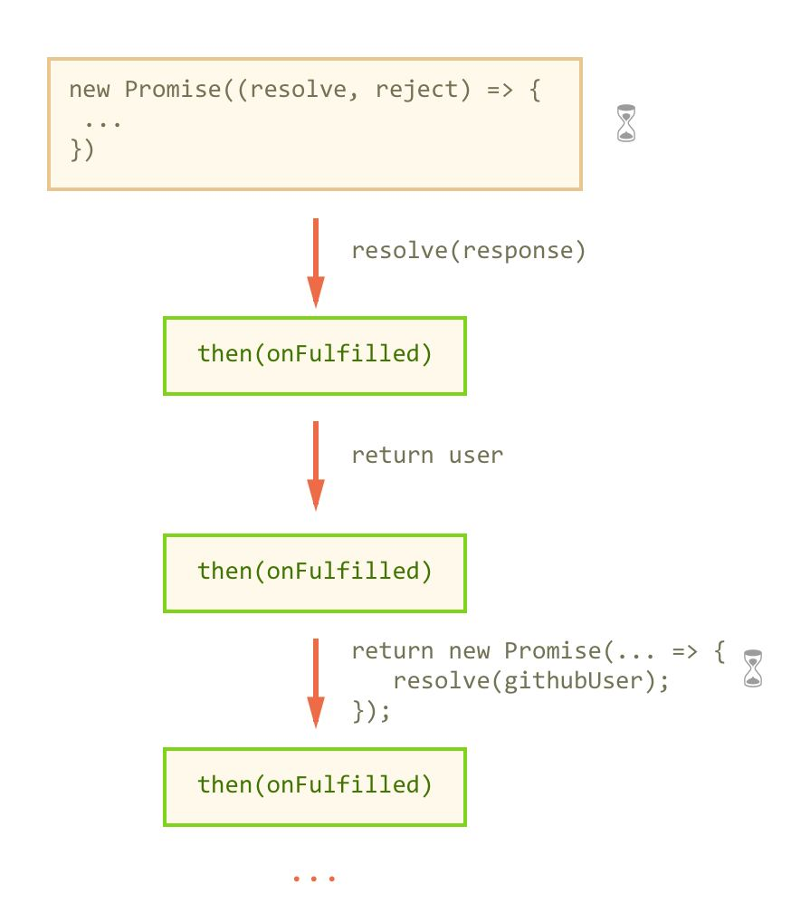

# Promise, async/await и Event Loop

## Промисы

- `Promise` представляет будущий результат операции: значение или причину ошибки.
- Состояния промисов
  - `pending` — промис ещё не выполнен и не отклонён
  - `fulfilled` — выполнено успешно
  - `rejected` — выполнено с ошибкой

```js
var promise = new Promise(function (resolve, reject) {
  // Эта функция будет вызвана автоматически
  // В ней можно делать любые асинхронные операции,
  // А когда они завершатся — нужно вызвать одно из:
  // resolve(результат) при успешном выполнении
  // reject(ошибка) при ошибке
});
```

- Функция, переданная в конструкцию new Promise, называется исполнитель (`executor`). При создании Promise она выполняется синхронно; обработчики then/catch выполняются асинхронно.
- Executor может запустить асинхронную операцию. По её завершении вызывают `resolve` или `reject`, чтобы определить результат промиса.
  - `resolve(value)` разрешает промис значением или принимает итоговое состояние thenable; это не всегда немедленный переход в fulfilled.
  - `reject(reason)` отклоняет промис с любым значением; обычно передают объект Error.
- Промис не может передумать, например, вызвать reject ПОСЛЕ вызова resolve
- Цепочки промисов:
  - Каждый `then()` возвращает новый промис, поэтому вызовы можно объединять в цепочку. Несколько вызовов `then()` на одном промисе создают независимые ветки.

```js
fetch("/api/user")
  .then((response) => {
    if (!response.ok) throw new Error(`HTTP ${response.status}`);
    return response.json();
  })
  .then((user) => console.log(user))
  .catch((error) => console.error(error));
```

- В каждом then мы получаем текущий результат работы.
  Можно его обработать синхронно и вернуть результат (например, применить JSON.parse). Или же, если нужна асинхронная обработка – инициировать её и вернуть промис.
- 
- Схема показывает успешную цепочку: каждый `then()` возвращает новый промис. Возвращённый обработчиком промис передаёт своё итоговое состояние следующему звену. Песочные часы обозначают возможное ожидание операции, а не отложенный запуск executor: он вызывается синхронно.

- Методы промисов:
  - `then()`
    - также перехватывает ошибки, если задан второй аргумент (который является обработчиком ошибок).
  - `catch()`
    - выполняется при ошибке
    - можно пробросить ошибку дальше
  - `finally()` выполняется при завершении конкретного промиса независимо от успеха; возврат обычного значения не заменяет результат, а throw или отклонённый промис меняет его на отклонение
- При возникновении ошибки – она отправляется в ближайший обработчик onRejected.
  - если ошибка не критическая можно перейти в ближайший (следующий) .then вернув значение при помощи return
  - Необработанное отклонение вызывает `unhandledrejection` в браузере и обычно сообщение в консоли; реакция среды может отличаться. Обычный синхронный try/catch не ловит позднее отклонение без await.
- У объекта `promise`, возвращаемого конструктором new Promise, есть внутренние свойства:
  - `[[PromiseState]]` (внутреннее состояние, не публичное свойство state) — вначале "`pending`" («ожидание»), потом меняется на "`fulfilled`" («выполнено успешно») после разрешения обычным значением (при resolve с thenable ожидается его результат) или на "`rejected`" («выполнено с ошибкой») при вызове `reject`.
  - `[[PromiseResult]]` хранит итоговое значение или причину отклонения после завершения промиса; при resolve с thenable принимается его итоговый результат. Публичного свойства result нет.

- Статические методы промисов
  - `Promise.all(iterable)` - ожидает выполнения всех промисов и возвращает массив с результатами. Если хотя бы один промис из переданного массива завершится с ошибкой, то `Promise.all()` тоже завершится с этой ошибкой.
  - `Promise.race(iterable)` принимает состояние первого завершившегося промиса (успех или ошибка); остальные операции не отменяются.
  - `Promise.any(iterable)` ждёт первый успех; если все отклонены (или iterable пуст), отклоняется с AggregateError.
  - `Promise.resolve(value)` разрешает value: обычное значение даёт fulfilled-промис, thenable принимается с его итоговым состоянием; подходящий Promise возвращается без создания нового
  - `Promise.reject(reason)` создаёт отклонённый промис с причиной reason.

- **ASYNC / AWAIT**
  - У слова `async` один простой смысл: эта функция всегда возвращает промис. Значения других типов оборачиваются в завершившийся успешно промис автоматически
  - `await` приостанавливает текущую async-функцию (или модуль), а не поток JavaScript. Продолжение выполняется асинхронно: возвращает значение fulfilled-промиса или бросает причину rejected-промиса.
    - Пока промис не выполнится, JS-движок может заниматься другими задачами: выполнять прочие скрипты, обрабатывать события и т. п.
    - В обычной функции await требует async; также разрешён на верхнем уровне модуля
  - ошибки можно ловить, используя `try..catch`

Документация: [MDN — Promise](https://developer.mozilla.org/ru/docs/Web/JavaScript/Reference/Global_Objects/Promise).

Пример:

```javascript
const pending = new Promise(() => {}); // pending
const success = Promise.resolve(2); // fulfilled
const failure = Promise.reject(new Error("Сбой")); // rejected
failure.catch((error) => console.log(error.message)); // "Сбой"
success.then((value) => value * 3).then(console.log); // 6: Promise chaining
Promise.resolve(1)
  .then(() => {
    throw new Error("Ошибка шага");
  })
  .catch((error) => {
    console.log(error.message);
    return 0;
  })
  .finally(() => console.log("Очистка"))
  .then(console.log); // 0: catch восстановил цепочку
Promise.resolve()
  .then(
    () => {
      throw new Error("Сбой");
    },
    () => console.log("Не вызовется"),
  )
  .catch((error) => console.log(error.message)); // "Сбой": второй аргумент then не ловит ошибку своего onFulfilled
Promise.all([Promise.resolve(1), Promise.resolve(2)]).then(console.log); // [1, 2]
Promise.race([Promise.resolve("первый"), Promise.resolve("второй")]).then(
  console.log,
); // "первый"
Promise.any([Promise.reject("сбой"), Promise.resolve(2)]).then(console.log); // 2
async function read() {
  try {
    return await Promise.resolve(42);
  } catch (error) {
    console.error(error);
    return 0;
  }
}
read().then(console.log); // 42
// Внутренние [[PromiseState]] и [[PromiseResult]] не доступны как свойства:
console.log(success.state, success.result); // undefined, undefined
```

## Event Loop

- В браузере после выполнения задачи и освобождения стека выполняется контрольная точка микрозадач (Promise.then, queueMicrotask); очередь микрозадач опустошается, включая добавленные ими микрозадачи. Затем браузер может обновить отображение и перейти к следующей задаче. setTimeout задаёт минимальную задержку, а не точное время выполнения.

Источник: [MDN — цикл событий](https://developer.mozilla.org/en-US/docs/Web/JavaScript/Reference/Execution_model).

Пример:

```javascript
console.log("начало");
setTimeout(() => console.log("таймер"), 0);
Promise.resolve().then(() => console.log("промис"));
queueMicrotask(() => console.log("микрозадача"));
console.log("конец");
// начало → конец → промис → микрозадача → таймер
```

## Асинхронный JavaScript

Документация: [Promise](https://developer.mozilla.org/en-US/docs/Web/JavaScript/Reference/Global_Objects/Promise).

### Promise

- **Описание:** Promise — объект для написания и обработки асинхронного кода.
  ```javascript
  let promise = new Promise(function (resolve, reject) {
    // executor вызывается синхронно; resolve/reject определяют результат; resolve с thenable ждёт его исхода
    resolve(42);
  });
  ```

### Promise states

- **Состояния Promise:**

Пример:

```javascript
const pending = new Promise(() => {}); // pending: не завершён
const fulfilled = Promise.resolve(42); // fulfilled
const rejected = Promise.reject(new Error("Сбой")); // rejected

fulfilled.then((value) => console.log(value)); // 42
rejected.catch((error) => console.log(error.message)); // "Сбой"
// Публичного свойства state нет; состояние видно в инструментах разработчика.
```

- `pending` — начальное состояние: промис ещё не fulfilled и не rejected

- `fulfilled` — операция завершилась успешно

- `rejected` — произошла ошибка

### Promise chaining

- **Цепочки промисов:**
  ```javascript
  Promise.resolve(2)
    .then((value) => value * 3)
    .then((value) => Promise.resolve(value + 1))
    .then((value) => console.log(value)) // 7
    .catch((error) => console.error(error));
  ```

### Promise static methods

- **Статические методы:** Promise.resolve(), Promise.reject(), Promise.all(), Promise.allSettled(), Promise.race(), Promise.any(), Promise.withResolvers().
- then(), catch() и finally() — методы экземпляра промиса, а не статические.

Пример:

```javascript
const a = Promise.resolve(1);
const b = Promise.resolve(2);

Promise.resolve(42).then(console.log); // 42
Promise.reject(new Error("Сбой")).catch((error) => console.log(error.message)); // "Сбой"

Promise.all([a, b]).then(console.log); // [1, 2]
Promise.allSettled([a, Promise.reject("сбой")]).then(console.log);
// [{ status: "fulfilled", value: 1 }, { status: "rejected", reason: "сбой" }]
Promise.race([a, b]).then(console.log); // 1: первый завершившийся
Promise.any([Promise.reject("сбой"), b]).then(console.log); // 2: первый успешный

const { promise, resolve } = Promise.withResolvers();
promise.then(console.log); // "Готово"
resolve("Готово");
```

### Обработка ошибок в Promise

- **Обработка ошибок в промисах:**
  ```javascript
  Promise.resolve(2)
    .then(() => {
      throw new Error("Сбой");
    })
    .catch((error) => {
      console.log(error.message); // "Сбой"
      return 0; // восстановление после ошибки
    })
    .then((value) => console.log(value)); // 0
  ```

### async/await

- **Описание:** `async` и `await` используются для работы с промисами в синхронном стиле.
  ```javascript
  async function example() {
    const result = await Promise.resolve(42);
    console.log(result); // 42
  }
  example();
  ```

### Event loop

- **Описание:** Event Loop — механизм, который позволяет JavaScript выполнять асинхронный код. Ниже будет приведен более подробный разбор:

1. **Стек вызовов** хранит активные вызовы. Последний вызов завершается первым (LIFO); текущая задача выполняется до завершения.
2. **Web APIs** выполняют операции платформы, например таймеры и сеть. Обычный вызов async-функции начинается синхронно и приостанавливается на await; функция не «передаётся в Web API» целиком.
3. **Задачи (tasks, часто «макрозадачи»)** включают колбэки таймеров и асинхронную обработку событий. У браузера может быть несколько очередей задач. fetch запускает сетевую операцию, но его then/catch — микрозадачи.
4. **Микрозадачи** — реакции промисов then/catch/finally, колбэки MutationObserver и queueMicrotask. Executor new Promise выполняется синхронно. На контрольной точке очередь микрозадач опустошается, включая добавленные при её обработке микрозадачи.
5. **Event loop** выбирает готовую задачу, после её выполнения обрабатывает микрозадачи, а при возможности обновляет отображение. Перерисовка не гарантирована после каждой задачи. Таймер задаёт минимальную задержку, а не точное время вызова.

Источник: [MDN: микрозадачи](https://developer.mozilla.org/en-US/docs/Web/API/HTML_DOM_API/Microtask_guide).

Пример:

```javascript
console.log("начало");

setTimeout(() => console.log("таймер"), 0);

Promise.resolve().then(() => console.log("промис"));

queueMicrotask(() => console.log("микрозадача"));

console.log("конец");
// начало → конец → промис → микрозадача → таймер
```
